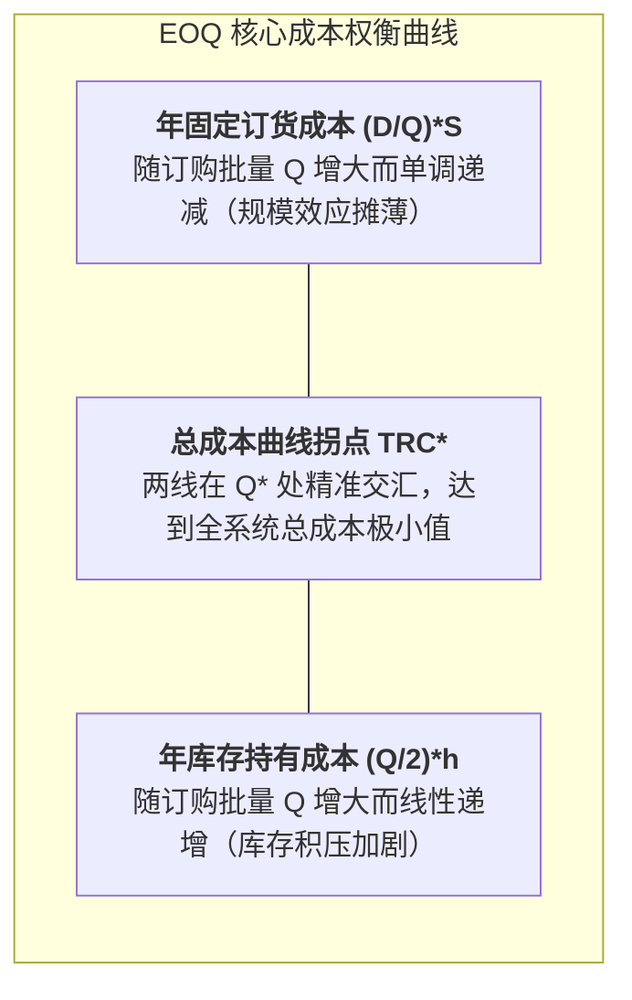

# Lec 7 库存管理 I：稳定需求与经济订货批量 EOQ（Inventory Management I: Level Demand, EOQ, Sensitivity）

## TL;DR

- 库存持有的根本权衡：订货固定交易成本与资本占用持有成本的数学对立。
- 经典经济订货批量（EOQ）公式推导、总成本凹凸性与敏感度弹性分析。
- 在非平稳环境下的鲁棒性特征：为什么 EOQ 在参数轻度偏离时仍保持极佳成本稳健度。

## 一、经典 EOQ 模型的基本假定与成本结构

经济订货批量（Economic Order Quantity, EOQ）由福特·哈里斯（Ford W. Harris）于 1913 年提出，是整个现代库存理论的奠基石。尽管其提出已逾百年，但其揭示的核心权衡至今依然统治着工厂与仓储运作。

经典 EOQ 模型立足于以下严格假定：
1. 年总需求率 $D$ 是恒定且已知均匀发生的；
2. 订货提前期 $L$ 为确定的常数；
3. 补充批量的入库是瞬间一次性完成的；
4. 不允许缺货，全时期满足订单；
5. 物料单价 $c$ 恒定，不存在数量折扣。

全系统的年度总相关成本（Total Relevant Cost, TRC）仅由两项相互冲突的费用构成：
- **年订货固定成本（Annual Ordering Cost）**：每次下达采购订单产生的行政、通信、审单与进厂质检固定费用 $S$（与订购数量多少无关）。年订货频次为 $D / Q$，故年总订货成本为：
  $$C_{order} = \frac{D}{Q} \cdot S$$
- **年库存持有成本（Annual Holding Cost）**：包括资金占用利息成本、仓储租金、保险、折旧与货损报废费用。设单位产品年持有成本为 $h = c \cdot i$（$i$ 为年资本持有成本率，通常在 15% - 30% 之间）。由于需求均匀，平均库存水平恰好为 $Q / 2$，故年总持有成本为：
  $$C_{hold} = \frac{Q}{2} \cdot h$$

## 二、EOQ 公式推导与极值条件

年度总相关成本函数为：
$$TRC(Q) = \frac{D}{Q} S + \frac{Q}{2} h$$

对订购批量 $Q$ 求一阶导数并令其为 0：
$$\frac{d \, TRC}{dQ} = -\frac{D S}{Q^2} + \frac{h}{2} = 0 \implies \frac{D S}{Q^2} = \frac{h}{2}$$

::: theorem [最佳经济订货批量公式]
$$Q^* = \sqrt{\frac{2 D S}{h}}$$
在最优订货点 $Q^*$ 处，**年固定订货成本恰好严格等于年库存持有成本**：
$$\frac{D}{Q^*} S = \frac{Q^*}{2} h = \sqrt{\frac{D S h}{2}}$$
对应的最低年度总相关成本为：
$$TRC^* = TRC(Q^*) = \sqrt{2 D S h}$$
最优订货周期（Order Interval）与年最优订货次数分别为：
$$T^* = \frac{Q^*}{D} = \sqrt{\frac{2 S}{D h}}, \quad N^* = \frac{D}{Q^*} = \sqrt{\frac{D h}{2 S}}$$
:::

## 三、EOQ 敏感度与参数鲁棒性分析

在实际工业应用中，管理者经常担忧：“如果我们无法精确估算订货手续费 $S$ 或资金成本率 $h$，用算出的所谓最优值 $Q$ 会不会造成成本剧增？”

敏感度分析给出了极为振奋人心的数学证明：**EOQ 具有极其优异的鲁棒平坦性（Robustness）**！

::: definition [EOQ 成本比率公式]
设实际采用的订货批量为 $Q$，而理论最优批量为 $Q^*$，则实际总成本与最优总成本的比值为：
$$\frac{TRC(Q)}{TRC(Q^*)} = \frac{1}{2} \left( \frac{Q}{Q^*} + \frac{Q^*}{Q} \right)$$
:::

::: example [参数严重偏差下的成本容错]
假设企业由于参数估计失误，订购批量 $Q$ 达到理论最优值 $Q^*$ 的 **2 倍**（即过量采购 100%），我们来计算总成本增加幅度：
$$\frac{TRC(2 Q^*)}{TRC(Q^*)} = \frac{1}{2} \left( 2 + \frac{1}{2} \right) = \frac{2.5}{2} = 1.25$$
总成本仅增加了 **25%**！
类似地，即使 $Q$ 只有 $Q^*$ 的 **50%**，总成本同样也仅仅只增加 25%。这意味着在 $Q^*$ 附近，总成本曲线底部非常宽阔平坦。
:::

## 我的理解

EOQ 最震撼人心的哲学在于其精妙的“开方根法则（Square Root Law）”。它深刻揭示了规模经济的非线性本质：当企业业务规模 $D$ 增长 4 倍时，最经济的库存订货批量 $Q^*$ 和总库存成本 $TRC^*$ 仅需要增长 2 倍，而不是愚蠢地同步膨胀 4 倍！更重要的是它的成本敏感度容错曲线，它告诉实战中的运营管理者：不要因为参数无法测到小数点后两位而陷入决策瘫痪，大胆应用 EOQ 确定数量级，系统本身就会为你提供强大的数学容错护盾。
