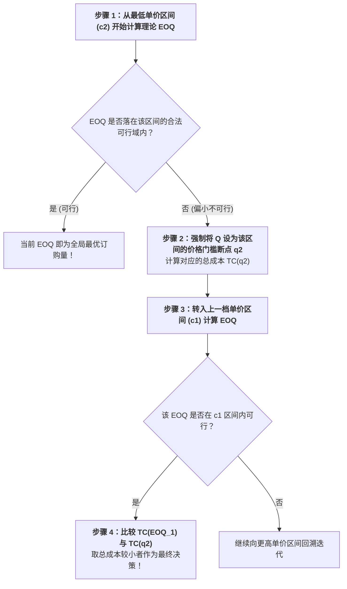

# Lec 8 库存管理 II：EOQ 扩展、数量折扣与权衡曲线（Inventory Management II: EOQ Extensions, Discounts, Exchange Curves）

## TL;DR

- 从瞬时到渐进：经济生产批量（EPQ / POQ）有限生产率补偿模型推导。
- 阶梯式与全额数量折扣（Quantity Discounts）下的最优断点决策求解算法。
- 企业级多产品库存交换曲线（Exchange Curves）在全局资金预算与订单频次约束下的平衡。

## 一、经济生产批量模型（Economic Production Quantity, EPQ）

在自制生产场景中，产品并非瞬间一次性全部入库，而是以恒定日生产速率 $p$ 边生产、边被下游以日需求速率 $d$ 消耗（必然满足 $p > d$）。

在此期间，最大库存水平并不能达到批次总量 $Q$，而是在生产阶段结束瞬间达到峰值：
$$I_{max} = Q \left( 1 - \frac{d}{p} \right)$$
平均持有库存为：
$$\bar{I} = \frac{Q}{2} \left( 1 - \frac{d}{p} \right)$$
包含生产换模调整成本 $S$ 的年度总相关成本函数为：
$$TRC(Q) = \frac{D}{Q} S + \frac{Q}{2} h \left( 1 - \frac{d}{p} \right)$$

::: theorem [最佳经济生产批量 EPQ 公式]
求导极值可得：
$$Q_{EPQ}^* = \sqrt{\frac{2 D S}{h \left( 1 - \frac{d}{p} \right)}}$$
由于 $\left( 1 - \frac{d}{p} \right) < 1$，故 $Q_{EPQ}^* > Q_{EOQ}^*$。因为边产边销缓解了库存堆积压力，使得企业能够经济地扩大单次连续生产的批量。
:::

## 二、数量折扣（Quantity Discounts）决策算法

现实中供应商为了鼓励客户大批量下达订单，往往提供阶梯价格：
$$c = \begin{cases} c_0, & 0 \le Q < q_1 \\ c_1, & q_1 \le Q < q_2 \\ c_2, & Q \ge q_2 \end{cases} \quad (\text{其中 } c_0 > c_1 > c_2)$$

此时，产品采购成本 $D \cdot c$ 不再是常数，必须纳入总成本一并权衡：
$$TC(Q) = D \cdot c + \frac{D}{Q} S + \frac{Q}{2} (i \cdot c)$$

::: pitfall [贪心折扣陷阱]
采购人员最容易被“每件便宜 5 块钱”的巨大诱惑冲昏头脑，为了拿到最低档折扣贸然订购了可供使用两年的巨额货物。这往往导致资金链断裂，且后期的仓库租金、货损霉变和资金利息支出远远超过了账面省下的那点采购差价。
:::

## 三、多品类库存交换曲线（Exchange Curves）

当企业管理数千种 SKU 时，单独对每个产品算 EOQ 往往会与企业全局宏观限制发生冲突：
1. **全厂年度总订单审批处理次数上限**（如采购部人力有限，一年最多处理 2000 次下单）；
2. **总库存投资占用资金上限**（如财务总监规定仓库货值不能超过 1000 万元）。

此时，可以通过拉格朗日乘子法构建**全厂库存交换曲线（Exchange Curve）**：

::: definition [交换曲线方程]
设第 $j$ 个产品的年需求为 $D_j$，订购量为 $Q_j$，单价为 $c_j$。全网年总订单次数 $N = \sum \frac{D_j}{Q_j}$，平均全网库存资金占用 $W = \sum \frac{Q_j c_j}{2}$。
在不同政策偏向下的 Pareto 权衡前沿满足：
$$N \cdot W = \frac{1}{2} \left( \sum_{j} \sqrt{D_j c_j} \right)^2 = \text{常数 } K$$
:::

该双曲线关系表明：在不改变底层作业流程（如未压缩单次换模准备时间或未实现自动化报关）的前提下，**若想降低全厂库存资金占用 $W$，就必须以成倍增加年订单处理频次 $N$ 为代价**。管理者可以沿着这条光滑曲线自由选择最契合当前企业财务状态的运行平衡点。

## 我的理解

从经典 EOQ 到多品类交换曲线，运筹学完成了从“单点微观优化”向“企业级宏观系统平衡”的宏伟升华。数量折扣算法教会我们在商战谈判中保持清醒的理性，不被供应商的花哨折扣所绑架；而交换曲线则是一张无情的经济学镜子，它告诉高管团队：如果底层的物流换模与订单录入效率没有得到技术改造（降低 $S$），单纯靠行政命令拍桌子要求“既要压降一半库存，又要减少下单频次”，在数学上是根本不可能实现的痴人说梦。
