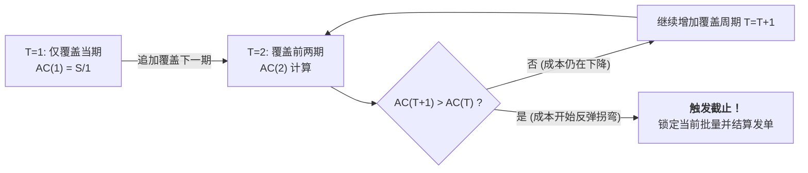

# Lec 9 库存管理 III：时变需求与动态批量法（Inventory Management III: Time-Varying Demand (Fixed Horizon)）

## TL;DR

- 经典平稳假定的破灭：有限离散规划期内剧烈时变需求对库存批量的挑战。
- Wagner-Whitin 动态规划算法推导：零库存触发点（ZIO）定理与反向追溯最优解。
- 工业界高效启发式算法：银-米尔（Silver-Meal）与最小单位成本法（LUC）实战比较。

## 一、时变确定性需求与批次规划（Lot Sizing）

在 MRP（物料需求计划）推演中，上层主生产计划（MPS）分解到零部件时，往往呈现出高度非平稳的离散时间序列需求：
第 1 周需求 20 个，第 2 周 0 个，第 3 周 150 个，第 4 周 10 个……

如果仍然盲目使用静态 EOQ 公式：
- 算出的批量可能会在某些周导致大量非必要的库存闲置跨周堆积，徒增持有成本；
- 或者产生荒谬的细碎订单残差。

面对有限规划期（如未来 12 周）内的离散需求 $D_1, D_2, \dots, D_T$，企业需要确定在哪些周期下达生产/采购订单，以及每次订单覆盖未来多少周的需求，从而使全期**固定订货费 + 累计跨周持有费**达到数学绝对最小值。

## 二、Wagner-Whitin 动态规划精确算法

哈维·瓦格纳（Harvey Wagner）与汤姆森·怀廷（Thomson Whitin）于 1958 年提出了求解该问题的动态规划算法。

::: theorem [零库存订货定理（Zero-Inventory Ordering, ZIO Property）]
在凹成本结构下，任何时期的最优补货数量要么为 0，要么恰好等于未来连续若干个离散周期的需求总和：
$$Q_t \in \left\{ 0, \sum_{k=t}^{t+m} D_k \right\}$$
即：**只有当期初可用库存恰好严格消耗降至 0 时，才应当启动新一轮订货补货！**
:::

### 动态规划状态转移方程
设 $f(t)$ 为满足前 $t$ 个周期需求所需的最低累积总成本（定义 $f(0) = 0$）：
$$f(t) = \min_{1 \le j \le t} \left\{ f(j-1) + S + \sum_{k=j}^t (k - j) h D_k \right\}$$
其中 $j$ 代表覆盖第 $t$ 期需求的这批货是在第 $j$ 期统一订购的，从第 $j$ 期持有到第 $k$ 期的单位持有成本累计为 $(k - j) h$。

通过从 $t=1$ 到 $T$ 的正向表格推进递推，记录每个时期的最优前驱节点 $j^*(t)$，最后从第 $T$ 期反向追溯回溯，即可求得严格全局数学最优的离散订货排程。

## 三、工业界轻量级启发式算法（Silver-Meal & LUC）

尽管 Wagner-Whitin 算法保证全局最优，但在几万个 SKU 的实时 ERP 系统中运算开销较大，且对未来长周期的需求预测变动过于敏感。工业界广泛应用两类出色的启发式算法：

### 1. 银-米尔算法（Silver-Meal Heuristic）
Silver-Meal 的核心逻辑是寻找**每周期平均总相关成本（Average Cost per Period）的局部极小值点**：
假设当前订单覆盖从第 $t$ 期到第 $t+T-1$ 期共 $T$ 个周期的需求，该期间的平均每期成本为：
$$AC(T) = \frac{S + h \sum_{k=1}^T (k-1) D_{t+k-1}}{T}$$
- 当 $T=1$ 时，$AC(1) = S$；
- 随着 $T$ 增加，由于分母增大，$AC(T)$ 通常会先下降；
- 一旦某一步发现 $AC(T+1) > AC(T)$，**立即停止扩大批量**，确定当前订单批量为 $\sum_{k=1}^T D_{t+k-1}$，并从第 $t+T$ 期开启下一轮循环。

### 2. 最小单位成本法（Least Unit Cost, LUC）
与 Silver-Meal 按“周”均摊不同，LUC 是按“件数”均摊，即最小化平均单件相关成本：
$$UC(T) = \frac{S + h \sum_{k=1}^T (k-1) D_{t+k-1}}{\sum_{k=1}^T D_{t+k-1}}$$
当追加一个周期的需求导致单件综合成本反弹时，立即终止并下单。

## 我的理解

时变需求批量法是连接高级供应链理论与车间现场生产调度之间的桥梁。它彻底打破了“平均值幻觉”——在真实工厂里，从来没有均匀平滑的每一天。Wagner-Whitin 算法用优雅的 ZIO 原理砍掉了浩瀚的排列组合搜索空间，而 Silver-Meal 则以精湛的边际思维，向我们展示了启发式算法如何用极小的计算代价换取无限逼近最优解的商业奇迹。
