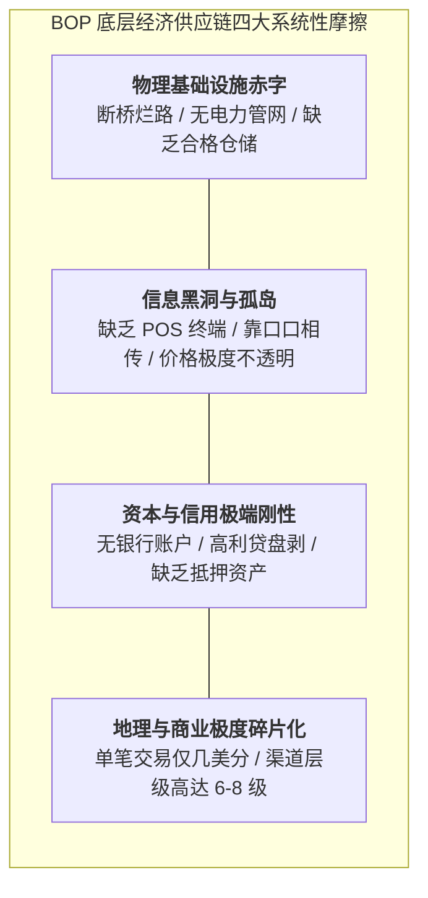

# Lec 1 新兴市场与底层经济供应链导论（Introduction to Emerging Market Supply Chains）

## TL;DR

- 全球金字塔底层（BOP）40 亿人口面临的严峻现实：基础设施严重匮乏与极度碎片化流通。
- 主流发达国家供应链理论在资源极度受限（Resource-Constrained）环境下的水土不服。
- MIT D-Lab 实用主义设计哲学：低成本、本地可用材料与社会影响力商业闭环。

## 一、发展中国家供应链的极端现实摩擦

在麻省理工学院斯隆管理学院与 D-Lab（Development Lab）联合开设的 15.772J 课堂上，教授首先颠覆了学生对“供应链”的常规认知。
在欧美发达经济体中，我们理所当然地假定：
- 拥有四通八达的八车道高速公路与标准化集装箱多式联运网络；
- 拥有全天候不间断供电的冷链温控立体仓库；
- 拥有高度普及的移动互联网、条形码扫码枪和成熟的商业信用体系。

然而，在全球南方（Global South）广阔的撒哈拉以南非洲、南亚次大陆及拉美内陆农村，40 亿生活在“金字塔底层（Base of the Pyramid, BOP）”的民众所面对的真实世界截然相反：
- **道路基础设施瘫痪**：雨季来临时，未经硬化的泥土公路被暴雨冲垮，整个村庄沦为交通孤岛达数月之久；
- **冷链断裂与电力极度匮乏**：乡村电网每天停电 12 小时以上，导致牛奶、疫苗和新鲜蔬菜在运输途中大面积变质腐烂；
- **极端脆弱的流动资金**：小农户与街头杂货铺摊主（Mom-and-pop shops）手头现金流仅够支撑一两天的周转，根本无力垫付任何批量进货款。

## 二、传统运筹模型为何在资源受限环境中失灵？

当我们将西方经典的商学院运筹公式直接搬到发展中国家农村时，往往会遭遇惨烈的水土不服：

1. **经典 EOQ 经济订货批量失灵**：
   - EOQ 公式假定可以按固定的订货手续费 $S$ 随时向批发商订货；但在非洲乡村，采购员往往需要亲自乘坐颠簸的摩的或长途小巴去几十公里外的县城集市背货，交通成本和时间机会成本完全是非线性的；
2. **正态分布安全库存假定破灭**：
   - 农村需求并非平滑随机分布，而是受到极其剧烈的农业收割周期、雨季旱季交替以及突发部落冲突的脉冲式冲击，呈现出强烈的“肥尾”与断续特征；
3. **“高科技数字化”的成本陷阱**：
   - 强行推行需要昂贵手持终端（PDA）和高速 4G 网络的复杂 WMS 仓储软件，往往因当地工人文化程度低、设备缺乏零配件维修、甚至暴风雨打坏信号塔而迅速沦为废铁。

## 三、MIT D-Lab 的核心设计哲学：逆向创新与共创

面对上述绝境，MIT D-Lab 提出了独树一帜的**逆向创新（Reverse Innovation）与参与式共创（Co-Design）**原则：

::: definition [D-Lab 发展中供应链三大核心信条]
1. **就地取材与本地制造（Local Sourcing & Fabrication）**：
   绝不从波士顿空运精密复杂的昂贵设备去“施舍救济”；必须使用当地废弃油桶、自行车轮毂、竹子或粘土等随处可见的廉价材料，让当地铁匠和木匠也能自主维修仿制；
2. **微型化与可分割包装（Sachet Economy）**：
   深刻尊重穷人“日结日清”的微薄现金流，将大包装工业品拆解为单次使用的一美分极小袋装（如微量洗发水、净水药片），降低初次尝试的门槛；
3. **社会资本网络变现（Leveraging Social Capital）**：
   利用乡村熟人社会中根深蒂固的宗族、妇女互助会（Self-Help Groups）与宗教社区信任纽带，代替冰冷的法律合同与征信系统，实现低成本的履约监督。
:::

## 我的理解

15.772J 课程是一堂洗涤灵魂的商业社会责任课。它提醒我们：运筹学最崇高的使命，不是帮助华尔街的跨国巨头把利润率从 25% 抠到 26%，而是帮助那 40 亿生活在贫困线边缘的人类同胞，用最低廉的成本喝上一口干净的饮用水、吃上一剂救命的抗疟疾药。在资源极度匮乏的泥泞土地上，任何浮夸的算法都会被现实无情击碎。真正的顶级工程师，懂得蹲下身来聆听大地的苦难，用最质朴的智慧创造出真正改变命运的生命通道。
