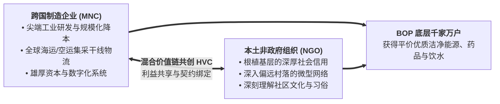

# Lec 10 NGO 与跨国企业公私协同：混合价值链与微型特许经营（NGO-Corporate Partnerships and Hybrid Value Chains）

## TL;DR

- 突破零和对立：非政府组织（NGO）与跨国企业（MNC）优势互补的混合价值链（HVC）。
- 微型特许经营（Micro-Franchising）模式在乡村末端分销体系中的商业复制机制。
- 双重底线治理：平衡社会影响力考核（Social Impact）与企业商业财务可持续性。

## 一、跨国企业与 NGO 的互补性痛点

长期以来，跨国企业（Multinational Corporations, MNCs）与非政府组织（NGOs）在发展中国家往往处于互相猜忌甚至敌对的状态：
- MNC 认为 NGO 效率低下、思想僵化、完全不懂商业财务造血逻辑；
- NGO 斥责 MNC 唯利是图、掠夺第三世界廉价资源、剥削弱势劳工。

然而，当双方试图在金字塔底层（BOP）建立可持续供应链时，很快遭遇了各自无法独自逾越的绝壁：
- **跨国企业的痛点**：缺乏基层信任与渠道触达。作为“外来殖民者”形象的跨国公司，走入非洲或南亚乡村时寸步难行，既不懂复杂的宗族方言，也无法建立低成本监督体系；
- **NGO 的痛点**：缺乏工程研发、全球供应链规模与商业造血能力。纯靠欧美基金会善款施舍的项目，一旦捐赠资金中断，建立的诊所和水井在半年内迅速荒废。

阿育王（Ashoka）全球社会企业家网络创始人比尔·德雷顿（Bill Drayton）提出了划时代的**混合价值链（Hybrid Value Chains, HVC）**概念：促成两者走向深度战略联姻！

## 二、微型特许经营（Micro-Franchising）分销网络

将西方成熟的麦当劳、7-Eleven 特许经营模式进行本土化极简化改良，形成**微型特许经营（Micro-Franchising）**：

::: definition [微型特许经营标准运作模型]
1. **标准化极简商业包（Business-in-a-Box）**：
   母体社会企业向乡村青年或妇女提供一整套标准启动包：一辆改装货运自行车、统一制服、一套产品展示箱、简易记账手册以及首批铺货商品；
2. **小额信贷垫资（Micro-Loan Financing）**：
   创业者无需一次性掏出本金，通过微型信贷机构按周分期偿还工具包费用；
3. **品牌背书与质量担保**：
   挂靠在知名国际或本土品牌旗下，为劣质假冒伪劣泛滥的农村集市注入珍贵的品质公信力；
4. **包容性利润分成**：
   每一笔销售提成直接归微型创业者所有，极大激发一线销售代表的内生奋斗动力。
:::

::: example [Living Goods 在乌干达与肯尼亚的卓越实践]
社会企业 Living Goods 联合当地健康 NGO，招募并培训了数千名乡村全职妈妈担任“社区健康促进员（Community Health Promoters, CHPs）”：
- 每位 CHP 妈妈背着装满经 WHO 认证的平价抗疟疾药、净水消毒片、儿童营养补充剂和太阳能灯的背包，走家串户为邻里提供基础健康咨询与配送；
- 她们使用极简智能手机 App 记录村民健康档案并自动补货；
- **惊人成效**：该模式不仅让数千名底层妇女实现了经济独立自尊，更在当地独立随机对照实验（RCT）中被证实：**使覆盖社区的 5 岁以下儿童死亡率显著暴降 27% 以上**！
:::

## 三、双重底线（Double Bottom Line）平衡治理

在混合价值链的日常运营中，最大挑战在于**社会公益使命（Social Mission）与商业财务自负盈亏（Financial Sustainability）之间的张力平衡**：
- 如果过度倒向商业利润，微型特许经营者会倾向于只将高毛利的可乐、零食卖给富裕村落，彻底放弃贫困偏远山村，背离初心；
- 如果过度倒向纯慈善，长期亏损将导致供应链体系在投资人撤资后瞬间崩塌。

先进的社会企业通过引入**社会影响力加权 KPI（Impact-Weighted Accounting）**，在契约中将高管与一线人员的奖金池同时与“财务净现金流”以及“挽救生命的伤残调整寿命年（DALYs Averted）”双向挂钩，确保企业在健康的商业轨道上持续践行社会正义。

## 我的理解

混合价值链是现代商业文明向善进化的最美见证。它向我们证明：商业的力量从来不是掠夺与冷血的代名词，当它与崇高的社会理想相结合时，能爆发出任何纯施舍慈善都无法企及的磅礴伟力。跨国企业的规模工程与 NGO 的基层信任深度咬合，让商业逻辑成为穿透贫困坚冰的最硬钻头。这种公私协同的范式，为人类解决全球性发展难题照亮了一条充满希望的可行坦途。
