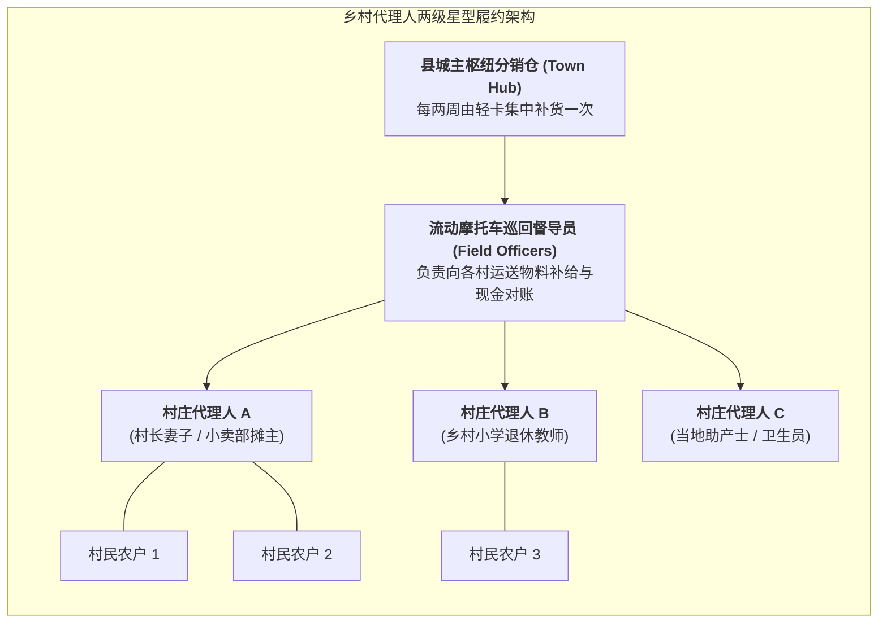
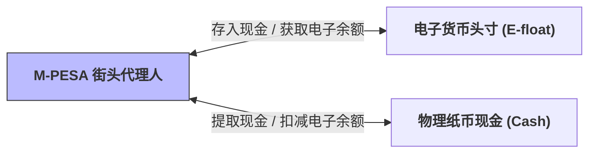

# Lec 11 最后一公里微型零售网络与乡村代理人分销机制（Micro-Retail & Village Agent Distribution Networks）

## TL;DR

- 突破物理与信任双重荒原：乡村代理人（Village Agents）网络的组织动力学。
- 代理人激励兼容设计：小额提成佣金、社交地位声望与违约惩罚的博弈平衡。
- 肯尼亚 M-PESA 移动代理人网络（Agent Banking）的现金流动性重平衡算法。

## 一、最后一公里（Last Mile）的物理与信用双重绝境

在发展中国家的农业腹地与偏远群岛，通往最终消费者的最后 5 到 10 公里被称为**“物流死亡地带”**。跨国企业即便拥有最顶尖的集装箱干线货轮与现代化中央立体仓储，一旦货物运抵内陆三四线城镇的边缘，整个现代化物流体系就会遭遇断崖式的终结：
- **物理通路断裂**：道路条件极其恶劣，任何常规四轮货运机动车都无法通行，唯有泥泞小道、独木栈桥或简陋小木船；
- **人口居住极度分散**：一个村落可能仅仅散落着十几户农家，彼此相隔数公里，单位交付密度的单票履约成本高昂到不可想象；
- **社会信用防线森严**：在封闭的乡村熟人社会中，外来推销员进村往往被视为骗子，村民只信任本村德高望重、具有长期血缘或地缘联系的熟人。

在这些地理环境中，建立中心化的直营连锁超市或官方邮政网点在财务上完全不可行。唯一的破局之道，是将供应链的神经末梢寄生在当地原生的**乡村代理人（Village Agents）与夫妻微型小卖部（Kiosks / Dukas）**之上，形成由点带面、层层递进的星型毛细血管履约网络：

这种两级星型架构将现代化供应链的骨干力量与草根社会的微观毛细血管无缝缝合。县城枢纽仓作为集中批发的库存防波堤，由摩托车巡回督导员定期按固定巡航路线向各村代理人“送货上门兼现金结算”，彻底化解了小农户进城采购的高昂路费摩擦。

## 二、代理人网络的激励兼容（Incentive Compatibility）机制设计

乡村代理人并非企业的全职正式员工，他们是自负盈亏的个体微型创业者。如何保证他们积极主动推销正品、不私自加价宰客、不携款潜逃？
机制设计理论（Mechanism Design）在这里发挥了至关重要的作用：

::: theorem [代理人激励相容三大支撑柱]
1. **多重收入来源捆绑（Multi-Product Bundling）**：
   如果代理人仅销售单一低频耐用品（如太阳能板），卖出一台后几个月开不了张，必然导致其放弃业务；必须将其与高频快消品（手机充值卡、食用盐、净水片）捆绑，保证代理人**每天都有稳定的零钱佣金现金流**；
2. **本土社会声望激励（Social Status & Recognition）**：
   在熟人社会中，成为受过正规培训的“健康代表”或“科技带头人”，能为代理人带来巨大的社区尊敬与话语权（在很多文化中，这种声誉溢价甚至超越直接金钱收益）；
3. **连带担保与沉没保证金（Group Collateral & Staged Credit）**：
   由本村 5 位代理人组成互助联保小组；初次铺货额度仅为 20 美元，唯有按时回款结算后，系统才逐步将其授信额度梯度提升至 100 美元。一人违约，全组信用评级冻结，利用强大的社区熟人舆论压力彻底杜绝坏账道德风险。
:::

## 三、M-PESA 代理人网络的现金流动性（Liquidity）动态运筹

肯尼亚萨法利电信（Safaricom）开创的 **M-PESA 移动货币系统**，彻底颠覆了全球金融普惠版图。
其底层奇迹完全依托于遍布全国超过 16 万家街头小摊的**物理现金代理人（Cash Agents）**：
- 客户拿着现金去代理人摊位，换取手机电子钱包里的电子货币（E-float）；
- 也可以将手机里的电子货币转给代理人，提取真金白银的纸币。

在此系统中，代理人面临严苛的**双向库存不平衡（Double Inventory Imbalance）**：
- 如果今天来取现金的人太多，代理人手中的物理纸币（Cash）会被瞬间抽干（产生纸币缺货）；
- 如果今天来存现金的人太多，代理人手机里的电子余额（E-float）会被耗尽（产生电子头寸缺货）。

### 现金流动性再平衡运筹模型
当代理人头寸失衡时，必须停下手头生意，亲自乘坐巴士前往几十公里外的商业银行支行进行“现金-电子货币转换再平衡（Rebalancing Trip）”。
MIT 运营团队将其建模为一个带有固定交易费用与非对称缺货损失的**连续状态脉冲控制（Impulse Control）模型**：
推导出一对最优双向控制阈值 $(s_{cash}, S_{cash})$ 与 $(s_{float}, S_{float})$，指导代理人在何时启动去银行换钱的最优往返批次，将全网资金死锁率降低了 45% 以上。

## 我的理解

乡村代理人网络是物流工程与社会人类学交融的最迷人范例。它打破了“只有大卡车和现代化立库才叫供应链”的狭隘偏见。在缺乏法治合同和银行体系的旷野，那些坐在村口泥屋前的小贩、妇女和教师，构成了人类商业文明最坚韧、最充满生机的神经网络。用精巧的激励契约激活沉睡的基层信任，正是这门学科直面真实世界的伟大力量。
