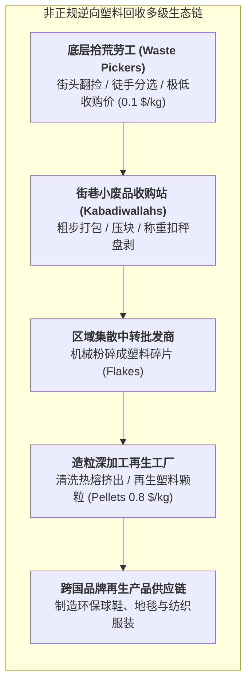

# Lec 12 发展中经济体循环经济与非正规废弃物回收逆向物流（Reverse Logistics & Waste Recovery in Emerging Economies）

## TL;DR

- 非正规废品回收者（Waste Pickers / 拾荒群体）构成的隐形逆向物流动脉。
- 高密度聚乙烯（HDPE）与 PET 塑料全生命周期闭环回收闭环的微观经济学。
- 将社会边缘底层拾荒劳工纳入正规化循环商业生态的包容性转型实践。

## 一、被遗忘的隐形逆向物流帝国

在西方发达国家，垃圾分类与逆向回收依赖政府财政补贴的昂贵环保卡车、自动化光学分选传送带和高税收支撑。
然而，在第三世界的特大城市（如印度孟买达拉维贫民窟、肯尼亚内罗毕丹多拉垃圾场、埃及开罗的扎巴林垃圾人社区）：
- 市政垃圾清运系统常年处于崩溃瘫痪状态；
- 支撑全城废弃物回收再利用的，是数以百万计挣扎在社会最边缘的**非正规拾荒大军（Informal Waste Pickers）**！

这些贫困劳工赤脚在恶臭熏天的垃圾山上徒手翻捡塑料瓶、废纸箱、铝罐和旧电线：
- 他们用肉眼精准识别 PET、HDPE、PP、PVC 等十几种不同高分子塑料的微小质感差异；
- 他们的回收率惊人地高达 60% 至 80%（远超许多欧美大都市的官方市政回收率！）；
- 但他们却承受着极度恶劣的职业伤害（针头扎伤、有毒重金属吸入、皮肤溃烂），且在商业链条中被上游废品中间商残酷剥削，每天仅能拿到微薄的 1 至 2 美元。

## 二、微观逆向物流的回收价值流分析

将废弃塑料从垃圾堆转化为合格工业再生原料，需要跨越漫长的质量跃升门槛：

::: definition [塑料逆向回收三大增值转化阶段]
1. **纯净度手工精细分级（Manual Sorting & De-labeling）**：
   - 撕掉塑料瓶外的 PVC 贴标套管，分离聚丙烯（PP）瓶盖与聚酯（PET）瓶身（不同塑料混合熔融会导致机械强度断崖式崩塌）；
   - 按透明白瓶、蓝瓶、杂色瓶分类（纯透明料再生价格是杂色料的 3 倍）；
2. **就地去中心化粉碎清洗（Decentralized Flaking & Washing）**：
   - 将蓬松占体积的空塑料瓶在本地简易粉碎机中打成 5 毫米见方的碎片，**将体积能量密度压缩 80%**，大幅削减向远郊工厂转运的干线运费；
   - 经过烧碱热水热洗，洗去糖分污渍与工业胶水；
3. **挤出造粒（Pelletizing）**：
   - 过滤熔融挤出成均匀的光滑颗粒，作为再生树脂（rPET）回填至注塑吹瓶产线。
:::

## 三、包容性回收转型（Inclusive Recycling）与尊严赋权

传统跨国企业在推动环保倡议时，最常犯的错误是直接引进昂贵的大型全自动垃圾焚烧或分选流水线，这往往直接砸掉了底层数万拾荒工人生死攸关的饭碗，引发激烈的街头社会冲突。

D-Lab 倡导的**包容性逆向供应链（Inclusive Reverse Logistics）**走出了第三条道路：

::: example [将拾荒者联合组建为合法产业合作社]
在巴西和印度班加罗尔，社会企业联合当地工会发起“哈西鲁·达拉（Hasiru Dala）”运动：
1. **身份认证与尊严正规化**：
   为拾荒工人发放官方印制的工作证和反光安全背心，由“社会闲散游民”转型为合法的“城市绿色环保工程师”；
2. **配备防护劳保装备**：
   发放防穿刺高帮工靴、防割劳保手套与破伤风疫苗接种；
3. **直连工业品牌采购（Bypassing Exploitative Middlemen）**：
   合作社直接与联合利华、可口可乐等快消巨头签订长期包销采购协议。巨头以高于黑心贩子 30% 的公允价格直接收购符合品质的干净打包料；
   **双赢结局**：跨国企业达成了严苛的 ESG 循环再生塑料采购配额，而拾荒工人的家庭收入整整翻了一番，孩子们终于能够走进学校接受正规教育。
:::

## 我的理解

非正规废弃物回收是全球循环经济最真实、最底层的肉身支撑。当我们在光鲜亮丽的写字楼里高谈阔论碳中和与 ESG 宏大叙事时，绝不能忘记，正是那些在垃圾堆中弯下腰的粗糙双手，替全人类阻挡了数以千万吨计的塑料垃圾涌入海洋。逆向物流工程学最崇高的境界，不仅是计算出最优的回收吨位成本，更是用平等的机制设计，将尊严、健康与体面的收入重新赋予这些默默守护地球生态的无名英雄。
