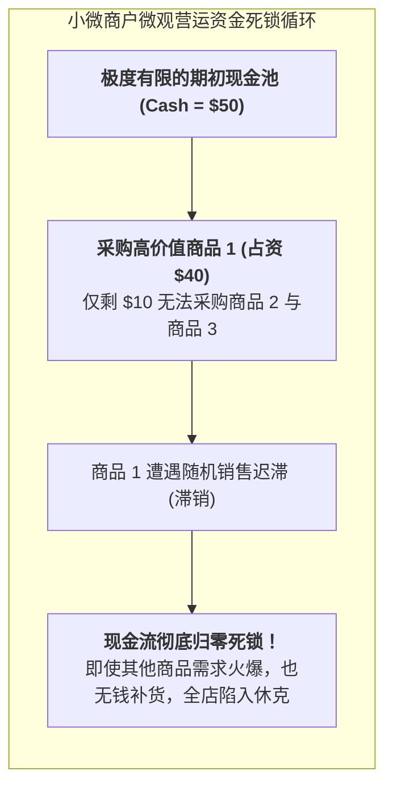

# Lec 13 资金刚性约束下的库存管理：营运资本极限与安全库存（Inventory Management Part 1: Capital Constraints and Safety Stock）

## TL;DR

- 经典库存理论的致命盲区：假设资金无限充沛与平滑借贷利率。
- 小微商户营运资本（Working Capital）刚性上限下的有约束报童模型推导。
- 当现金流耗尽时：在缺货损失惩罚与破产清算风险之间的极值权衡。

## 一、经典库存理论的“富人偏见”

在所有主流教科书的 EOQ 和报童模型中，都心照不宣地包含着一个极其奢侈的暗含假定：
**“企业拥有无限充沛的流动资金，或者可以按固定的年利率 $i$ 随心所欲地向商业银行借入任意额度的贷款。”**

然而，在发展中国家的小型制造工坊、农资合作社以及乡村街头杂货铺中：
- 摊主口袋里今天可用于进货的现金总额是一堵**绝对死板、不可逾越的刚性砖墙（Hard Cash Constraint）**；
- 当地根本没有银行愿意为他们开户贷款；
- 民间地下高利贷（Loan Sharks）的日利率往往高达 1% 至 3%（年化利率超过 1000%！），一旦借入高利贷进货，遭遇哪怕微小的滞销，全家将瞬间家破人亡。

在这样严酷的营运资金（Working Capital）刚性约束下，传统的库存决策必须被彻底推倒重构！

## 二、带硬性营运资本约束的报童模型数学求解

设小商户面临 $N$ 种商品的联合订购决策。商品 $j$ 的单位进货成本为 $c_j$，零售价为 $p_j$，残值为 $v_j$。
真实市场需求为随机变量 $D_j$，累积分布函数为 $F_j(x)$。
商户手头可用于采购的总现金资本上限为 $W$。

### 优化问题形式化
$$\max_{Q_1, Q_2, \dots, Q_N} \sum_{j=1}^N E\left[ \Pi_j(Q_j) \right] = \sum_{j=1}^N \left\{ (p_j - v_j) E[\min(D_j, Q_j)] - (c_j - v_j) Q_j \right\}$$
$$\text{s.t.} \quad \sum_{j=1}^N c_j Q_j \le W \quad (\text{绝对刚性营运资本约束})$$
$$Q_j \ge 0, \quad \forall j$$

### 引入拉格朗日乘子法求解
构造拉格朗日函数：
$$\mathcal{L}(Q_1, \dots, Q_N, \lambda) = \sum_{j=1}^N E[\Pi_j(Q_j)] + \lambda \left( W - \sum_{j=1}^N c_j Q_j \right)$$
对每个变量 $Q_j$ 求一阶偏导数并令其为 0：
$$\frac{\partial E[\Pi_j]}{\partial Q_j} - \lambda c_j = 0$$
根据经典报童边际推导：
$$\frac{\partial E[\Pi_j]}{\partial Q_j} = (p_j - c_j) [1 - F_j(Q_j)] - (c_j - v_j) F_j(Q_j) = (p_j - v_j)[1 - F_j(Q_j)] - (c_j - v_j)$$
代入整理，可得**资本约束修正后的最优临界分位数准则**：

::: theorem [资本约束报童临界分位数定理]
当资本约束处于紧致激活状态（$\lambda > 0$）时，各商品的最优订购量 $Q_j^*$ 必须满足：
$$F_j(Q_j^*) = \frac{(p_j - c_j) - \lambda^* c_j}{p_j - v_j} = \frac{p_j - (1 + \lambda^*) c_j}{p_j - v_j}$$
其中 $\lambda^* > 0$ 为使总资金消耗恰好用尽（$\sum c_j Q_j^* = W$）的唯一影子价格。
:::

### 核心结论的震撼经济学含义
由于 $\lambda^* > 0$，修正后的临界分位数**严格小于无约束时的经典临界分位数**！
- 乘子 $\lambda^*$ 代表商户手中“每一美元现金在其他商品上的边际机会成本收益”；
- 资本约束相当于将商品进货成本人为上浮为了 $(1 + \lambda^*) c_j$；
- **高成本商品（$c_j$ 很大）的订购量被急剧无情压缩，系统自发将有限资金倾斜向“资金周转率极快、占用本金微薄的高频小品类”！**

## 三、资金断裂下的破产清算防御

小微企业在配置库存时，不仅要追求期望利润最大化，更要防范最底层的**生存风险（Survival Risk / Ruin Probability）**：

::: pitfall [大单诱惑陷阱]
批发商经常以“整箱进货可享受八折”诱惑小摊主。缺乏财务常识的摊主如果将手中 90% 的现金全部孤注一掷砸进这一单，只要接下来三天遭遇一场暴雨导致该批货物未能在周末前变现，全家将断炊断粮，甚至由于无法缴纳摊位费而被市场管委会永久吊销营业执照。
:::

因此，在 D-Lab 培训中，向小农户灌输的核心守则是：**“宁可忍受高频缺货，也绝不在单品上押上超过总营运资金 30% 的筹码”**。生存永远优先于理论上的最优解。

## 我的理解

资本约束下的库存管理是一门沉重而清醒的生存哲学。它让我们深刻理解了穷人行为背后的数学理性——为什么很多街头小贩明明知道大批量进货单价更便宜，却依然坚持每天去批发市场用零钱一包一包地买？这不是他们愚昧无知，而是他们在面对绝对破产红线时，所能做出的最具韧性的自我防御。运筹学在撕去资本充裕的温情假设后，展现出了直面生死考验的凛冽锋芒。
