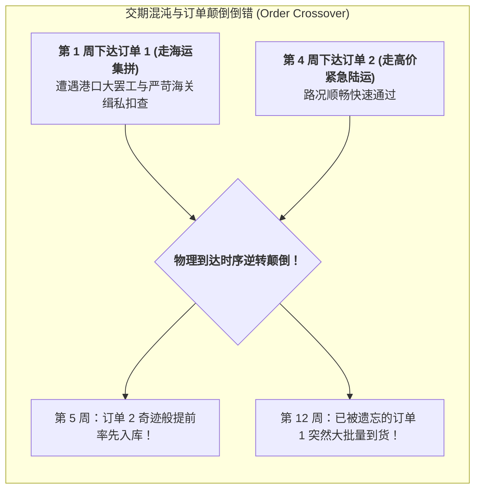

# Lec 14 极度不确定前置时间下的库存策略与长周期对冲（Inventory Management Part 2: Lead Time Variability and Lead-Time Hedging）

## TL;DR

- 前置时间方差压倒需求方差的现实极端化：跨洋清关甩柜与雨季道路泥泞阻断。
- 订单乱序到达（Order Crossover）现象及其在库存盘点控制中的数学冲击。
- 安全时间（Safety Time / Lead-Time Hedging）对冲策略在不可预测交付中的应用。

## 一、当交付交期沦为薛定谔的猫

在经典供应链运筹中，我们常假定订货提前期 $L$ 是一个温和波动的随机变量（如均值 10 天，标准差 2 天）。
然而，在发展中国家的海运进口与内陆走廊运输中，**交期不是波动，而是完全失控的混沌随机事件**：
- 一艘满载平价农药的集装箱货轮抵达蒙巴萨港，由于港口吊桥故障和清关腐败，集装箱被扣留滞港的时间可以短至 7 天，也可以长达 **120 天**；
- 每年热带季风雨季降临，山洪冲毁了内陆唯一的铁皮栈桥，陆运车队被直接困在泥潭中长达一个月毫无音讯；
- 采购员完全无法知晓上个月下达的订单下周会不会到、还是下个月才会到。

当交期方差 $\sigma_L^2$ 呈现爆发性膨胀时，传统的安全库存公式彻底崩溃。

## 二、订单乱序到达（Order Crossover）的系统性危害

在传统的连续检查补货模型中，我们隐含假定先下的订单必定先到达（FIFO）。
但当提前期高度随机且方差巨大时，必然频繁发生**“后下的订单比先下的订单更早到货”的乱序颠倒现象（Order Crossover）**！

Order Crossover 带来极为致命的运营破坏：
1. **在途库存双重计算与虚假再订货**：
   当计划员看到 3 周前下的单迟迟未到，系统误以为即将发生断水断粮，于是惊慌失措地再次下达紧急追加大单；结果不久后两批订单几乎在同一天同时呼啸涌入，将仓库彻底撑爆；
2. **在制品持有成本非线性膨胀**：
   在途存货由于漂泊时间拉长，资金成本成倍剧增；
3. **传统有效提前期需求方差低估**：
   根据海德利与维汀（Hadley & Whitin）证明，若忽略 Order Crossover，传统卷积算出的缺货期望值可能低估高达 50% 以上。

## 三、安全时间（Safety Time）vs. 安全库存（Safety Stock）

在应对这种极其疯狂的交期波动时，麻省理工学院运营专家指出了一个深刻的分水岭：
**单纯增加“安全库存（Safety Stock）”往往收效甚微，且代价极其昂贵；必须将防御重点全面转向“安全时间（Safety Time / Lead-Time Hedging）”！**

| 防御策略 | 运作执行机制 | 适用典型场景 |
| :--- | :--- | :--- |
| **安全库存 (Safety Stock)** | 在物理仓库内**常年多堆放 $SS$ 件实物现货** | 需求波动大、但供应商交期极其准时稳定的环境 |
| **安全时间 (Safety Time)** | 在计划排程中，**故意将发单采购时间向提前方向垫早 $\Delta T$ 天** | **交期极度不确定、交期方差巨大的恶劣供应链环境** |

::: theorem [安全时间垫量数学推演]
若正常期望交期为 $\mu_L$，设企业采用安全时间垫量 $\Delta T$。
下达采购发单的提前量定为：
$$L_{planned} = \mu_L + \Delta T$$
只要实际交付交期满足 $L_{actual} \le \mu_L + \Delta T$，货物就能在生产线断料前准时入库。
通过将 $\Delta T$ 设定为交期经验分布的高位分位数（如第 90 百分位）：
$$\Delta T = F_L^{-1}(0.90) - \mu_L$$
企业不仅避免了长年在高价值实物上死锁资金，更给变幻莫测的物流清关提供了充裕的弹性缓冲带。
:::

::: example [东非抗疟疾药的季风安全时间对冲]
某国际公共卫生组织在刚果分发青蒿素复方药物（ACT）。每年 11 月至次年 2 月是热带雨季，疟疾感染率暴增，但同时也是道路大面积泥泞瘫痪的高峰期。
如果按传统模型在 10 月份根据安全库存补货，卡车必定在 11 月被困在半路烂泥中，导致诊所断药。
执行**“季风安全时间法则”**：在每年 8 月中旬（雨季尚有整整 3 个月才来、气候极度干燥晴朗）即启动全量发运发货，将半年用量的救命药提前预置到各偏远乡村诊所的铁皮药箱中，成功达成了全雨季 100% 的救命现货满足率。
:::

## 我的理解

安全时间是对抗混沌时空的最高战略对冲。它告诉我们，运筹学中的“缓冲（Buffer）”不仅可以具象化为货架上的箱子，更可以抽象为日历上的刻度。在面对发展中世界不可抗拒的自然季风与体制摩擦时，企图用一成不变的静止模型硬碰硬注定会头破血流。学会顺应自然的节拍，用时间的提前量消解空间的不可控，这不仅是高超的工程调度，更是与天地共处的大智慧。
