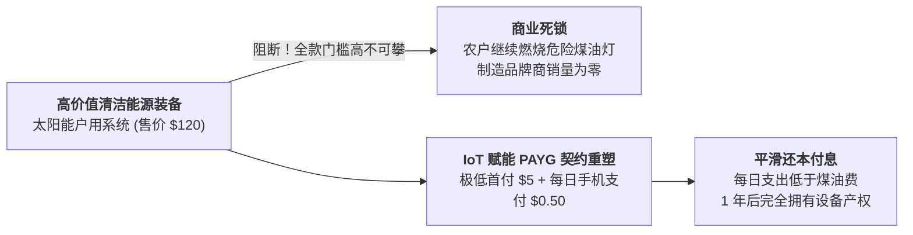
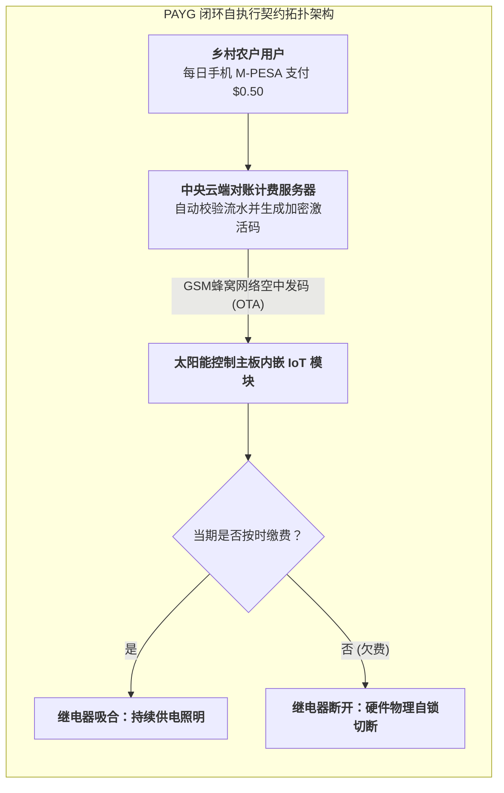

# Lec 15 面向低收入微型企业家的供应链契约与小额信贷绑定（Supply Chain Contracts for Low-Income Entrepreneurs）

## TL;DR

- 双重边际化在极端贫困小商户身上的恶性演化：进货能力枯竭与渠道断流。
- 寄售代销契约（Consignment Contracts）与按次即用付费（Pay-As-You-Go, PAYG）机制设计。
- 物联网（IoT）远程闭锁技术（Remote Lockout）与小额金融资产绑定的契约合规保障。

## 一、极端贫困生态中的契约死局

我们在前面课程中学习过经典批发价契约（Wholesale Price Contract）：
上游制造品牌商要求下游经销商以批发价 $w$ 掏出真金白银全额买断商品，自担后期的滞销与缺货风险。

然而，在金字塔底层（BOP），这套通行世界的契约机制彻底破裂：
- 一台高品质的家用太阳能发电系统（含光伏板、蓄电池、两只 LED 灯泡与手机充电接口）出厂成本高达 **100 至 150 美元**；
- 非洲乡村农户全家全年的现金储蓄可能总共只有 30 美元，根本不可能一次性全款买下；
- 乡村街头杂货铺摊主同样囊中羞涩，借遍亲戚也拿不出 1000 美元去批发 10 套设备陈列在货架上代售。

这种**“巨大的真实生活需求 + 绝对清零的即时购买力”**构成了残酷的商业断层。传统供应链契约如果不能与金融工程创新融合，任何先进的绿色科技都只能永远锁在仓库里沦为展品。

## 二、按次即用付费（Pay-As-You-Go, PAYG）与 IoT 智能契约

由 M-KOPA、d.light 等社会创新企业开创的 **PAYG 模式**，彻底颠覆了全球离网清洁能源的普及版图。
其核心在于将**供应链实物交付、物联网嵌入式硬件与小额金融信贷进行了三位一体的深度闭环捆绑**：

::: definition [PAYG 智能契约运作机制]
1. **超低首付提货（Micro Down-payment）**：
   农户只需向代理人支付极低的首期押金（如 5 美元），即可将整套太阳能系统搬回家完成安装点亮；
2. **微额按天分期还款（Daily Micro-installments）**：
   农户每天通过 M-PESA 等手机移动钱包支付大约 0.4 至 0.5 美元（这一金额**严格等同甚至低于农户过去每天购买劣质煤油和去集市给手机充电的花销**！）；
3. **物联网远程锁定控制（IoT Remote Lockout Enforcer）**：
   太阳能控制主板内嵌了一颗价值仅几美元的 2G/GSM 通信芯片与继电器开关：
   - 只要系统收到当天的短信付款凭证，主板自动通电解锁 24 小时；
   - 一旦农户欠费停缴，系统在宽限期后自动通过移动网络向硬件下发关断指令，**太阳能板瞬间断电锁定熄灭**；
4. **产权渐进转移（Lease-to-Own）**：
   在连续按日履约还款 12 至 18 个月后，总还款金额结清本金与合理利息，中央服务器向主板下发永久解锁固件代码，农户**永久完全拥有这套太阳能资产的物理产权**！
:::

## 三、微型寄售契约（Micro-Consignment）与代理人赋能

针对微型零售杂货铺，D-Lab 大力推行**微型寄售模式（Micro-Consignment Model, MCM）**：
- 供应链母体企业将商品（如老花镜、节能灶、水过滤器）以**完全零押金、零垫资的方式直接摆放在乡村代理人的摊位上**；
- 货物所有权依然归母体企业所有，小商贩不承担任何滞销亏本风险；
- 唯有当最终村民实际购买并付清货款后，商贩才在下周督导员巡查时将货款本金结算，自己当场扣留约定比例的丰厚代销佣金。

这一契约彻底消除了底层微商的心理恐惧，使得原本毫无抵押资产的赤贫妇女也能一夜之间成为活跃的乡村企业家。

## 我的理解

PAYG 与微型寄售是现代博弈论契约设计在广袤大地上最精彩的绝杀。过去，商业银行认为穷人“没有抵押品、信用风险极高”而将他们拒之门外；但聪明的工程师用一颗微小的 IoT 芯片和极简的代码，直接把设备本身变成了最坚硬的抵押品——不需要警察，不需要法庭，代码即法律（Code is Law）。它用精密的金融闭环把沉重的资本大山拆解为微不足道的每日零钱，让阳光真正普照每一个黑暗的茅屋。
