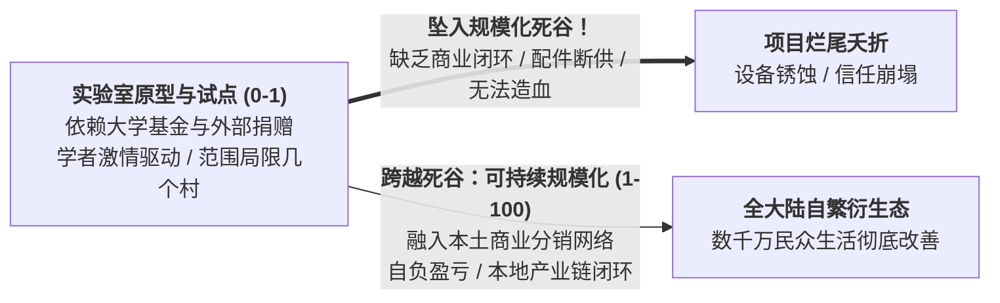

# Lec 16 在发展中世界实现供应链商业可持续性与规模化落地（Scaling Sustainable Supply Chains in the Developing World）

## TL;DR

- 从实验室样机走向千万级规模（Scale-up）：发展中供应链跨越死谷的系统性瓶颈。
- 摆脱对非政府组织（NGO）外援捐赠的脐带依赖：构建自组织商业造血循环机制。
- MIT D-Lab 全课程终极大盘点：以人为本、系统韧性与改变世界的包容性运营工程。

## 一、死谷迷局：为何 95% 的社会创新项目无法规模化？

在麻省理工学院 D-Lab 的展厅里，摆满了各种惊艳世界的人道主义创新发明：廉价甘蔗渣制炭机、超节能炉灶、简易太阳能净水器、手摇越野轮椅……
然而，严峻的现实是：
- 许多极具创意的产品在赢得国际设计大奖、发表顶级论文并依靠几十万美元慈善赞助完成两三个村庄的“试点演示（Pilot Showcase）”后；
- 一旦赞助资金耗尽、MIT 研究生毕业回国，项目便在当地无声无息地彻底死亡；
- 真正能够突破所谓的**“死谷（Valley of Death）”**、实现从几百件走向数百万件**商业规模化（Scale-Up）**落地的项目凤毛麟角。

## 二、实现商业自造血（Financial Self-Sustainability）的四大支柱

要想摆脱对慈善捐赠的“脐带依赖”，发展中供应链体系必须在底层建立健康的商业基因：

::: definition [规模化落地的四大工程基石]
1. **建立备件与全生命周期维保售后网络（Spare Parts & Repair Ecosystem）**：
   - 任何产品卖进乡村仅仅是长征的第一步；如果损坏一颗特殊螺丝或橡胶圈都需要从首都甚至欧美空运，产品在 3 个月内必将沦为废铁；
   - 必须赋能村庄铁匠铺和摩托车修理师傅，确保所有易损易耗件完全使用当地街市现成通用的摩托车或自行车标准件；
2. **本土化制造与装配（Localization of Assembly）**：
   - 跨国整机进口需要缴纳高达 25% 至 40% 的关税和沉重海运运费；
   - 转向全散件组装（CKD / SKD），在目标国设立简易组装工坊，既能规避高昂进口关税，又能为当地创造急需的产业就业机会；
3. **正规金融与营运资金杠杆接入**：
   - 从依赖赠款转向引入影响力投资基金（Impact Investment Funds）与商业银行担保贷款，用商业契约约束运营效率；
4. **融入既有成熟流通宿主（Hitching a Ride on Existing Host Networks）**：
   - 切忌狂妄地在穷乡僻壤从零自建一条昂贵专属的全新仓储物流网络；
   - **巧妙“寄生”在当地已经跑得极为顺畅的商业巨头网络上**（例如借用可口可乐、英美烟草或移动运营商已经触达最偏远村庄的送货小卡车，顺带捎带分销净水片和太阳能提灯）。
:::

## 三、MIT D-Lab 全景征程终极大总结

回顾 15.772J 的全景知识图谱，我们完成了一场重新审视世界的精神洗礼：
- 我们走下了传统商学院追逐暴利的象牙塔，深入到全球底层 40 亿同胞的泥泞现实；
- 我们在没有道路、没有电力、没有大数据的“三无荒原”中，用 PRA 参与式地图与节俭创新重构了需求预测；
- 我们推导了极端资本刚性与 Order Crossover 混沌交期下的库存防御极限，见证了 PICS 密封袋与 Zeer 蒸发冷却罐如何用两美元改变数百万人的命运；
- 我们领略了混合价值链、乡村代理人网络与 PAYG 物联网智能契约如何将现代博弈论转化为点亮黑暗茅屋的希望火种。

::: insight
运营管理与供应链科学，从来不应该只是帮助富裕世界变得更加奢华的精算工具。它最深沉、最崇高的灵魂，永远在于**在资源极度匮乏的荒野中建立秩序，在被世界遗忘的角落架设通往尊严与希望的桥梁**。
:::

## 我的理解

15.772J 是一门让工程学回归初心的课程。它教会我们，最高的工程造诣不是设计出结构最繁复、芯片最昂贵的超级机器，而是在面对人类最深重的苦难时，能够克制虚荣，用最朴素、最耐用、最便宜的材料，创造出最坚实长久的系统生命力。无论未来我们身处繁华都市的跨国总部，还是置身尘土飞扬的非洲田野，这份对极端约束的敬畏、对草根智慧的尊重，以及用系统运筹改变世界命运的炽热初心，将永远是我们心中最光芒万丈的灯塔。
