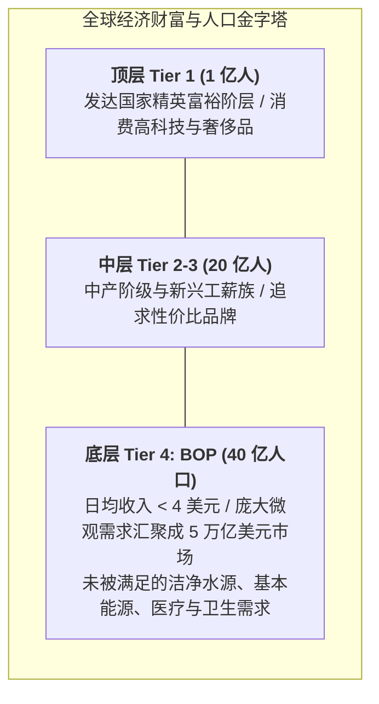

# Lec 2 金字塔底层 BOP 用户画像与特殊需求工程（Market Segmentation at the Base of the Pyramid）

## TL;DR

- C.K. 普拉哈拉德（Prahalad）金字塔底层理论：穷人不是受害者，而是充满活力的价值创造者。
- 可负担性（Affordability）、可获得性（Availability）与可接受性（Acceptability）3A 准则。
- 针对恶劣物理环境的节俭式创新（Frugal Innovation）工程重新设计范式。

## 一、普拉哈拉德的 BOP 商业范式革命

已故密歇根大学商学院教授 C.K. 普拉哈拉德在其划时代名著《金字塔底层的财富》中提出了极具开创性的洞见：
长期以来，跨国企业与慈善国际组织对待第三世界穷人存在严重的认知偏差——要么把他们视为无能为力的悲惨受害者（纯粹依靠联合国施舍），要么认为他们毫无商业价值而完全忽视。

然而，全球 BOP 人口虽然个人日均收入不足 2 至 4 美元，但当 40 亿人的购买力聚合在一起时，构成了**超过 5 万亿美元的庞大潜在消费总市场**！
穷人不仅需要粮食，他们同样对洁净饮水、太阳能照明、移动通信、医疗健康与儿童教育拥有极其迫切的尊严需求。

## 二、BOP 市场的“3A 成功准则”

跨国企业试图直接把欧美滞销的产品“降配降级”卖给穷人，几乎无一例外惨遭溃败。面向 BOP 市场的供应链与产品工程必须严格恪守**3A 准则**：

::: definition [BOP 商业成功的 3A 铁律]
1. **极端可负担性（Extreme Affordability）**：
   不仅是总价低，更是**单次现金流支付金额的极致低门槛**。通过微小包装（Sachets）、按次即用付费（Pay-As-You-Go, PAYG）等金融工程，使客户仅需掏出几美分零钱即可获得服务；
2. **全天候可获得性（High Availability）**：
   在没有正规超市与电商快递的旷野乡村，产品必须能无缝渗透进村头巷尾的简陋夫妻杂货铺、甚至依靠流动商贩的扁担深入千家万户，实现“最后一公里永不缺货”；
3. **文化与环境可接受性（Acceptability）**：
   必须完全适应当地居民的宗教习俗、饮食习惯与生活习惯。例如太阳能提灯如果设计得过于像“高科技仪器”，当地村民会因害怕弄坏而不敢使用；若设计成他们熟悉的传统煤油灯外形，采纳率将翻倍暴涨。
:::

## 三、节俭式创新（Frugal Innovation）工程实践

**节俭式创新（Frugal Innovation）**是指在极端资源约束下，以 10% 的极低成本重塑产品架构，并维持甚至超越原产品在恶劣环境下的耐用性能：

| 传统西方产品工程 | BOP 节俭式创新重构 | 典型实战案例 |
| :--- | :--- | :--- |
| 依赖 220V 恒定市电运行 | 搭载超微型太阳能板或手摇发电储能 | **d.light 太阳能 LED 乡村提灯**（取代致命易燃有毒煤油灯） |
| 脆弱高精度光学镜片与微芯片 | 纯机械力学结构、耐冲击聚乙烯塑料 | **LifeStraw 生命吸管**（内嵌多层中空纤维膜直接过滤污水细菌） |
| 庞大恒温无尘实验室分析仪 | 基于毛细管作用的浸渍试纸（Paper-based）| **纸基疟疾与登革热快速诊断试纸条**（常温保存、滴血即出结果） |
| 昂贵的轮式电动轮椅 | 采用通用自行车链条与农用橡胶轮胎 | **GRIT 越野手摇三轮轮椅**（能轻松征服热带雨林泥泞山路与沙地） |

## 我的理解

BOP 用户画像彻底撕掉了西方中产阶级消费主义的虚伪滤镜。它让我们看到人类真实生存状态的坚韧与尊严。为穷人设计产品和供应链，不是粗暴的“偷工减料”或“低端倾销”，而是对工程本质的终极拷问——剔除所有花哨炫技的装饰，在每一克塑料、每一分钱成本中倾注对生命的至高敬畏。这种在逼仄约束中迸发出的节俭创新，往往孕育着颠覆世界主流工业格局的革命火种。
