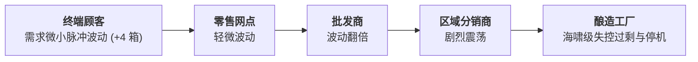
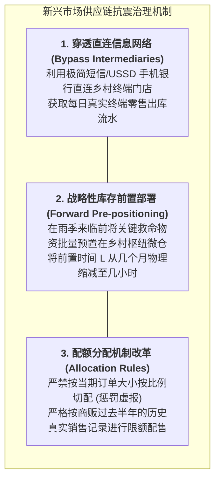

# Lec 3 供应链动力学：脆弱市场中的啤酒游戏与剧烈牛鞭效应（Supply Chain Dynamics: The Beer Game in Fragile Markets）

## TL;DR

- 麻省理工系统动力学经典：啤酒分销游戏（The Beer Game）多级博弈机制拆解。
- 脆弱新兴市场中牛鞭效应的成倍放大器：信息不透明、长前置时间与恐慌性囤积。
- 消除系统内生震荡的治理机制：共享 POS 真实扫码需求与缩减多级层级。

## 一、MIT 啤酒游戏（The Beer Distribution Game）与系统动力学

在 20 世纪 60 年代，MIT 斯隆管理学院系统动力学奠基人杰·福瑞斯特（Jay Forrester）设计了举世闻名的**啤酒分销游戏（The Beer Game）**。
游戏模拟了一条由四个独立角色串联构成的线性供应链：
$$\text{零售商 (Retailer)} \longrightarrow \text{批发商 (Wholesaler)} \longrightarrow \text{分销商 (Distributor)} \longrightarrow \text{酿酒工厂 (Factory)}$$

每个角色在各自的回合中独立做出订货决策。在游戏开始前几周，终端消费者的真实啤酒需求极其稳定（每周恒定 4 箱）；
在第 5 周，外部需求仅仅微幅上涨至每周 8 箱，并在此后一直保持恒定。

然而，各个节点之间存在两周的信息传递时滞以及两周的物理发运时滞。
实验中数以万计受试者反复呈现出完全一致的**毁灭性系统振荡**：
- 随着轻微的需求上涨，下游由于暂时缺货而产生恐慌；
- 恐慌沿着供应链逐级向上逆流传导，批发商订 16 箱，分销商订 32 箱，上游工厂最终收到了每周狂增到数百箱的荒谬订单；
- 工厂开足马力扩产，数周后巨量啤酒如排山倒海般涌向全网，各级仓库瞬间被彻底撑爆，订单在数周内暴跌为 0！

## 二、新兴市场牛鞭效应（Bullwhip Effect）的剧烈放大器

如果在工业基础设施完善的发达国家，牛鞭效应已经造成全行业数以千亿计的库存浪费；那么在发展中国家的脆弱生态中，**这只皮鞭被不可逆地装上了剧烈的火箭推进器**：

::: theorem [牛鞭效应方差放大倍数公式]
设前置时间为 $L$（以周计），下游采用简单移动平均法基于过去 $p$ 期数据预测，各级独立向上传递订单方差放大比为：
$$\frac{\sigma_{orders}^2}{\sigma_{demand}^2} \ge 1 + \frac{2 L}{p} + \frac{2 L^2}{p^2}$$
:::

新兴市场环境使该公式中的破坏性因子急剧恶化：
1. **交付提前期 $L$ 极其漫长且极不稳定**：
   从海运清关、跨国陆运到乡村土路，一个简单的化肥或药品订购周期长达 3 至 6 个月（$L$ 很大），直接导致方差放大倍数以 $L^2$ 的二次方速率失控膨胀；
2. **通胀与短缺催生的恐慌性囤积（Phantom Orders & Hoarding）**：
   在经常发生货币恶性贬值或物资匮乏的国家，下级零售商深刻明白“货架上有货就是硬通货”。一旦传出断货风声，商贩会故意将订货量虚报 5 到 10 倍，以确保在批发商配额限购时能分到一点点货，这制造了大量虚幻的“幽灵需求”；
3. **缺乏 POS 数据打通的信息黑盒**：
   上游制造厂与终端市场之间隔着 6 到 8 层中间皮包商与小批发贩，工厂根本无法获知最终到底卖出了多少，完全在信息的伸手不见五指中瞎子摸象。

## 三、化解脆弱生态震荡的结构性解药

消除牛鞭效应，绝不能靠道德说教呼吁下级商贩“不要恐慌”，必须从**系统拓扑与机制设计**层面动手术：

::: example [联合利华 Shakti 项目在印度的穿透实践]
联合利华在印度农村推行著名的“沙克蒂计划（Project Shakti）”：直接绕过了层层加价、互相倒买倒卖的传统批发商网络，招募培养了数万名乡村贫困妇女担任直销代表。这些妇女直接通过手机短信从联合利华区域中心进货并就近配送给村民。此举直接将供应链中间层级从 5 级砍为 1 级，全渠道牛鞭效应振幅下降了 70%，同时为印度赤贫妇女带来了稳定的体面收入。
:::

## 我的理解

啤酒游戏是所有供应链学子的成人礼。它用残酷的事实粉碎了一个傲慢的假设：“系统出问题一定是因为里面有坏人或蠢人”。在游戏里，每一个受试者都在极其努力、高度负责地试图满足客户需求，但最终全系统依然不可避免地走向了疯狂与崩溃。这深刻揭示了系统结构对个体行为的绝对支配力。在脆弱的发展中世界，如果不彻底革新长时滞、多层级的腐朽拓扑，任何局部的努力都只会在牛鞭的狂舞中被撕得粉碎。
