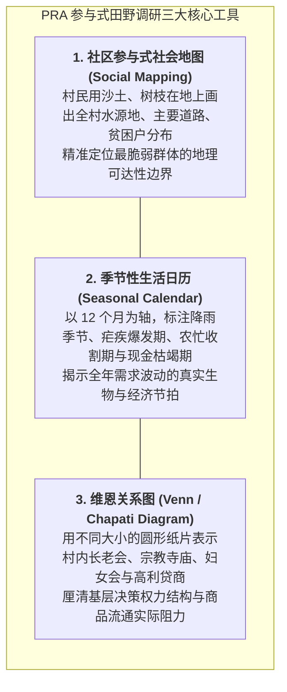

# Lec 4 数据匮乏情境下的需求预测与定性调研工具（Demand Management and Forecasting in Data-Poor Environments）

## TL;DR

- 面对历史销售记录完全空白的黑盒市场：定性与混合预测方法论架构。
- 参与式乡村评估（PRA / RRA）工具集：社区资源地图、季节历与生计分析图。
- 情景规划（Scenario Planning）在极端地缘政治与气候脆弱性情境中的压力测试。

## 一、数据荒原（Data Deserts）中的预测困境

在发达国家，算法工程师拥有取之不尽的结构化大数据：每一秒都有上亿条带有经纬度、用户画像与支付标签的 POS 交易流水和点击流被写入云端数据湖。
然而，在发展中国家的偏远农村或内战刚刚平息的冲突地区：
- 没有统计局发布的权威人口普查数据（官方数字往往已是 15 年前的过时估计）；
- 当地 99% 的交易以皱巴巴的纸币甚至以物易物现金结算，零历史数字留存；
- 地形测绘图缺失，甚至连村庄在 Google Maps 上都只是一个模糊的无名绿块。

在面对这样一片“数据荒原（Data Desert）”时，任何高深的自回归移动平均（ARIMA）或深度学习神经预测网络都彻底瘫痪。供应链团队必须学会成为**人类学田野调查家与定性运筹大师**。

## 二、参与式乡村评估（Participatory Rural Appraisal, PRA）工具集

由罗伯特·钱伯斯（Robert Chambers）开创的 PRA 方法论，是 MIT D-Lab 在基层收集需求情报的核心利器。
其根本原则是：**放下精英专家的居高临下，让当地村民亲自掌握粉笔和画棒，成为自己需求的第一表达者**。

::: insight
PRA 工具的精妙之处在于它跨越了文字与语言的鸿沟。在文盲率高达 60% 的非洲部落，向村民发放问卷调查表是荒谬且极具冒犯性的；而围坐在村口大树下，让村民用石头摆出“哪个月全家最缺粮食、生病最多”，不仅能获得比官方报表精确十倍的真实需求节拍，更能瞬间建立起深厚的社区信任。
:::

## 三、情景规划（Scenario Planning）在极端不确定性中的运用

当定量数字无法预测时，企业必须转而推演**“可能发生的几种结构性未来”**：

::: definition [两轴情景矩阵构建步骤]
1. 识别对目标市场供应链影响最大的两个**关键独立不确定性驱动轴（Critical Uncertainties）**；
2. 构造正交二维矩阵，生成四个互不相同但内部逻辑自洽的未来情景世界；
3. 针对每一个情景推演供应链的应灾生存方案。
:::

例如在东非某国推广太阳能微电网系统：
- **横轴（宏观经济稳定性）**：左侧为本国货币恶性贬值，右侧为汇率平稳外资涌入；
- **纵轴（气候降水条件）**：上方为连续极端干旱农作物绝收，下方为风调雨顺农业大丰收。

| 极端情景象限 | 情景特征描述 | 供应链与产能防御战略 |
| :--- | :--- | :--- |
| **象限 I：繁荣丰收** | 汇率稳定 + 农民手握充沛农产品现金 | 启动满负荷规模化量产，大批量供货，拓展分销加盟 |
| **象限 II：滞胀荒年** | 恶性通胀 + 极端大旱粮食危机 | **严防坏账！**全面收紧信用，产品转向耐用可替代救灾粮食的刚需品 |
| **象限 III：现金贫血**| 汇率暴跌但农业收成良好 | 绕开法定货币结算，推行“以粮食换太阳能板”实物以物易物机制 |
| **象限 IV：温和复苏**| 农业受灾但宏观外援充沛 | 联合世界银行与 NGO 进行机构采购，由国际援助资金托底兜底 |

## 我的理解

在没有数据的黑暗丛林中航行，是对供应链人战略定力与人性洞察的终极考验。过去我们习惯了在冷气十足的办公室里跑回归方程，以为数字就是世界的全貌；但 D-Lab 教会我们，最鲜活、最真实的情报永远沉淀在田间地头的泥土里。参与式地图与情景规划不是精确到小数点后两位的算命，而是一套对抗傲慢、拥抱未知的谦逊智慧。它让我们在最极端的风暴中，依然能够拥有看清前路的清醒眼光。
