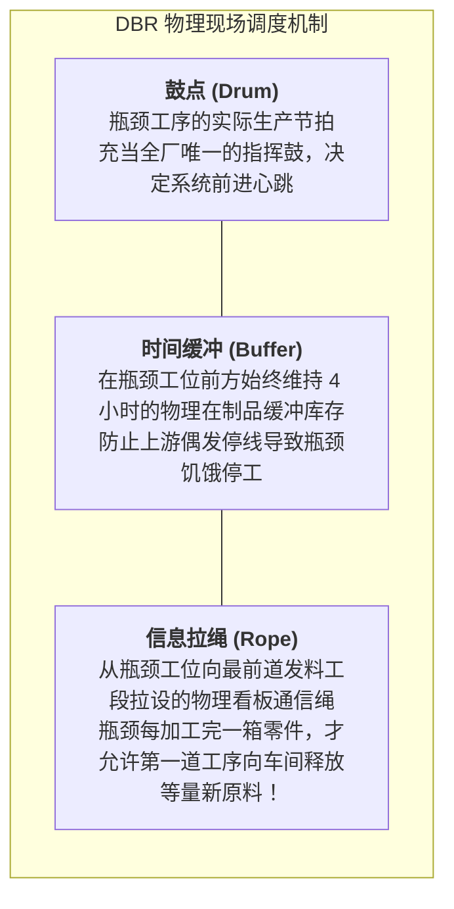

# Lec 6 瓶颈管理与高德拉特约束理论在资源受限环境下的应用（Bottlenecks & Theory of Constraints in Resource-Constrained Contexts）

## TL;DR

- 伊利亚胡·高德拉特（Eliyahu Goldratt）约束理论（TOC）：系统产出完全由唯一的瓶颈决定。
- 在极端资源匮乏工坊中的五大核心聚焦步骤（Five Focusing Steps）落地。
- 鼓-缓冲-绳（Drum-Buffer-Rope, DBR）排产机制在分散微型手工装配线中的实战。

## 一、高德拉特《目标》与约束理论（TOC）核心公理

物理学家兼商业顾问伊利亚胡·高德拉特在其商战小说《目标》（The Goal）中提出了震撼管理学界的公理体系：
任何现实运营系统，无论其组织架构多么庞大繁杂，本质上都是一条由环环相扣的工序组成的链条。

::: theorem [约束理论核心公理（TOC Axiom）]
1. **链条的强度完全由其最脆弱的那一环决定**：在任何给定的时间点，任何一个系统的有效产出（Throughput）上限，**有且仅由一个唯一的系统瓶颈（Bottleneck / Constraint）所决定**；
2. **在非瓶颈环节上的任何效率提升，都是完全虚妄的幻象与浪费！**
   如果在非瓶颈工序拼命加班生产，除了制造出堆积如山的在制品（WIP）堵塞车间、冻结宝贵流动资金之外，全系统的最终交付产出不会增加哪怕一分钱！
:::

## 二、TOC 五大聚焦步骤（Five Focusing Steps）在发展中国家的本土化

在资源极度受限的发展中国家微型工坊（如肯尼亚的内罗毕露天五金加工区 Kamukunji、卢旺达手工艺品编织合作社），由于资金极度匮乏，企业根本无法靠“砸大钱买新设备”来解决问题。
TOC 的五步循环法展现了惊人的低成本撬动力量：

1. **第一步：识别系统约束（Identify the Constraint）**：
   - 不看报表，直接走到露天工坊巡视：**哪台机器或者哪道工位前面堆积的半成品像小山一样高，而该工位后面的机器都在空转闲逛，那个堆积如山的位置就是全厂唯一的瓶颈！**
2. **第二步：竭尽全力压榨约束潜能（Exploit the Constraint）**：
   - 瓶颈工序停工 1 小时，等于全厂彻底停产 1 小时！必须确保瓶颈设备**24 小时绝对不间断连续运转**：
   - 工人午饭交接班时，必须安排替补工人实现无缝换班不停机；
   - 严禁将有缺陷的劣质毛坯料送入瓶颈加工（在瓶颈工位前设立 100% 专职预检质检哨卡，防止瓶颈把宝贵工时浪费在废品上）；
3. **第三步：使其他一切非瓶颈工序向约束迁就妥协（Subordinate Everything Else）**：
   - 严厉制止非瓶颈工段为了片面追求“个人绩效”而盲目超产；非瓶颈的投料节奏必须严格服从瓶颈的消耗速率；
4. **第四步：给约束扩容松绑（Elevate the Constraint）**：
   - 如果经过管理优化后系统产出仍无法满足市场，才考虑投入资本扩充瓶颈：购买第二台二手老冲床、或者外包部分瓶颈工序给邻近小作坊代工；
5. **第五步：防止惯性警惕新瓶颈（Go Back to Step 1 / Avoid Inertia）**：
   - 一旦原瓶颈被打破，系统约束必然瞬间转移漂移到另一道新工序（如变成原料采购或包装物流），管理层必须立即从第一步重新循环，坚决破除路径依赖。

## 三、鼓-缓冲-绳（Drum-Buffer-Rope, DBR）简易控制系统

在没有昂贵工业软件和计算机排产系统的粗陋工坊中，如何实现全厂各道工序步调一致的高效协同？高德拉特提出了著名的“鼓-缓冲-绳（DBR）”排产体系。

这一机制模仿了童子军野外徒步编队的经典智慧：让行进速度最慢的小胖子走在队伍前列（充当决定全队行军节拍的鼓点），在小胖子身后系上一根绳子牵引后方所有队员，并在队伍关键位置设置微小安全缓冲。在非正式制造车间中，DBR 是一套极其纯粹的物理调度控制架构：

通过这套朴素而精密的机制，非瓶颈工序的投料节奏被牢牢绑死在瓶颈工位的实际消化速度之上。车间现场不再需要复杂的条形码追踪或排产算法，仅凭一根物理挂牌绳或彩色塑料卡片，工人们就能自然形成“前道不盲目抢跑、后道不无故断档”的默契韵律。

这种完全依赖物理信号或纸质看板的 DBR 机制，不需要任何电力和服务器，却能在极短时间内将混乱工坊的在制品积压压缩 60% 以上，同时保证交付准时率逼近 100%。

## 我的理解

约束理论是管理学中最纯粹的常识与聚焦艺术。在资源丰沛的环境里，管理层容易被繁杂的数据迷住双眼，误以为“处处都在忙碌”就是欣欣向荣；然而高德拉特告诉我们，90% 的忙碌不过是无头苍蝇式的自我感动。在资源极度紧缺的发展中世界，TOC 更是救命的指南针——它强迫我们克制贪婪，将所有的智慧和仅有的微薄资金，像激光一样精准聚焦在最致命的那一个针尖上。这是用极简主义战胜复杂混乱的最高智慧。
