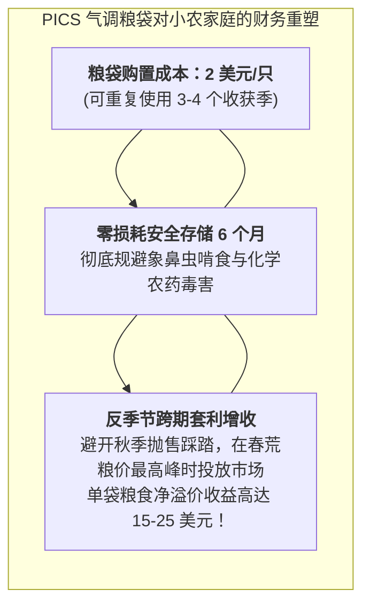

# Lec 7 农业生鲜供应链与小农户采后减损工程（Agricultural Supply Chains & Post-Harvest Loss Prevention）

## TL;DR

- 小农经济核心痛点：采后损耗（Post-Harvest Loss, PHL）高达 30%-50% 的成因拆解。
- 季节性丰收价格暴跌与春荒缺粮高价的“丰收悖论（Sell Low, Buy High）”破局。
- 微型气调贮藏（Hermetic Storage）与简易分级包装对农户净收入的倍增杠杆。

## 一、全球粮食采后损耗（PHL）的严峻现实

联合国粮农组织（FAO）与世界银行统计表明：在撒哈拉以南非洲和东南亚地区，每年生产的谷物、豆类及新鲜果蔬中，有**高达 30% 至 50% 从未真正进入人类的餐道**，而是在田间采摘、脱粒、仓储与运输过程中被霉菌、象鼻虫害虫、老鼠啃食或机械挤压彻底损毁！

这种惊人的采后损耗（Post-Harvest Loss, PHL）带来了双重灾难：
1. **毁灭性的粮食安全威胁**：仅需将非洲的采后损耗降低一半，所节约的粮食就足以彻底消灭全大陆的饥饿人口；
2. **水土与碳排放的巨大浪费**：农民辛苦灌溉数月的珍贵水源、施加的昂贵化肥与消耗的劳动力，最终化为垃圾场排放甲烷温室气体的烂泥。

## 二、“贱卖贵买（Sell Low, Buy High）”的小农丰收悖论

在没有安全贮藏技术的小农经济中，农民深陷悲惨的恶性循环：
- **秋季丰收时节（Harvest Season）**：
  所有农民的玉米或水稻在同一周成熟。由于担心粮食存放在家里很快会被象鼻虫吃光发霉，且农民急需现金偿还春耕高利贷并为孩子缴纳学费，所有人被迫在同一时间将全部粮食涌入当地集市贱卖抛售。市场供严重过于求，粮食价格暴跌至地板价；
- **春季青黄不接时节（Lean Season）**：
  到了来年三四月份，农户家中的存粮早已耗尽，而新一季庄稼尚未成熟。此时全村陷入饥荒，农民不得不以秋季售价 **2 至 3 倍的天价**从黑心粮食投机商手中借粮度日！

这种“丰收时当草贱卖、春荒时当金贵买”的残酷剪刀差，像无形的绞索一样将亿万小农死死锁死在绝对贫困的泥潭之中。

## 三、微型气调密封袋（Hermetic Storage Bags）的技术革命

普渡大学与 MIT 合作推广的**普渡改良粮袋（Purdue Improved Crop Storage, PICS Bags）**，被誉为发展中国家农业减贫史上最伟大的平民黑科技之一：

::: definition [PICS 三层气调密封袋原理]
PICS 粮袋由三层结构复合组成：
- 外层为结实抗撕裂的编织聚丙烯麻袋（抗搬运磨损）；
- 内部套有两层厚度为 80 微米的高密度聚乙烯（HDPE）无毒透明特种塑料内胆。
:::

### 物理窒息杀虫机制
1. 农民将晒干的玉米或豇豆装满内胆袋，用绳子层层死死扎紧袋口；
2. 袋内的粮食谷物与混在其中的象鼻虫成虫、幼虫及虫卵继续进行微弱的呼吸作用；
3. 由于 HDPE 塑料具有极佳的气体阻隔性，袋内的氧气浓度在 24 至 48 小时内从正常的 21% 急剧暴跌至 **5% 以下**，而二氧化碳浓度飙升；
4. **无需喷洒任何有毒化学农药**，袋内所有的象鼻虫、卵和幼虫在缺氧环境中全部被**100% 物理窒息杀死**！
5. 谷物在袋内可以安全储存长达 1 至 2 年，开袋时品质宛如新粮！

## 我的理解

PICS 气调粮袋是运筹学中“时间延迟（Time Arbitrage）”策略最感人至深的现实化身。两美元的塑料袋，打破了千百年来吞噬非洲农人的丰收诅咒。它没有采用任何高大上的冷冻机组或自动化立体库，纯粹凭借最质朴的高分子阻气物理学，把粮食跨期储存的自主权重新交还到了最贫困的农民手中。这种技术所释放出的尊严与财富，正是工程学赠予人类文明最深情的礼物。
