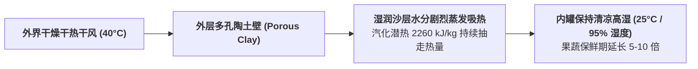

# Lec 8 平民化低能耗离网冷链与被动制冷技术架构（Low-Cost Decentralized Cold Chain Solutions）

## TL;DR

- 冷链断裂与热带农业腐烂危机：离网无电乡村保鲜的工程热力学挑战。
- 基于水蒸发吸热潜热的零电能被动制冷：简易双瓮冷却器（Zeer Pot）与微型冷库。
- 相变材料（PCM）蓄冷箱在疫苗最后一公里冷链冷藏运输中的实战应用。

## 一、热带无电地区的“热力学死亡陷阱”

在热带与亚热带新兴经济体中，气温常年高达 35°C 至 42°C。
根据范特霍夫（van 't Hoff）化学反应动力学规律，**温度每升高 10°C，果蔬的细胞呼吸衰老速率和微生物细菌繁殖速度将加快 2 至 3 倍**！
- 刚刚挤出的新鲜牛奶在 38°C 的室温下放置 4 小时即酸败变质；
- 儿童麻疹与脊髓灰质炎疫苗若脱离 2°C 至 8°C 的温控区间，蛋白质抗原将在几小时内变性失效，导致接种儿童完全失去免疫保护。

然而，在广袤的离网农村地区：
- 缺乏稳定的三相工业交流电网；
- 传统的压缩机制冷冷水机组造价极其昂贵（动辄数万美元），且柴油发电机每度电成本高昂，农民根本无力承受；
- 传统的“冰块保鲜”面临冰块自身在运输途中快速融化的窘境。

因此，必须开发**完全摆脱电网依赖、利用自然热力学潜能的平民化被动制冷技术**。

## 二、零能耗蒸发冷却技术：吉尔罐（Zeer Pot）与蒸发冷库

蒸发冷却利用了水相变为水蒸气时吸收巨大汽化潜热（Latent Heat of Vaporization, 约 $2260 \text{ kJ/kg}$）的天然物理原理。

::: definition [简易双瓮冷却器（Zeer Evaporative Pot）结构]
由尼日利亚教师穆罕默德·巴·阿巴（Mohammed Bah Abba）改良推广：
1. 取一大一小两个未上釉的多孔粗陶土罐；
2. 将小陶罐嵌套置入大陶罐内部，在两个罐体之间的夹层缝隙中填满清洁河沙；
3. 每天向夹层沙子中浇注清水，保持沙层充分湿润；
4. 将蔬菜放入内部小陶罐中，顶部覆盖一层湿麻布。
:::

### 热力学降温表现与保鲜奇迹
- 干燥炎热的空气掠过多孔大陶罐外壁，驱使沙层中的水分持续向外蒸发；
- 剧烈蒸发带走大量热量，使内部小陶罐的温度**比外界环境干球温度显著降低 8°C 至 15°C**，同时内部相对湿度维持在 95% 以上；
- **惊人的保鲜对比**：
  - 在热带酷暑中，未冷藏的番茄仅能存放 2 天即腐烂；
  - 放入 Zeer 罐中，番茄保鲜期直接延长至 **20 天以上**！
  - 茄子保鲜期从 3 天延长至 27 天！
这项耗资不到 2 美元的土法发明，使西非数百万农村妇女摆脱了每天赶集贱卖蔬菜的窘境。

## 三、先进离网冷链：相变材料（PCM）与太阳能直驱冷库

当面对严苛的医药疫苗与高附加值生鲜外销时，D-Lab 联合工程团队研发了进阶离网冷链架构：

1. **相变蓄冷材料（Phase Change Materials, PCM）冷藏箱**：
   - 摒弃传统融化后淌水的普通水冰，采用特定相变温度点（如精准维持在 $+4^\circ\text{C}$ 或 $-20^\circ\text{C}$）的无毒无机盐水合物蓄冷板；
   - 配合高密度真空绝热板（VIP），使得摩托车骑手携带疫苗在热带荒漠穿行长达 72 小时，箱内温度曲线依然如同一条水平直线锁定在 $+5^\circ\text{C}$；
2. **太阳能光伏直驱变频冷库（Solar Direct Drive Cold Rooms）**：
   - 彻底**取消昂贵且寿命极短的铅酸/锂蓄电池组**（蓄电池在热带高温下通常 2 年内报废，是离网太阳能系统的最大成本黑洞）；
   - 太阳能光伏板发出的直流电直接驱动直流变频压缩机，在白天阳光强烈时全负荷运行，不仅冷却冷库，更将多余冷量直接**冻结为大量相变冰浆（Thermal Energy Storage）**；
   - 夜间停电时，依靠白天冻结的冰浆自然释放冷量维持低温，全系统零电池、免维护寿命长达 15 年以上。

## 我的理解

平民化冷链技术是工程物理学对底层人间的最高致敬。它证明了制冷并不等同于轰鸣的昂贵柴油压缩机和污染大气的氟利昂。利用水滴蒸发的自然潜能，用几捧湿沙和两个陶罐，就能在酷暑荒漠中撑起一片清凉的生命方舟。这种与自然环境和谐共生、利用最朴素物理法则解决致命生存难题的工程艺术，展现了人类智慧最纯粹、最动人的光芒。
