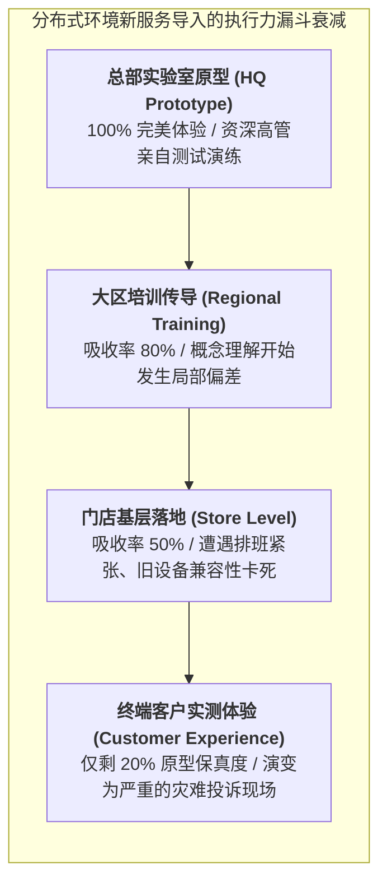

# Lec 10 分布式环境下的新服务导入（Introducing a New Service in a Distributed Environment）

## TL;DR

- 在分布广泛的连锁网点导入新服务（NSD），面临极高的流程执行衰减与多节点组织协同失调风险。
- 新服务开发（NSD）经典四阶段周期（战略定位、服务概念化、服务蓝图工程设计、全网试点与复制）确立了严密的导入管线。
- 全网推行策略必须在“大爆炸全面铺开（Big Bang）”与“阶梯式渐进试点（Phased Pilot Rollout）”之间权衡先发窗口与系统风险。

## 一、分布式网络导入新服务的“墨菲定律”与执行衰减

对于拥有成百上千家线下网点、分布式分支机构或特许加盟商的大型服务网络（如跨国商业银行网点、连锁快捷酒店、汽车售后维保体系、快递加盟网络），向全网推广一项看似微小的新服务（New Service Development, NSD）（如银行推出新的财富管理咨询服务、连锁快餐推出全新早餐烘焙产品线、快递网点推出上门冷链代收服务），往往是一场惊心动魄的系统灾难。

管理层最常经历的残酷现实是**执行力的逐级严重衰减（Execution Dilution）**：
- 总部服务设计团队在实验室中设计的流程极其优雅、体验惊艳，高管无不拍手称赞；
- 然而，当政策文件下发给全国 2000 家偏远分支网点时，经过区域督导、加盟商老板、店长直至一线轮班临聘人员的四层传导；
- 最终呈现在终端消费者面前的，往往是：设备不会操作、员工话术错漏百出、系统报错频繁导致大排长龙、客户体验严重翻车。

麻省理工学院 15.778 课程将分布式环境下的新服务导入，提升为一门融合了**系统工程、组织变革管理（Change Management）与控制理论**的高阶学问。

## 二、新服务开发（NSD）结构化生命周期阶段门禁

为了消除主观拍脑袋的随意性，卓越的服务企业必须建立严密的新服务开发（New Service Development, NSD）**阶段门禁体系（Stage-Gate Process）**：

1. **阶段 1：战略定义与可行性前瞻（Strategic Alignment & Idea Screening）**：
   - 审视该新服务是否契合企业核心战略定位。如果是经济型连锁酒店，盲目导入极其复杂的米其林法式下午茶，注定会因破坏运营节奏而死；
   - 评估分布式网络的现有基础设施（电力负荷、柜台空间、网络带宽）是否能够承载。
2. **阶段 2：服务概念化与微观选择验证（Service Conceptualization）**：
   - 明确新服务的核心“价值主张”，制定量化的成功衡量指标（如每单增量收益、操作增加工时上限）；
   - 开展小范围用户焦点小组与概念测试，避免闭门造车。
3. **阶段 3：服务工程化与服务蓝图设计（Detailed Service Engineering）**：
   - 绘制制造级的详细**服务蓝图（Service Blueprint）**，明确每一步动作的操作时间定额（SOP）；
   - 设计配套的软件拦截防呆机制与培训多媒体微课件；
   - 采购标准化的即插即用硬件设备包（Store-in-a-box）。
4. **阶段 4：现场试点与迭代调优（Pilot Testing & Optimization）**：
   - 严禁在全网直接一次性上线！选拔 5-10 家具有代表性的典型门店开展封闭实战演练；
   - 高管与设计团队必须常驻试点现场，用秒表记录每一个操作摩擦点，快速迭代修改 SOP。

## 三、推广落地策略对决：大爆炸全面铺开 vs. 阶梯式渐进试点

在完成试点验证后，企业在向全网成百上千家节点全面复制时，面临两大经典策略路线的抉择：

| 评估维度 | 大爆炸全面推开（Big Bang Rollout） | 阶梯式渐进推进（Phased Regional Rollout） |
| :--- | :--- | :--- |
| **推进逻辑** | 全国所有网点在指定日期（Day 1）同一时刻同时上线新服务 | 按大区、按城市等级分批推进（如第一批一线城市、第二批二三线） |
| **营销与公关爆发力** | **极致震撼**：全网统一广告轰炸，瞬间引爆全国消费者心智 | 相对平淡：无法展开全国统一的集中宣发，存在信息传播时差 |
| **系统性试错风险** | **极度高危**：一旦隐藏的软件 Bug 或流程硬伤爆发，全国瞬间瘫痪 | **高度可控**：前批次暴露的问题可以在后续批次中以低成本平滑修复 |
| **组织支援资源承载** | **严重承压**：总部 IT 运维与督导专家被全国求助电话瞬间淹没 | **从容自如**：精锐特种巡检组可以全程驻场护航每一批次的点亮 |
| **适用业务场景** | 强网络效应产品、极易被竞对迅速抄袭的前沿功能（抢占先机） | 涉及复杂重资产工装改造、员工技能变动极大的重型服务体系 |

::: example [全球顶级快餐巨头早餐全日化（All Day Breakfast）的惊心导入战]
某全球快餐巨头决定将原本仅在上午 10:30 前供应的早餐，推行为“全天候 24 小时供应”。这一看似简单的服务变更，在车间现场却是一场工程地震：
后厨的烤炉与煎板面积是固定的，煎炸薯条与煎烤牛肉饼的温度设定完全不同于煎鸡蛋与英式松饼；在午高峰时段如果强行同时制作汉堡与松饼，极易导致交叉污染与出餐延迟。
公司成立了专属工程特种部队，首先在 3 个中等城市的 50 家餐厅秘密试跑 6 个月。工程团队通过研发专用的“模块化分体磁吸煎蛋环”与微波热风组合炉，重新规划了后厨动线，将换温时间压缩至秒级。在确保午高峰出餐时间毫秒不差后，才在全美一万余家门店成功推广，单项新服务导入为全集团拉动了 **5.4% 的同店销售超额增长**。
:::

## 我的理解

新服务导入是检验一家企业跨层级组织执行力的终极熔炉。

1. **尊重一线工人的物理与认知极限**：总部的产品经理坐在空调办公室里画出的流程，往往假设工人是永远不知疲倦、记忆力超群的精密机器人。当你在现场看到柜台员工一边要接听外卖电话、一边要向顾客赔笑脸、还要在复杂的收银机屏幕上翻找三层子菜单才能找到新服务的按钮时，你就会明白为什么新服务会推行失败。把前台操作界面做得极其简单、让傻子都不会按错，是新服务导入的第一法则。
2. **试点阶段必须寻找“最差的门店”测试**：许多管理者做试点时，喜欢挑选全公司业绩最好、店长最精明的旗舰店去做测试，结果自然是一片大好。这是自欺欺人。真正高水平的压力测试，必须把新流程扔到那些员工流动率最高、设备最老旧、客流量最大的地狱级网点去试跑。如果在这类恶劣环境中系统依然能顺畅跑通，全网推行才能真正做到万无一失。
3. **推行新服务必须伴随旧流程的退役（Pruning）**：许多平庸的企业只知道不断向基层推销“新考核、新服务、新标准”，却从来不清理那些十年前遗留下的僵化老单据。一线员工的注意力带宽是有限的。每导入一项新服务，必须强制在基层废除一项冗余的老汇报流程，唯有保持组织呼吸的新陈代谢，新服务的幼苗才能茁壮成长。
