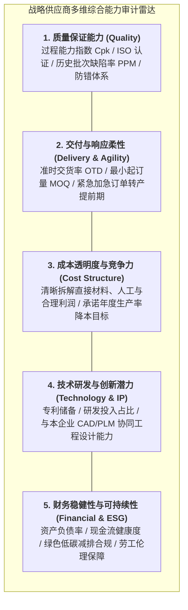

# Lec 12 供需匹配：战略采购与外包决策（Matching Supply and Demand: Procurement and Outsourcing）

## TL;DR

- 战略采购是实现全系统供需精准匹配的源头阀门，绝非单纯被动的行政压价询比价。
- 卡拉杰克矩阵与总拥有成本（TCO）模型，为跨越单纯采购单价、全息评估供应链全生命周期摩擦提供了量尺。
- 柔性供应契约（数量弹性契约、收益共享契约、回购契约）能够有效消除双重边际化效应，达成系统级协同共赢。

## 一、战略采购（Strategic Sourcing）的范式革命

在过去的传统工业管理观念中，采购部门（Purchasing Department）往往被视为组织层级中地位低下的后勤支持职能：每天的工作就是接收工厂各车间提报的缺料申请单，随后向老供应商打电话压价催货、走审批报销流程。

麻省理工学院 15.778 课程确立了现代采购的战略高度：**在外部供应链占据产品 BOM 成本 70% 以上的今天，采购是决定企业最终供需匹配敏捷度、产品创新先机与抗风险韧性的战略咽喉**！

::: definition [战略采购（Strategic Sourcing）]
战略采购是一个全面、结构化且持续循环的业务流程。它立足于企业长期竞争战略，深入分析企业内部各项物资与服务的全生命周期支出需求，深入洞察外部全球供应市场的技术壁垒与竞争格局，通过选拔、培养、深度协同战略供应商并重塑交易契约，实现全系统总价值的最大化获取。
:::

### 传统被动采购 vs. 现代战略采购的核心范式对决
| 比较维度 | 传统战术采购（Tactical Purchasing） | 现代战略采购（Strategic Sourcing） |
| :--- | :--- | :--- |
| **首要目标** | 压低当期的账面采购单价（Unit Price） | 最小化全生命周期总拥有成本（TCO）与保障供应连续性 |
| **供应商关系** | 对抗式、零和博弈、频繁比价转单压榨 | 深度协同、长期共赢、联合研发、资本与技术绑定 |
| **研发介入时机** | 产品全部定型画完图纸后（过墙投掷） | 在产品概念初期即推行供应商早期介入（ESI） |
| **信息共享水平** | 高度保密防备、黑盒博弈、仅传递采购订单 | 供应链数据打通、公开透明成本核算（Open-book Costing） |

## 二、供应商全生命周期选择与综合评估雷达模型

战略寻源的核心决策是选拔合格的长期战略伙伴。企业必须建立超越单纯价格考量的**多准则加权评估雷达模型（Multi-Criteria Supplier Evaluation）**。在传统的招投标实践中，采购经理往往容易陷入“唯最低报价者中标”的短期陷阱，从而招致后期漫长严重的交期延误、次品返工、隐性工程变更索赔等巨额综合损失。

为系统化规避这一逆向淘汰困局，现代企业普遍采用五维能力评价体系，对潜在供应商进行全方位的资信穿透与现场实地验厂审计。每个评估维度均设有严格的量化 KPI 和硬性红线指标，并根据所属行业的业务特征分配动态权重系数（如在高科技制造行业，技术研发潜力与交付柔性权重通常高于常规原材料行业）：

通过层次分析法（AHP）与加权评分矩阵，企业能够客观识别出哪些供应商仅仅是善于报低价但后期频繁烂尾的“价格投机者”，哪些是真正能够陪伴企业共同攻克技术难关的战略级中流砥柱。在实际运营中，企业应当建立供应商分级分层管理制度（Tiered Supplier Management）：对于评分处于顶尖梯队的前 10% 核心供应商，授予免检入库、战略优先付款与联合产品定义特权；对于评分居中的供应商实施定点赋能与精益生产帮扶；对于落后供应商则启动整改倒计时或双寻源（Dual-sourcing）分流替换。

## 三、供应链契约机制（Supply Chain Contracts）与双重边际化根除

在分散式供应链博弈中，独立供应商与独立采购方各自追求自身当期利润最大化，必然导致著名的**双重边际化效应（Double Marginalization）**——供应商在边际成本上加价批发，采购方在批发价上再次加价零售，最终导致终端产品售价过高、全系统销量萎缩、全网总利润低于集中一体化系统的最优总利润。

现代运筹学设计了一系列精妙的**供应链协同协调契约（Coordinating Contracts）**，从机制上消除双重边际化摩擦：

1. **回购契约（Buy-Back Contracts）**：
   - 供应商向零售商承诺：销售季节结束后，以约定的残值折扣价格 $b$ 回购零售商未售出的全部滞销存货；
   - **机制效果**：显著降低了零售商承担的过估滞销风险（Overage Cost），激励零售商大幅增加订货量，使全网总库存逼近系统全局最优库存水平。
2. **收益共享契约（Revenue-Sharing Contracts）**：
   - 供应商以极低的、近乎边际成本的优惠单价 $w$ 向零售商供货；
   - 作为交换条件，零售商同意将终端销售所得总营业额的固定比例（如 20%-30%）自动反向分流给供应商；
   - **机制效果**：彻底消灭了双重加价，双方利益休戚与共（Blockbuster 录像带出租连锁曾借此机制彻底解决热门大片供不应求的世纪难题）。
3. **数量弹性契约（Quantity-Flexibility Contracts）**：
   - 采购方提前给出预测，在实际交货前允许在约定的百分比区间（如 $\pm 20\%$）内自由向下调整或向上追加采购量；
   - **机制效果**：以契约形式在供应链上下游之间公允分担了市场需求波动风险。

::: example [全球顶级消费电子巨头实施收益共享契约的飞跃]
某智能穿戴设备品牌在推出全新智能手表时，传统供应商因担心滞销，要求每块主板收取 80 美元刚性高价，导致整机定价高企、首月销量惨淡。
公司与核心代工厂签署了创新的收益共享契约：主板供货价格下调至 55 美元保本价，同时将手表未来三年订阅健康云服务的软件服务费的 15% 长期分流给该供应商。代工厂为了获取长期软件分红，甚至自费追加了自动化测试夹具以保障主板长效可靠性。最终整机售价下调引发市场井喷，双方在硬件与软件后向收益中均获得了远超传统模式 **3 倍以上的超额纯利润**！
:::

## 我的理解

战略采购与外包决策，是商业世界中最具艺术感的契约博弈工程。

1. **便宜是世界上最昂贵的东西**：在采购招标中，单纯因为某家供应商报价便宜了 5% 就盲目定标，是初级采购员最常犯的幼稚病。如果这家低价供应商在量产时频繁良率崩塌、交期延误两周、或者售后发生批量索赔，你为此付出的停线损失与商誉减值，往往能买下整座供应商工厂。算清 TCO 的全账本，是战略采购的第一职业操守。
2. **契约设计决定了系统博弈的走向**：查理·芒格曾说：“告诉我激励在哪里，我就能告诉你结果在哪里。”如果你给供应商的合同是纯粹的计件单价合同，供应商就必然会在材料隐蔽处想方设法偷工减料；唯有通过收益共享、长期阶梯量产返利等机制，让供应商的长期繁荣与你的产品成功深度捆绑，你才能收获真正的工程同盟军。
3. **核心机密牢牢掌控，边缘物料充分竞争**：在外包决策中，永远保持清醒的战略定力。对于直接承载你产品差异化灵魂的核心 IP 与关键算法，哪怕自制成本高昂也必须牢牢自研自控；对于市场上完全充分竞争的螺栓、机箱与通用芯片，充分利用全球采购杠杆激进压低成本。抓大放小，方能成就敏捷商业帝国。
