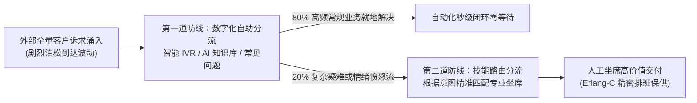

# Lec 13 供需匹配：客户界面管理与呼叫中心（Matching Supply and Demand: Managing the Interface - Call Centers）

## TL;DR

- 客户联络界面是企业连接外部随机需求与内部确定性运营系统的动态压力阀门。
- 经典爱尔朗排队模型（Erlang-B 阻塞系统与 Erlang-C 延迟系统）为量化客服人工坐席配额提供了精密数学工具。
- 通过智能交互式语音应答（IVR）、技能路由与多渠道数字自助分流，实现对突发话务洪峰的柔性吸纳与分层削峰。

## 一、客户接触界面（The Interface）：系统与人类对话的交界处

在现代数字化企业、互联网巨头、商业银行与全渠道零售体系中，运营系统并不是深埋在封闭保险箱里的静态资产。企业必须通过一个庞大而敏感的窗口，全天候 24 小时面向全球数以千万计性格各异、情绪不可预测的真实人类客户开放。

这个窗口就是**客户联络界面（Customer Contact Interface / Call Centers / Digital Helpdesk）**。

客户界面在企业运营体系中扮演着极其关键的双重角色：
1. **它是外部未驯服随机需求的吸收前哨**：客户的咨询、催单、改签、投诉与退货诉求，像潮水一般以离散泊松流的形式涌向联络界面；
2. **它是企业运营故障与延误的第一受压器**：后方工厂停工一天、仓储发货延误两小时、或者软件出现一个支付 Bug，所有下游灾难都会瞬间以成千上万通电话、工单和在线留言的形式，如海啸般集中拍打在客户界面的坐席代表身上。

如果客户界面缺乏精密的运筹设计，联络中心将瞬间陷入“电话打不进、排队半小时、客户破口大骂、客服批量辞职”的系统性瘫痪。

## 二、经典爱尔朗排队模型（Erlang Models）的数学推导与定额配算

为了科学配置呼叫中心的人工坐席数量，运筹学家依托丹麦数学家阿格纳·克拉鲁普·爱尔朗（Agner Krarup Erlang）在 20 世纪初开创的电话排队理论，建立了严谨的工程度量模型：

### 1. 系统基础参数定义
- $\lambda$：单位时间内的外部平均呼叫到达率（Calls per hour/second）；
- $1/\mu$：人工坐席处理单通电话的平均处理时长（Average Handling Time, AHT，包含通话时长与事后工单整理时间 ACW）；
- 系统名义流量负荷（Traffic Intensity，单位：爱尔朗 Erlangs）：
  $$A = \frac{\lambda}{\mu}$$

### 2. 爱尔朗 C 公式（Erlang-C / $M/M/s$ 延迟排队系统）
在允许客户无限排队等待接听的理想客服系统中，若配置了 $s$ 个并行的人工坐席（必须满足 $s > A$ 以保证系统稳态可收敛）。
新呼入电话**必须进入队列排队等待的稳态概率 $P_c$** 由著名的爱尔朗 C 公式给出：

$$P_c(s, A) = \frac{\frac{A^s}{s!} \frac{s}{s - A}}{\sum_{k=0}^{s-1} \frac{A^k}{k!} + \frac{A^s}{s!} \frac{s}{s - A}}$$

由此推导系统核心服务水平指标：
- **平均排队等待时长（Average Speed of Answer, ASA）**：
  $$\text{ASA} = \frac{P_c(s, A)}{s\mu - \lambda}$$
- **符合特定服务协议（SLA）的概率**（例如等待时间不超过 $T$ 秒的比例）：
  $$\mathbb{P}(W \le T) = 1 - P_c(s, A) \cdot e^{-(s\mu - \lambda)T}$$

::: example [航空公司客服中心旺季坐席扩容测算]
某航空公司客服热线在春节前夕，预计上午高峰期每小时涌入 1200 通改签电话（$\lambda = 20$ 通/分钟）。客服代表平均处理每通电话需 3 分钟（$\mu = 1/3$ 通/分钟）。
- 系统基础交通负荷为 $A = \lambda / \mu = 20 / (1/3) = 60$ Erlangs。
这意味着系统即使在没有任何排队等待的理想乌托邦状态下，也至少需要 60 名坐席处于全负荷说话状态！
若管理层仅排班 62 名坐席，代入公式计算可知，电话排队概率 $P_c$ 高达 78%，平均等待时间长达 4.5 分钟；
而当管理层依据 Erlang-C 公式将坐席适度追加至 **68 名**时，排队概率骤降至 18%，85% 以上的电话能够在 20 秒内被秒级接听！仅仅多招募 6 名坐席（人力成本微增 9%），就换来了全系统体验从崩溃到卓越的质的飞跃。
:::

## 三、现代交互式语音应答（IVR）与全渠道分流架构

单纯依靠增加人工坐席来抗击话务洪峰，在财务上是不可持续的。现代客户界面管理的核心战役在于**构建智能分流分级的全渠道防洪大堤**：

1. **交互式语音应答（IVR / 智能语音导航）**：
   - 传统按键式 IVR（“查话费请按 1，宽带报修请按 2……”）由于层级深、操作繁琐，常年被用户深恶痛绝；
   - 现代自然语言处理（NLP）语音导航允许客户直接说出“我想要退款上周买的机票”，算法在 0.5 秒内精准识别意图，并在后台知识库中检索自愈方案，将超过 60% 的基础高频咨询在进入人工队列前完全拦截在数字自助层。
2. **基于技能的智能路由（Skill-Based Routing, SBR）**：
   - 打破传统所有客服排大长队的单一水池，构建高维技能矩阵。VIP 钻石卡客户直接路由给专属资深顾问，发生大额扣费争议的客户直接路由给具备退款授权的高级专员，实现首问解决率（First Contact Resolution, FCR）的最大化。
3. **全渠道异步平移（Channel Shifting）**：
   - 当检测到电话线路严重拥堵时，IVR 语音向客户建议：“当前电话排队较长，我们已向您的手机发送了一条专属企业微信链接，点击即可与在线专属客服图文沟通并发送截图，无需在线等待。”将同步强占用的电话流平滑分流至多并发的文本客服渠道。

::: pitfall [盲目设立 AI 机器人阻拦人工的“恶心用户陷阱”]
一些企业为了极致压缩客服人力成本，在 App 里布设了极其弱智的自动回复机器人，并隐蔽甚至彻底取消了“转人工客服”的所有入口。用户无论输入什么都只能收到驴唇不对马嘴的官方套话。这种把客户界面当成“防贼隔离墙”的做法，不仅无法降低成本，反而会在社交媒体上引发全网口诛笔伐，彻底摧毁用户对品牌的底层信任。
:::

## 我的理解

客户界面管理与呼叫中心运营，是技术理性与人文关怀的最深交汇点。

1. **呼叫中心的坐席是企业最重要的传感器**：在许多公司，呼叫中心被边缘化为偏远外包基地，客服每天记录下的客户痛点反馈从来没有传达到产品经理和高管的桌上。伟大的企业把呼叫中心视为组织最敏感的神经末梢。每一个客户打来的抱怨电话，都在为你免费指出系统中最致命的漏洞。建立从客服录音直接推送到研发周会的“故障溯源直通车”，能让企业产品以惊人的速度完成自愈进化。
2. **Erlang-C 公式对非线性临界点的敬畏**：在排队系统中，负荷与排队时长的关系不是平缓的斜坡，而是带有悬崖效应的急转弯。当负荷 $A$ 逼近坐席数 $s$ 时，多一名坐席就能让等待时间腰斩，少一名坐席就能让系统直接瘫痪发散。做运营容量规划，必须熟练掌握排队论的数学推导，绝不能凭主观感觉随意砍掉那几个至关重要的关键冗余编制。
3. **情绪价值无法被冰冷的机器完全替代**：尽管大语言模型与智能语音 Agent 已经能处理 90% 的标准工单，但在客户遭遇航班取消导致无法见病危亲人最后一面、或者遭遇大额电信诈骗恐慌无助的极端时刻，冰冷的算法只会让客户感到绝望。保留温情脉脉、具备高度共情能力的人工高级坐席通道，是企业在数字冰冷时代保卫商业文明底线的最后灯塔。
