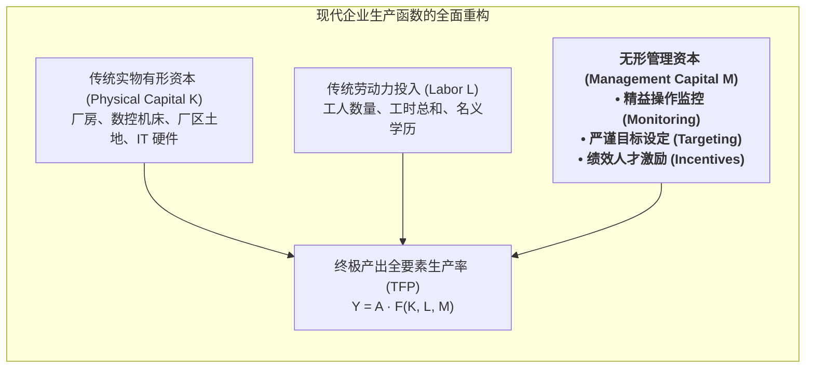

# Lec 14 管理资本的力量与无形资产溢价（The Power of Management Capital）

## TL;DR

- 布鲁姆与范里宁（Nick Bloom & John Van Reenen）开创了量化管理资本（Management Capital）的世界级微观实证范式。
- 跨国跨行业大数据实证表明：同一行业内部不同企业之间高达数倍的生产率离散（Productivity Dispersion），核心源于管理实践水平的鸿沟。
- 严谨的目标考核、基于绩效的人才激励与精益运营流程监控，共同构成了支撑企业长期超额全要素生产率（TFP）的无形资本护城河。

## 一、生产率的世纪谜题：为什么同一行业企业差距如此巨大？

在经典的微观经济学理论中，存在一个著名的完美市场假说：如果两家处于同一个完全竞争行业中的制造企业，拥有完全相同的先进数控机床、购买相同价格的大宗钢材原材料、甚至招募相同学历背景的工人群体，那么根据生产函数理论，这两家企业的生产率与盈利能力应当迅速收敛一致。

然而，近半个世纪以来全球宏观经济学家面对的残酷实证事实却是**惊人的生产率离散度（Huge Productivity Dispersion）**：
- 在美国、日本、德国乃至中国，在完全相同的细分行业（如纺织、汽车冲压、甚至标准轴承制造）内部，**排名前 10% 的顶级企业其全要素生产率（TFP），往往是排名后 10% 企业的 2 至 3 倍以上！**
- 顶尖企业用相同甚至更少的资本和工人工时，生产出了数倍于平庸企业的优质产品，并且这种超额盈利优势能够持续稳定保持数十年而不被抹平。

斯坦福大学尼古拉斯·布鲁姆（Nicholas Bloom）与伦敦政治经济学院约翰·范里宁（John Van Reenen）在发表于《Quarterly Journal of Economics》等顶级期刊的划时代实证研究中，揭晓了这个世纪谜题的终极答案——**管理资本（Management Capital）作为一种无形战略生产要素的独立存在**！

## 二、世界管理调查（WMS）三大维度的严谨量化度量

布鲁姆与范里宁最伟大的学术贡献，在于彻底打破了管理学以往“纯讲故事、靠大师直觉”的玄学传统，发明了全球通用的**世界管理调查评估体系（World Management Survey, WMS）**，对数万家企业的管理实践进行双盲量化打分（1 至 5 分标准化量尺）：

### 1. 运营过程监控与持续改善（Operations Monitoring）
- **低分特征（1 分）**：车间没有看板，没有定期质量数据统计，出了问题完全靠运气排查，对设备故障毫无记录；
- **高分特征（5 分）**：建立全息端到端实时指标监控，推行基于数据的根本原因追踪（5 Whys），持续改善（Kaizen）成为全员本能，管理层用闭环跟踪代替口头批评。

### 2. 严谨目标设定与逻辑分解（Target Setting）
- **低分特征（1 分）**：目标完全脱离实际（如高管拍脑袋要求“明年利润翻五倍”），各部门目标相互冲突，仅考核孤立的短期财务指标；
- **高分特征（5 分）**：推行科学的平衡计分卡（BSC）与 OKR，将顶层战略层层拆解为车间可执行的端到端量化指标，兼顾短期交付与长期研发，目标具备合理挑战性且全员深度理解。

### 3. 绩效挂钩的人才激励机制（Incentives & People Management）
- **低分特征（1 分）**：论资排辈、铁饭碗、大锅饭，干好干坏一个样，冗员无法劝退淘汰；
- **高分特征（5 分）**：实行严谨透明的绩效考评机制，奖惩分明；对顶级骨干提供具有行业竞争力的丰厚股权与晋升通道，对长期不胜任者提供体面的退出和转岗机制。

::: definition [管理资本（Management Capital）]
指企业内部沉淀并固化在标准作业流程、日常管理纪律、绩效评价规则、组织信任文化与数据驱动决策机制中的无形知识资产。管理资本具有极高的资产专用性与路径依赖性，竞对无法通过在公开市场上砸钱采购而瞬间获取。
:::

## 三、印度纺织厂随机对照双盲实验（RCT）的铁证

为了彻底反驳怀疑论者“到底是优秀管理带来了高利润，还是有钱的大公司才有闲钱搞管理”的互为因果质疑，布鲁姆团队在印度孟买开展了运筹管理学历史上最具震撼力的**随机对照实地双盲实验（Randomized Controlled Trial, RCT）**：

- **实验设计**：研究团队选取了 28 家规模庞大但管理原始的印度大型家族纺织集团工厂。随机将工厂分为两组：
  - **实验组工厂**：由埃森哲资深精益运营专家入驻 5 个月，手把手协助导入最基础、最朴素的标准管理实践（车间划线 5S、每日工时质量看板、纱线批次追溯、机器预防性维护日历、缺陷返工统计表）；
  - **对照组工厂**：维持原样自发运行。
- **震撼的实验结果**：
  在仅仅实施了这些基础的管理工具后，实验组工厂在短短一年内：
  1. 织造布匹的质量次品缺陷率**断崖式下降了 50%**；
  2. 车间堆积如山的死库存在制品**减少了 40%**；
  3. 全厂综合产出产量**逆势跃升了 9.4%**！
  单厂平均年化净利润**净增超过 32.5 万美元**，而这对于人均月薪仅有两三百美元的发展中国家工厂而言是一笔不可思议的巨额财富。

::: example [全球知名跨国代工集团管理资本溢价变现实录]
某跨国电子代工巨头在收购东南亚数家濒临破产的本土老旧装配厂时，并未更换工厂里任何一台贴片机或冲压机。集团仅仅向各工厂派出了由 20 名资深精益黑带组成的“管理特种部队”，导入集团通用的统一管理操作系统（包含晨会看板、物料防呆追踪与全员提案系统）。
仅仅过去 18 个月，这批老旧工厂的平均综合设备效率（OEE）从原先的 52% 飙升至 **84%**，扭亏为盈创造了数千万美元的自由现金流。资本市场对该集团给出了远超同行的 3 倍市盈率（P/E）估值溢价，这正是华尔街对“管理资本”作为核心无形资产的最高商业奖赏。
:::

## 我的理解

Bloom 与 Van Reenen 的管理资本理论，是对所有技术崇拜者的重要思想补完。

1. **管理不是玄学，而是一门可以被严格度量的硬科学**：许多企业家喜欢在聚光灯下大谈“格局、情怀、心力”，把管理描摹得高深莫测。WMS 实证研究冷酷地证明：真正拉开企业生死差距的，恰恰是那些听起来极度枯燥无味的底层动作——车间每天有没有查良率？问题有没有追问 5 个为什么？表现最好的人有没有拿到对应的奖金？把最朴素的常识做到极致，就是最可怕的管理资本。
2. **硬件设备是可以用钱买到的，管理资本只能靠组织苦练**：如果一家企业以为只要斥资数亿元从德国或日本买回最顶级的全自动化机床，就能自动成为世界一流工厂，那注定会沦为笑柄。最昂贵的硬件如果配上清朝时期的官僚管理和麻木不仁的员工，机床只会以更快的速度产出高成本废品。软件与制度文化的重构，远比签发一张设备采购支票艰难千百倍。
3. **消除不良管理是全社会最大的经济红利**：在全球范围内，尤其是在广大发展中国家和传统制造业深水区，数以亿计的劳动力和数万亿的固定资产，正被极度糟糕、极度原始的管理实践严重糟蹋和浪费。向传统产业普及严谨的管理资本体系，其所能释放的人类生产力与财富潜力，丝毫不亚于发明一项全新的前沿黑科技。做一名卓越的运营管理者，本身就是对社会最大的价值创造。
