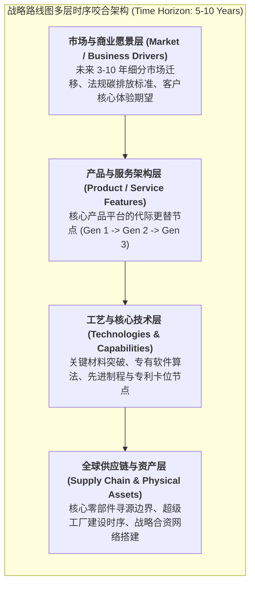

# Lec 15 供应链战略路线图与价值链设计（Supply Chain Road-mapping and Value Chain Design）

## TL;DR

- 战略路线图（Strategic Road-mapping）跨越时间视界，将顶层商业愿景与技术研发、工艺装备及供应链网络精准咬合。
- 价值链设计（Value Chain Design）确立了企业在“掌控核心咽喉”与“撬动外部专业分工”之间的战略分工架构。
- 通过系统解构核心能力的生命周期演进，企业能够提前预判能力空心化危机并在颠覆性技术前夜完成战略换道。

## 一、战略路线图（Road-mapping）：跨越时空的系统集成工具

在复杂的高科技制造、汽车产业、航空航天与大型基础设施建设中，一项重大系统级创新的落地，往往需要跨越 5 至 10 年漫长的时间跨度。如果企业缺乏长周期的全景规划，各个部门必然会陷入各自为政的混乱死锁：
- 市场营销部门答应了客户在 3 年后交付一款轻量化高续航产品；
- 研发部门却发现核心的新型复合材料至少还需要 5 年的实验室机理验证；
- 制造工程部门表示现有冲压机床根本无法加工该材料，需要重新向德国设备商定制，交付提前期长达 3 年；
- 采购部门则抱怨上游关键稀贵金属矿石尚未建立长期保供战略长约。

为了打破这种部门间的时空错配，麻省理工学院与剑桥大学制造研究院（IfM）共同倡导了现代企业最重要的战略工具——**技术与供应链战略路线图（Strategic Road-mapping）**。

路线图的核心价值在于：**在时间轴（Past - Present - Short Term - Long Term）上，强行构建四层维度的纵向共振与反向倒推**。

## 二、现代价值链设计的四大战略支柱

麻省理工学院查尔斯·法恩（Charles Fine）教授在《价值链设计》理论中指出，价值链设计不是一个静态的采购目录，而是企业最高领导层必须亲自操盘的顶级战略设计。其核心由四大支柱构成：

1. **选择价值链架构（Architecture: Integral vs. Modular）**：
   - 深入权衡产品是由高度耦合的一体化专有部件构成，还是由标准通用公模接口拼接而成？架构的选择直接决定了供应链上下游的协同复杂度；
2. **界定自制与外购边界（Make-or-Buy Boundaries）**：
   - 运用交易成本经济学与能力依赖矩阵，界定企业的核心护城河。凡是定义客户核心感知与关键专利控制点的要素，誓死自制；凡是标准化成熟商品，全力外包；
3. **规划全球供应网络拓扑（Footprint & Partner Selection）**：
   - 确定全球工厂网络与分销节点的空间地理分布，建立多层级的供应商金字塔协同机制；
4. **设计协作契约与关系治理机制（Relationship Governance）**：
   - 明确与关键伙伴是保持自由市场现货竞标，还是推行资本互持的深度技术联盟。

## 三、核心能力的生命周期衰减与动态能力置换（Capability Renewal）

企业高管在做价值链设计时，最容易犯的致命错误是“将能力视为永恒不变的静态资产”。哈佛商学院克里斯坦森（Clayton Christensen）与皮萨诺指出：**任何一项曾经让企业登峰造极的“核心能力”，最终都会随着技术的代际跃迁，异化为阻碍转型的“核心刚性（Core Rigidity）”**！

### 动态能力置换的战略节拍控制
卓越的价值链架构师必须具备冷酷的生命周期雷达：
- **在成熟业务顶峰期启动剥离**：当某项制造工艺（如内燃机精密齿轮磨削）逐渐走向标准化、市场上出现大量成熟代工厂时，管理层必须克服对既有折旧资产的情感留恋，果断将该环节推向外部外包代工；
- **提前 3-5 年向下一代控制点重注布局**：将腾挪出的宝贵现金流与工程精英，前置投入到下一代全新价值链控制点（如固态电解质材料研发、全线自研系统软件架构）；
- **跨越“能力的无人区”**：在老能力已经衰竭、新能力尚未完全实现经济量产的危险转换断层期，必须通过战略性合资伙伴（JV）或风险并购，构筑安全的过渡浮桥。

::: example [荷兰飞利浦集团（Philips）百年来三次战略路线图成功蜕变]
飞利浦在过去一个世纪的商业史上，完成了两次令人赞叹的价值链自我蜕变：
- 早期凭借白炽灯泡与照明帝国雄霸全球，在照明技术走向公模微利化前夜，提前布局电视机、半导体与消费电子（发明卡带式录音磁带与 CD 光盘）；
- 在消费电子沦为亚洲低成本代工红海前夜，飞利浦再次制定二十年战略路线图，果断剥离剥离半导体业务（分拆为恩智浦 NXP 并联合孵化台积电）、卖掉传统家电业务，将全集团价值链彻底重构为全球顶级的**高端医疗健康与精密影像科技科技帝国**。这种穿越百年周期的路线图规划力，是企业基业长青的教科书范式。
:::

## 我的理解

战略路线图与价值链设计，是高层管理者跨越日常琐碎、俯瞰未来的望远镜。

1. **路线图是动态指北针，而非刻舟求剑的死计划**：许多企业把制定战略路线图变成了形式主义的大工程，花半年时间写出厚厚一卷精装画册，随后束之高阁三年不看。真正的路线图必须是活的！它应当成为高管战略周会的背景看板，每当外部技术发生微小突破或竞品发布颠覆性功能，团队必须即时在路线图上平移或重写对应的时间节点。
2. **警惕能力空心化的温水煮青蛙**：在外包繁荣的时代，企业最容易不知不觉滑向“组装商”的平庸深渊。当你在做价值链设计时，如果发现全公司最聪明的工程师每天主要工作是向供应商催交进度、审核外部图纸，而内部已经没有任何一个人能在白纸上推导出底层参数机理时，你的核心能力就已经死亡。战略路线图必须强制预留用于内部自主硬核探索的自研领地。
3. **架构师的最高使命是为企业买时间**：在商业竞争中，没有永远安全的护城河。任何伟大的商业模式与制造壁垒，在历史的长河中都不过是争取到了 5 到 10 年的局部优势窗口。战略路线图的终极价值，就是在当前优势尚未完全破灭的宝贵时间窗口内，从容不迫地为你、为组织打造出下一艘能够远航的方舟。
