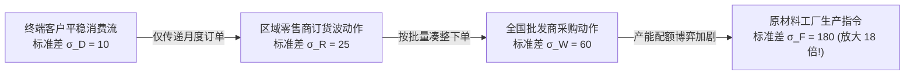

# Lec 16 信息的价值与供应链透明度（The Value of Information in Supply Chains）

## TL;DR

- 信息在供应链中具有等同于物理库存的真实对冲价值：信息越对称，系统所需物理安全库存缓冲越低。
- 端到端可见性（End-to-End Visibility）通过共享销售端 POS 真实扫码流水，从数学根源上击碎多级牛鞭效应。
- 企业间推行信息共享必须克服商业机密顾虑、寻租博弈与系统接口壁垒，确立公允的互惠数据契约。

## 一、信息作为供应链核心战略资产的崛起

在过去的传统供应链实践中，各节点企业之间普遍弥漫着深深的相互猜忌与保密文化：
- 零售商视自身的实际终端日销量数据为最高核心商业机密，坚决不对供应商公开；
- 供应商同样对自身的实际工厂在库库存与真实排产计划秘而不宣；
- 双方仅仅通过一张张滞后的“月度采购订单（Purchase Order, PO）”进行隔空喊话与零和博弈。

麻省理工学院 15.778 课程深刻指出：**在这种严重信息不对称（Information Asymmetry）的黑盒环境中，每一个节点都只能依靠猜忌去放大安全库存，导致全系统沉淀了数倍于实际所需的物理在制品，最终由整条链条共同承担巨额资金利息与滞销折价惩罚**！

::: definition [信息的价值（The Value of Information, VOI）]
指在供应链系统中，通过在上下游各节点之间实现实时、透明且高保真的需求、在途、库存与产能数据共享，相较于各自孤立决策模式所带来的全系统总库存持有成本降低、缺货率下降与准时交付率提升的净经济学价值。
:::

现代运筹学的数学推导严格证明：**信息与物理库存之间存在着完全等价的替换关系（Information Replaces Inventory）**。在极端假设下，如果你能以光速 100% 确定知晓未来每一个客户在何时何地需要什么产品，全系统的安全库存理论上可以直接归零！

## 二、牛鞭效应（Bullwhip Effect）的数学机理解构与信息根治

在多级供应链中，信息失真沿着链条向上游传递时，会产生令人瞠目结舌的非线性放大现象——牛鞭效应：

### 信息的终极解药机制
陈芳若（Fangruo Chen）与大卫·辛奇-利维（David Simchi-Levi）等学者推导证明，在两级供应链中，上游工厂面对的订货方差与下游零售商需求方差的关系满足：

$$\frac{\text{Var}(O)}{\text{Var}(D)} \ge 1 + \frac{2 L}{p} + \frac{2 L^2}{p^2}$$

其中 $L$ 为上游提前期，$p$ 为零售商预测更新所采用的时间滑动窗口宽度。

这一公式从数学底层揭示了：**只要下游零售商隐瞒真实消费数据，仅向上游发送加工后的订单序列，上游无论采用多么高级的时间序列预测算法，订货方差必然随着提前期 $L$ 呈二次方级暴增！**

消除这一灾难的唯一根本途径，就是推行**端到端数据穿透（POS Data Passthrough）**：
- 零售商将收银台扫码枪捕获的每一笔终端真实交易流水，通过标准 API 秒级直通共享给上游制造商；
- 制造商直接跳过批发商的月度订单噪声，直接基于终端最真实的消费脉搏安排工厂基础排产。

## 三、信息共享的技术与商业协同模式演进

在工业实践中，打通企业间的信息壁垒经历了三代重大技术与商业治理范式的跨越：

1. **第一代：电子数据交换（EDI, 1980s–1990s）**：
   - 基于专线网络传输标准化电子订单与发票（如 ANSI X12、EDIFACT）；
   - **局限**：专线部署费用高昂，小供应商难以承受，且仅限于点对点的静态批处理文件传输。
2. **第二代：供应商管理库存（VMI）与 CPFR（2000s）**：
   - **VMI（Vendor-Managed Inventory）**：沃尔玛将其所有门店与配送中心的实时货架在库数据对宝洁彻底开放，宝洁拥有沃尔玛货架的补货权与监控权，打破传统的采购下单流程；
   - **CPFR（Collaborative Planning, Forecasting, and Replenishment）**：上下游联合组建计划委员会，基于统一数据模型共同制定未来 12 周的主销售预测。
3. **第三代：云原生 API 驱动的供应链控制塔（Supply Chain Control Tower, 现代）**：
   - 跨组织、跨国家的端到端实时数据中台；
   - 实时汇聚海运轮船卫星 AIS 轨迹、港口清关卡口数据、工厂车间 MES 生产工单与电商前端加购流，算法在毫秒级内自动预测供应断链风险并触发多方案备用路由。

::: example [沃尔玛与宝洁（P&G）VMI 传奇的惊人商业收益]
沃尔玛与宝洁在 1980 年代末率先打通了全链路 EDI 与 VMI 系统。宝洁设在辛辛那提的排产调度中心，能够实时观察到全美每一家沃尔玛超市收银台刷过的一盒帮宝适纸尿裤。宝洁据此自动安排工厂卡车进行高频微量点对点直配。
这一信息透明革命创造了商业史上的双赢奇迹：
- 宝洁工厂的排产生产率提升了 30%，设备利用率大幅平稳；
- 沃尔玛货架的现货率维持在惊人的 **99.5%** 以上，而全网库存周转天数从原本的 40 天腰斩至 **18 天**，每年为两家巨头节省数亿美元的运营资金占用。
:::

## 我的理解

信息的价值与透明度理论，指明了现代智慧供应链进化的灵魂核心。

1. **信息孤岛是人为制造的系统自残**：在许多供应链联盟中，采购经理自作聪明地把终端真实销量当成筹码捂在手里，试图在谈判时给供应商“来个突然袭击”。这种短视的小聪明最终全会反噬到自己头上——供应商因为看不清未来，只能被动加价以对冲排产风险，最终所有的信息不确定性成本，全额被加计到了产品的到岸价格之中。真正的战略家懂得用透明换取供应商的极限配合。
2. **数据质量是信息价值的生命线**：许多企业投入数千万元采购了所谓的高大上“供应链控制塔系统”，但系统里显示的数据与车间现场实际物料相比，存在长达三天的时间延迟与 20% 的数量偏差。如果输入的数据本身就是过期的垃圾，算法再精妙也只能算出一堆垃圾指令。死磕数据源头的真实性、准确性与毫秒级时效，是数字化转型的第一底座。
3. **建立互信共赢的利益分享机制**：在推动供应商向你敞开数据大门之前，必须首先向对方证明“共享数据能为对方带来什么实质好处”。如果你拿到供应商的生产数据后，第一件事就是拿着人家的成本底牌去逼人家降价，这种背信弃义的行为将彻底扼杀未来的任何数字化协同。唯有以增量价值创造为导向、与伙伴公允分享效率红利，透明的生态网络才能基业长青。
