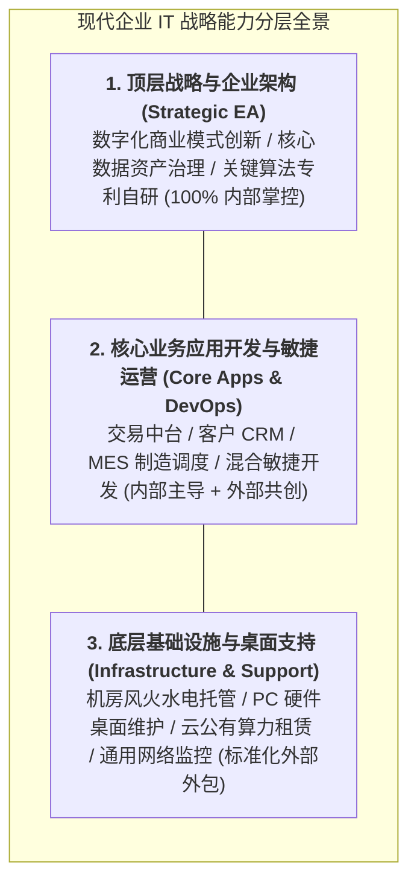

# Lec 17 IT服务管理：内部组织、供应商管控与外包（IT Services: Internal Organization, Vendor Management & Outsourcing）

## TL;DR

- IT 服务已从传统的辅助性行政工具，深度转变为驱动现代企业全链路运营的中枢神经操作系统。
- IT 外包决策必须在自建核心能力与外部专业化分工之间严谨权衡，防范技术锁定（Vendor Lock-in）陷阱。
- 服务等级协议（SLA）与多层级治理委员会构成了约束与激励外部 IT 服务商、保障系统高可用性的契约核心。

## 一、企业 IT 服务职能的历史性蜕变：从算盘后勤到战略引擎

在过去的半个世纪中，企业内部的信息技术（IT）部门经历了深刻的组织身份蜕变：
- **1970–1980 年代（电子数据处理 EDP 时代）**：IT 部门被锁在地下室的恒温机房里，地位相当于“超级电子打字机与算盘”，主要负责打印财务月度总账与工资条；
- **1990–2000 年代（ERP 与业务赋能时代）**：企业导入 SAP、Oracle，IT 部门成为落实业务流程标准化的重要职能支持部门；
- **现代（数字化原生与平台战略时代）**：**现代企业本身就是一家运行在代码之上的科技公司！**无论你是银行、航空公司、快运物流还是高端制造，核心的客户接触界面、全球排产算法、风险控制网关均完全由软件系统定义。一旦数据中心瘫痪或核心交易系统宕机，整家企业的全部实体商业营运将在瞬间陷入彻底休克。

这种战略蜕变向企业高管提出了严峻的组织挑战：**在软件吞噬一切的时代，企业内部究竟应当保留哪些 IT 核心编制？哪些非核心技术服务应当果断推向外部专业市场外包？**

## 二、IT 服务外包（IT Outsourcing, ITO）的战略权衡与锁定陷阱

20 世纪 90 年代，以柯达公司（Eastman Kodak）将全公司 IT 基础设施全盘外包给 IBM、DEC 为标志，全球掀起了轰轰烈烈的重型 IT 外包浪潮。许多传统企业渴望通过外包实现“一举甩掉沉重 IT 预算包袱、享受外部专业巨头规模经济”的梦想。

然而，随后的工业实践表明，超过一半的重型 IT 外包项目最终演变为旷日持久的商务纷争与技术灾难：

### 1. IT 外包的核心收益诱惑
- **资本支出转为经营支出（Capex to Opex）**：企业免去自建昂贵机房服务器的高额固定资产折旧，转为按使用量按月支付服务费；
- **接入全球顶尖技术人才池**：依靠埃森哲、IBM、Infosys 等外部专业服务商，快速获取前沿架构能力。

### 2. 致命的暗礁陷阱
- **技术供应商深度锁定（Vendor Lock-in）**：外部服务商往往使用其私有的封闭中间件与专有代码框架。五年合同到期后，企业发现内部已经没有任何一个人懂老系统的底层代码逻辑，想要转单或收回自建需要付出重写整套系统的毁灭性代价！
- **隐性变更成本黑洞（Creeping Scope & Change Orders）**：外包合同通常对基础维护界定严格。一旦企业业务部门提出一项微小的创新需求变更，外部服务商便会祭出天价的“变更工时账单（Change Request Fee）”，外包初期的账面节约迅速被无底洞般的变更开销吞噬殆尽；
- **敏捷响应能力被官僚合同阉割**：当业务部门需要 24 小时内快速上线一个促销功能时，外包流程需要经历商务谈判、合规审核、SOW 签署，耗时两个月，彻底丧失市场先机。

::: definition [选择性外包战略（Selective Sourcing / Smart Sourcing）]
现代成熟企业彻底摒弃了“全盘内建”或“全盘外包”的极端做法，推行精密的**选择性外包**：坚决将定义企业核心商业逻辑与独特竞争优势的“系统架构（EA）、核心算法代码与数据主权”牢牢自持；仅将标准化、大宗商品化的“底层云主机、物理网络链路与通用终端维保”通过严密契约推向外部市场。
:::

## 三、服务等级协议（SLA）与多层级治理委员会机制

在管理外部 IT 服务商时，合同文本的核心工程技术抓手是**服务等级协议（Service Level Agreement, SLA）**：

### 1. 核心量化 SLA 指标体系
- **可用性与宕机时长（Availability / Uptime）**：如核心交易系统必须达到 **99.99%（年度总非计划停机时间 < 52.6 分钟）**；
- **故障平均恢复时间（Mean Time to Recover, MTTR）**：P1 级致命故障必须在 15 分钟内启动应急响应，2 小时内完成业务容灾切流；
- **并发吞吐能力与端到端延迟（Latency）**：在秒级并发 5 万笔支付请求下，99 分位（P99）响应时间必须严格受控在 200 毫秒以内。

### 2. 赏罚分明的财务违约对冲机制
- **违约金挂钩（Service Credits）**：一旦服务商单月 SLA 未达标，直接按照阶梯比例在当月托管服务费中强制抵扣 10% 至 30% 作为惩罚；
- **超额达成阶梯奖励（Earn-back Mechanism）**：若服务商连续三个季度保持零故障且主动提出有价值的架构优化降本，返还历史抵扣金额并给予超额技术分红，激励服务商从被动背锅转向主动治理。

::: example [全球顶级快消零售帝国 IT 外包自救与重构实录]
某跨国零售巨头曾将其全球 ERP 与电商后台全盘打包外包给某印度外包巨头，签订了为期 7 年的 10 亿美元大单。三年后，由于外包团队人员流动率超 40%、代码混乱，导致黑五期间连续大崩溃，错失数亿美元销售额。
新任全球 CIO 果断启动“选择性收回自建战略（Insourcing Critical Core）”：在西雅图与深圳自建千人级内部数字工程中心，仅用 18 个月完全收回了核心用户中台、购物车与库存调度系统的源代码主权；外部服务商仅保留纯基础架构运维。重构后，系统平均发布周期从原先的 3 个月一次惊人地压缩至 **每周持续部署（CI/CD）**，黑五峰值平稳度过零故障。
:::

## 我的理解

IT 服务管理与外包决策，是技术掌控力与商业契约精神的结合。

1. **核心架构能力绝不可拱手让人**：如果一家企业的核心业务高度依赖数字化，那么企业的系统架构师就必须是领本公司薪水、对公司长期生死存亡负责的核心员工。你可以雇佣外部软件公司替你写通用的 CRUD 业务页面，但数据流向哪条总线、系统的容灾红线设在何处，必须由内部大脑亲自定夺。当一家公司连判断外部代码好坏的能力都丧失时，它就已经沦为任人宰割的技术殖民地。
2. **SLA 不是法务用来打官司的武器，而是系统可靠性的红线**：许多企业把 SLA 当成合同附件丢进保险柜，直到系统彻底瘫痪需要索赔时才翻出来找条款。这是典型的买椟还珠。真正的 SLA 必须被转化为后台持续运行的分布式自动化监控机器人（Prometheus / Datadog），全天候 24 小时用探针去探测服务商的真实性能。每一次微小的延迟抖动都要触发黄色预警，把系统性危机扼杀在亚健康状态。
3. **拥抱敏捷混合研发文化**：在现代快速迭代的商业世界中，传统按瀑布模型（Waterfall）签署固定工期、固定总价的重型外包合同早已过时。企业应当推行小步快跑的敏捷驻场混合兵团（Pod Model）：由内部产品经理与核心架构师担任指挥官，吸纳外部优质专业服务商的精锐工程师作为弹性雇佣兵，按双周冲刺进行价值交付与代码审查，才能在保证速度的同时牢牢守住代码质量底线。
