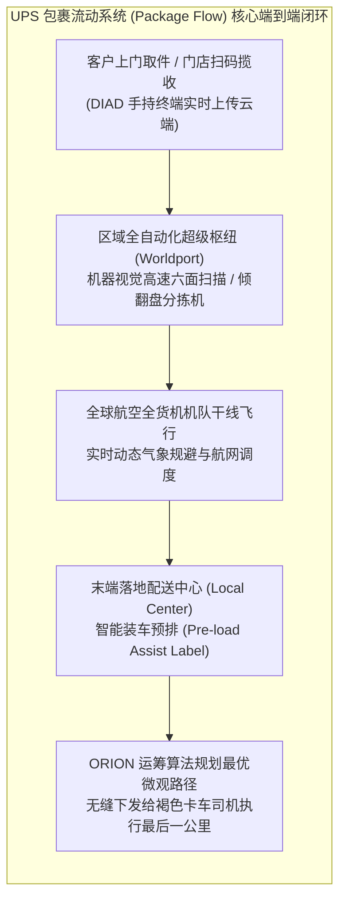

# Lec 18 供应链治理架构：UPS 物流项目剖析（Supply Chain Governance: UPS Project Analysis）

## TL;DR

- 联合包裹（UPS）百年发展史展现了以纪律、工业工程测时（Time-and-Motion）与高可用技术驱动的卓越运营范式。
- 包裹流动技术系统（Package Flow Technologies, PFT）与 ORION 运筹导航算法，重构了最后一公里微观路径排程的终极效率。
- 供应链治理架构（Supply Chain Governance）必须在集中化中央指挥调度与去中心化现场自主执行之间建立严密权责闭环。

## 一、UPS 百年运营传奇：工业工程（IE）的极致工业圣殿

在全球现代物流与供应链管理史上，联合包裹服务公司（United Parcel Service, UPS，又称“褐色巨人”）是一座屹立不倒的运营图腾。创立于 1907 年的 UPS，每天穿透全球 220 多个国家和地区，以极高的准点率与可靠性运送全球超过 2000 万件包裹，其每日包裹承运总货值占据全球 GDP 的 6% 以上！

深入解剖 UPS 的运营基因，其核心竞争力不在于拥有多么前卫的互联网光环，而在于将经典**工业工程学（Industrial Engineering, IE）与运筹学（OR）执行到了令人发指的极致境界**：
- **微观动作与时间研究（Time-and-Motion Studies）**：泰勒制（Taylorism）科学管理在 UPS 车间被发挥到极致。UPS 的工业工程师用秒表精确测算了卡车司机日常作业的每一个动作：司机下车前钥匙必须拿在哪只手、安全带单手扣合的标准耗时、手持扫码终端 DIAD 的佩戴角度、以及每分钟应当以每秒 2.5 英尺的匀速迈步等，均被编写为严苛的作业规范；
- **闻名世界的“避免左转”几何行车准则**：在北美靠右通行的交规下，卡车左转需要穿越对向车流，面临漫长的等待红绿灯与极高的碰撞事故率。UPS 通过运筹路径算法设计了举世闻名的行车路线——**卡车路径规划几乎全由顺时针右转组成**！仅仅这一项反直觉的路线优化规则，每年为 UPS 节省数千万加仑柴油，消灭了数万起潜在交通事故。

## 二、包裹流动技术（Package Flow Technologies, PFT）的系统革命

在 2000 年代初期，尽管 UPS 拥有世界上最敬业、最具纪律性的司机队伍，但系统面临着传统纸质分拣与人工记忆经验的极限天花板：
- 传统的卡车早间装车依赖经验丰富的老装卸工。老工人必须凭借自身大脑强记全城数百条街道名称，将包裹按先后顺序手工塞进深邃的货厢货架中；
- 一旦某位老工人退休或生病请假，新手装错货架位置，卡车司机在配送现场需要钻进漆黑的车厢翻找数十分钟，导致整条街区交付延误瘫痪。

麻省理工学院 15.778 课程深入复盘的著名工程实战，正是 UPS 斥资数十亿美元研发部署的**包裹流动技术系统（Package Flow Technologies, PFT）**：

1. **预装载辅助标签（Pre-load Assist Label, PAL）的技术重构**：
   - 当包裹运抵末端配送中心的自动化传送带时，智能打印机在 0.1 秒内为每个包裹贴上一张带数字编码的微型 PAL 标签；
   - 标签不再写复杂的客户地址，而是清晰打印形如 `R-14-3B` 的坐标编码（直接指示该包裹属于哪辆卡车、哪根货架、第几个物理隔板）；
   - 新手装卸工无需认识任何街道，只需像机器人分拣一样将包裹精准摆放在对应坐标货架上，装车错误率**断崖式下降了 90%**！
2. **手持信息分发采集终端（DIAD - Delivery Information Acquisition Device）**：
   - 司机的移动便携数字化大脑。集成了条码激光扫描、GPS 卫星定位、手机蜂窝数据通信与高灵敏电子签名屏；
   - 司机点击“妥投”的毫秒瞬间，全球货物追踪数据库与客户手机短信同步完成状态刷新，彻底消灭了纸质签收单的二次录入延误。

## 三、ORION 运筹算法与现代供应链治理架构（Governance）

在 PFT 系统的数字基座之上，UPS 历经十余年数学攻关，推出了被誉为运筹学历史上规模最大的商业算法工程——**车载一体化导航优化系统（On-Road Integrated Optimization and Navigation, ORION）**。

### 1. 超级旅行商问题（TSP with Time Windows）的工程破解
单辆 UPS 卡车每天需要在特定街区完成 120 至 180 次不等的停靠配送，且伴随着极其严苛的商业约束（特定商业写字楼必须在上午 10:30 前送达、特定住宅区要求下午下班后配送、中间随时穿插加急揽收任务）。
可能的行车路线排列组合数量是一个超过 $10^{150}$ 的天文数字（远超已知宇宙的原子总数）！ORION 运筹算法通过高阶定制元启发式算法（Genetic Algorithm & Large Neighborhood Search），在司机出发前仅用数秒钟即解算出满足所有时间窗口约束、且行驶里程与右转比例最优的巡回路线。

### 2. 供应链治理架构（Governance）的权责机制
UPS 的成功不仅是技术的胜利，更是其卓越的**治理架构（Governance Structure）**的胜利：
- **中央集权的标准与数据司令部**：全网所有飞行航线、车辆维修周期、算法参数由路易斯维尔（Worldport）与亚特兰大总部集中计算发布，消灭各地方分支各自为政的盲目微调；
- **现场一线的高度纪律化执行与合理反馈机制**：司机被赋予对现场不可预测突发路况（如道路施工、消防管爆裂）的手工绕行权，但所有绕行轨迹会被系统全量捕获，在当晚回传至中央算法库进行参数重新训练校准；
- **全员持股的合伙人文化基石**：UPS 长期坚持全员员工持股计划，一线司机与装卸工拥有公司大量股票分红权益。技术创新带来的燃油与工时节约，直接转化为员工个人退休金账户的增值，从根本上消除了工人对新技术的抵触与破坏心理。

::: example [ORION 算法落地带来的全球宏观震撼成效]
当 ORION 算法在全美 55000 条卡车配送路线上全面点亮后，其展现出的商业与环保威力震惊了全球物流界：
- 全美卡车行驶总里程每年直接**削减了 1 亿英里（约 1.6 亿公里）**；
- 每年为公司永久性削减燃油消耗超过 **1000 万加仑**，减少二氧化碳排放 10 万吨以上；
- 全年为 UPS 净节约经营运营开支超过 **4 亿美元**，成为运筹优化技术直接转化为巨额商业自由现金流的全球终极典范。
:::

## 我的理解

UPS 的物流项目与治理案例，为我们展示了将工程理性推向极致所能迸发出的神圣力量。

1. **常识做到极致就是绝招**：让卡车尽量右转、把包裹贴上货架坐标、让钥匙固定拿在左手……拆解开来看，UPS 的每一个操作规则都是那么朴实无华、毫无玄学。然而，当一家拥有数十万员工的庞大跨国巨头，能够数十年如一日把这成百上千个微小的常识以 100% 的纪律性在每一天、每一个网点严格执行到底时，所形成的综合效率壁垒就足以让任何竞争对手望洋兴叹。
2. **算法必须与现场人性达成和解**：在推进 ORION 系统初期，许多开了二十年车的老司机极度反感算法推荐的路线，他们愤怒地抱怨：“我在这里跑了二十年，闭着眼睛都知道哪条路最近，凭什么听电脑瞎指挥？”UPS 管理层没有简单粗暴地用行政命令惩罚司机，而是派出工业工程师坐在副驾驶陪司机跑完整条路线，用秒表和实测数据当面证明算法路线为什么能让司机提前半小时回家吃晚饭。唯有当一线劳动者深刻体会到技术是在解放他们、而不是在折磨他们时，数字化系统才能真正生根发芽。
3. **治理架构是一切重型工程的底座**：再聪明的算法如果没有配套的考核机制、没有全员利益分享的文化土壤，最终也只能沦为软件厂商交付后无人使用的死代码。把技术工具、流程标准、员工尊严与商业分红严密编织成一个有机生命体，这正是 UPS 留给现代运营战略学最宝贵的一课。
