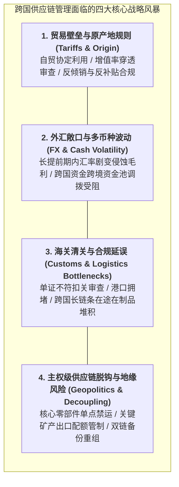

# Lec 19 供应链管理的国际化与跨国合规（Supply Chain Management: International Issues）

## TL;DR

- 跨国供应链管理必须直面关税壁垒、原产地规则（Rules of Origin）与进出口海关清关摩擦的多维治理挑战。
- 外汇汇率剧烈波动、跨国多币种结算与长周期在途存货，构成了侵蚀跨国运营经常性利润的隐性汇率风险敞口。
- 地缘政治对抗、实体清单技术禁运与强制环境碳审计（CBAM），迫使企业将主权级供应链合规与断链韧性提升至最高董事会日程。

## 一、跨越国界的供应链摩擦：从平面世界到高墙林立

在过去的全球化黄金年代，托马斯·弗里德曼（Thomas Friedman）宣称“世界是平的”，跨国企业高管习惯于在没有贸易摩擦的理想化假定下，自由调用全球各地的廉价劳动力与零部件。

然而，在当今世纪变局之中，跨国供应链管理面临的物理与法律环境发生了天翻地覆的剧变——**世界正在从平面走向碎片化的高墙林立**：
- **地缘政治博弈与贸易关税壁垒**：单边加征惩罚性关税（如中美贸易争端加征 25% 关税）、技术出口管制、实体清单（Entity List）精准制裁；
- **非关税行政壁垒（Non-Tariff Barriers）**：严苛的原产地穿透追溯、强制绿色环保与劳工准入认证、动植物检疫与技术标准互不相认；
- **物理跨洋运输的系统脆弱性**：红海航运危机导致商船必须绕行好望角、巴拿马运河极端干旱限行，单程运输提前期不可预测地拉长 2 至 4 周。

## 二、关税工程（Tariff Engineering）与原产地规则（Rules of Origin）

在跨国供应链网络设计中，企业不仅要懂运筹学，更必须精通国际贸易法与海关编码（HS Code）规则。现代跨国制造巨头普遍推行高度精密的**关税工程（Tariff Engineering）**：

### 1. 关税税率对产品物理解构的反向塑造
- 历史著名的“小板车税（Chicken Tax）”：美国对进口轻型货车征收高达 25% 的惩罚性关税，而对乘用车仅征收 2.5%。福特从欧洲向美国进口 Transit Connect 货车时，在欧洲工厂为货车后厢安装廉价的后排假座椅与假车窗（使其在法律上符合“乘用车”定义以 2.5% 税率清关）；运抵巴尔的摩港口后，工人在码头车间将假座椅拆下粉碎回收，瞬间变回货车销售！
- **HS 编码的微观微调**：通过微调零部件的集成度（例如将电路板与外壳分开进口，还是作为预装配半成品进口），其法定适用关税税率可能相差十几个百分点。

### 2. 原产地规则（Rules of Origin, ROO）与实质性改变原则
跨国贸易协定（如 USMCA 美墨加协定、RCEP 区域全面经济伙伴关系协定）普遍设定了严苛的享受零关税准入门槛：
- **区域价值成分（Regional Value Content, RVC）**：要求产品的总价值中，必须有特定比例（如 60%-75%）来自于协定成员国本土生产与采购；
- **税则归类改变标准（Tariff Shift Rule）**：非原产原材料在东道国必须经历具有实质意义的工业加工，使得最终成品的 4 位或 6 位 HS 编码发生不可逆的跳变，杜绝“单纯换个包装就贴标签洗产地”的违规套利。

## 三、跨国供应链外汇风险与主权级抗脆弱网络设计

在全球长链条采购中，从向海外代工厂下达采购订单、到漫长海运、再到最终在欧美商超完成终端货币结算，整个流程往往长达 6 至 9 个月。

### 1. 交易外汇风险（Transaction Exposure）的对冲
若一家美国企业以日元向日本供应商采购高精度减速机，在长达半年的提前期内，如果日元兑美元剧烈升值 15%，企业原本预留的微薄净利润将被汇率波动瞬间吞噬殆尽。
- **运营对冲（Operational Hedging）**：推行“收支自然对冲（Natural Hedging）”——在日本当地赚取日元收入用于支付当地供应商货款，避免频繁跨境换汇；
- **金融衍生品锁汇**：通过远期外汇合约（FX Forwards）、货币互换（Currency Swaps）与外汇期权，提前锁定未来采购交付日的法币兑换成本。

### 2. 主权级供应链“去单一化”与中国+1（China Plus One）战略
跨国巨头在后全球化时代的设施战略，已全面告别“将所有鸡蛋放在同一个篮子里”的单极化思维：
- **分布式双链对冲**：保留成熟完备的本土供应链超级枢纽以保障全球其他中立市场的成本竞争力；
- **在东南亚、墨西哥或中欧布局平行备份节点**：满足特定敏感地缘市场的本地化采购审查，构建能够随时跨厂切换模具与代码的全球模块化敏捷网络。

::: example [全球顶级半导体设备巨头跨国合规重构实战]
某全球光刻与半导体检测设备巨头，其供应链横跨荷兰、美国、日本与德国，包含上万家微观二级、三级供应商。面对近年来日益收紧的跨国技术出口管制与长臂管辖法规：
公司在全球法务与供应链中心设立了专门的“合规数字中台”。系统对设备中的上百万个零部件进行全生命周期溯源，精确标记每一枚螺栓、每一行控制代码的原产地国别与技术来源比例。当某国监管法规突然发布新的管制清单时，中台在数分钟内自动完成整机 BOM 的穿透排查，自动定位出受限模块并启动非受限中立替代供应商的准入认证，确保全集团全球交付网络在惊涛骇浪中保持绝对的法律与业务连续性。
:::

## 我的理解

国际供应链与跨国合规的研讨，让我们看到了真实商业世界中最复杂的系统博弈。

1. **没有合规就没有运营**：在当今世界，一个合规漏洞就足以让一家拥有千亿美元市值的跨国巨头在一夜之间遭遇全网停产与全球账户冻结。工程技术人员切忌沉醉在技术的象牙塔里、把法务合规当成繁文缛节。将原产地规则、出口管制清单与知识产权边界像公差约束一样，前置编入产品概念设计的系统架构之中，是现代全球化工程师的必修底色。
2. **算清全球化搬迁的隐性综合成本**：许多企业高管在面临关税压力时，头脑发热盲目将工厂全盘搬迁至某些欠发达国家。然而搬迁后他们痛苦地发现：当地港口效率低下、工人罢工频繁、电力经常短缺，不仅没有省下关税，反而多付出了两倍的供应链隐性摩擦成本。在决定重构全球工厂版图前，必须建立涵盖制度环境、法治成熟度与生态成熟度的系统化评估模型。
3. **保持开放与本土扎根的辩证统一**：真正的跨国运营大师，既具备调动全球资本、算力与最顶尖供应链的宏大视野，又具备在每一个涉足的国家深深扎下根去、与当地社区共享繁荣、尊重东道国主权法律的谦卑姿态。在多极化的未来世界中，唯有那些具备高度文化包容力、高合规确定性与全球分布式抗脆弱韧性的组织，才能穿越百年周期的地缘风暴。
