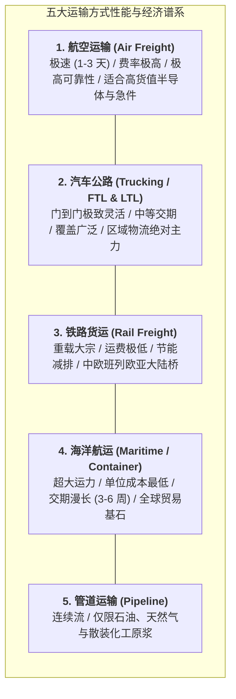

# Lec 2 供应链物流系统与实物交付（Supply Chain Management: Logistics）

## TL;DR

- 物流管理统筹运输、仓储、包装与装卸搬运四大实体支柱，是兑现供应链承诺的物理履约骨骼。
- 运力方式选择（海运、空运、铁路、公路）必须与货物单价货值（Value-to-Weight Ratio）进行严谨经济学匹配。
- 整车运输（FTL）与零担拼箱（LTL）的装载率优化，直接构成了降低干线单位物流成本的胜负手。

## 一、物流系统的四大功能支柱与物理网络形态

如果说战略规划是供应链的大脑，那么物流系统（Logistics Systems）就是将价值从蓝图转化为物理现实的肌肉与骨骼。物流绝不仅是简单的“叫一辆卡车拉货”，而是包含高度精密的系统工程：

1. **干线与支线运输（Transportation）**：跨大洲、跨省市的物料空间位移，解决时间与空间效用；
2. **仓储与节点流转（Warehousing & Material Handling）**：存货存储、动态拣选、包装与越库分拨；
3. **包装与防护工程（Packaging & Protection）**：单元化托盘包装、抗震跌落防护与绿色循环包装；
4. **逆向与循环物流（Reverse Logistics）**：退换货检测、有害废弃物回收与可复用容器闭环调度。

::: definition [物流管理（Logistics Management）]
物流管理是供应链管理的关键组成部分，专注于对商品、服务及相关信息从起始点到消费点的正向与反向流动及储存，进行高效率、低成本的规划、实施与严密控制，以满足客户的确定性交付需求。
:::

## 二、五大经典运输方式的经济学特征与价值重量比匹配

在物理运输决策中，企业必须在**速度、可靠性、运输费率（Freight Rate）与在途库存资金占用（In-transit Inventory Cost）**之间进行全局权衡：

### 价值重量比（Value-to-Weight Ratio）匹配黄金准则
决定是否应当采用昂贵空运的数学判据，取决于货物的**单位重量价值密度**：
- **超高价值密度品（> $100/kg，如先进制程芯片、高档奢侈品、抗肿瘤生物药）**：
  货物哪怕在货轮上海运颠簸延误一天，其产生的在途利息资金占用与市场跌价损失，就远超空运运费！理性的选择必须是**100% 采用全货机航空直配**；
- **低价值大宗商品（< $1/kg，如煤炭、水泥、大豆、铁矿石）**：
  运费在总到岸成本中占比超过 50%，必须坚决采用海运散货船或铁路集装箱大列，任何空运都是荒谬的财务自杀行为。

## 三、整车运输（FTL）与零担物流（LTL）的运营优化

在占据陆运绝对主导的公路运输中，核心管理战役在于装载模式的精益优化：

- **整车运输（Full Truckload, FTL）**：单家货主的单批次货物恰好装满整整一辆重型半挂牵引卡车。卡车从起点发车后直奔目的地，中途不经任何分拨中转。
  - **优势**：速度最快、几乎无倒装破损风险、单位吨公里运费最低；
  - **挑战**：要求企业具备大规模批量发货能力，否则会导致严重的“运空气（拉空箱）”浪费。
- **零担拼箱运输（Less-than-Truckload, LTL）**：单家货主的货量仅有几个栈板，无法填满整车。物流企业（如联邦快递、顺丰快运、中通快运）通过分布式的**集货中转站（Break-Bulk Hubs）**，将数百家不同货主的零星货物拼装进同一辆干线卡车。
  - **优势**：允许企业推行高频小批量发货，压缩两端工厂的在库积压；
  - **代价**：货物经历多次人工与叉车二次装卸分拣，运输交期拉长 2-3 倍，破损货损率大幅上升。

::: example [联合利华与宝洁的“协同拼车（Co-loading）”物流创新]
在欧洲成熟消费品市场，互为竞争对手的快消巨头联合利华（Unilever）与宝洁（P&G），曾面临共同的尴尬：向同一家偏远城市的家乐福配送中心送货时，双方各自派出一辆半空的卡车，装载率均只有 50%，运费居高不下。
两家巨头通过第三方中立物流平台达成协同物流协议：在前端始发仓对两家的洗发水与纸尿裤进行物理混装拼箱，直接将单车装载率提升至 95% 以上。这一创新每年为双方削减了数百万公里的空驶碳排放，干线物流费用直接**下降了 18%**。
:::

## 我的理解

物流系统是供应链的物理锚点，其运行规律受制于冷酷的经典力学与空间几何学。

1. **立方数比吨数更先见顶（Cube-out vs. Weigh-out）**：现代工业品越来越轻量化、体积膨胀化（如发泡包装的家用电器与膨化食品）。在排布卡车装载时，卡车往往在远未达到 30 吨法定核载重量上限时，车厢容积就已经被堆满塞爆（Cube-out）。优化工业品外包装的长宽高几何尺寸，使其能够像俄罗斯方块一样完美咬合国际标准托盘与货厢尺寸，能从源头上为企业节约几千万元的运输预算。
2. **在途库存同样是沉淀资产**：许多财务人员只把仓库里的货当成库存，对漂泊在太平洋上的集装箱视若无睹。根据利特尔法则，如果你的跨洋货轮航线常年维持 40 天周转，管道中沉淀的在途存货资产往往相当于半座大型工厂的全年产量。压缩物流运输时效，本质上就是盘活沉睡的流动资金。
3. **绿色低碳重塑干线竞争格局**：随着全球 ESG 披露与碳足迹核算的普及，传统重柴油卡车的高排放劣势正在被放大。推动“公转铁（公路向电气化铁路转移）”以及多式联运（Intermodal Transport），不仅是响应政策号召，更是规避未来高额碳关税惩罚的前瞻性战略护城河。
