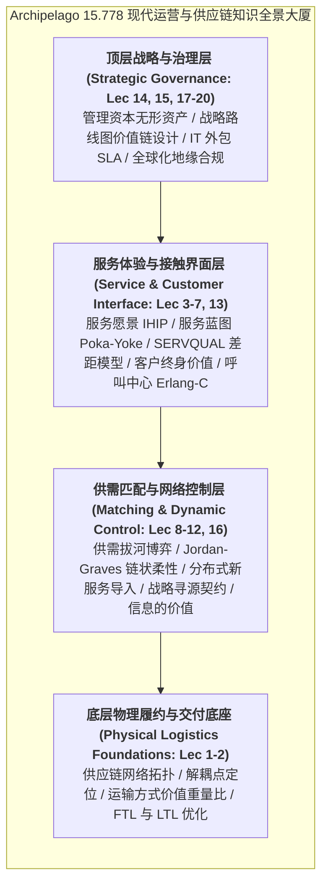

# Lec 20 全课程总结与未来前沿展望（Course Summary and Future Operations Frontiers）

## TL;DR

- 本课程 20 讲全景体系系统融合了现代物理供应链物流网络、服务运营体验设计与复杂系统运筹学数学理论。
- 供需匹配的永恒张力、信息替代物理库存的数学守恒律与追求卓越运营的组织习惯，构成了贯穿全课程的三大核心思想灵魂。
- AI Agent 驱动的自主供应链调度、数字孪生与全生命周期循环经济（ESG），共同指明了 21 世纪智能运营的最前沿进化方向。

## 一、15.778 知识体系大一统全景图谱回溯

纵览麻省理工学院 15.778 课程全学期的 20 次深邃探索，我们从物理制造业的供应链网络启程，横跨物流骨骼、服务愿景、服务接触蓝图、满意度差距、精益卓越体系，深入供需匹配的拔河博弈、呼叫中心排队论、管理资本实证，最终升华为战略路线图、信息价值、IT 治理与全球化跨国合规。

这 20 讲绝非分散孤立的技巧堆砌，而是共同构筑了一座逻辑自洽、层层递进的**现代产品与服务供应链运营大一统思想殿堂**：

### 贯穿全课程的三大永恒哲学灵魂
1. **供需匹配的永恒物理张力（The Eternal Balance）**：企业的所有商业动作，本质上都是在时间、空间、数量与品质四个维度上，化解供给端刚性惯性与需求端随机波动之间的摩擦；
2. **信息替代物理库存的数学守恒律（Information Replaces Inventory）**：无论是 Eppen-Schrage 的风险共担、MMFE 的预测鞅修正、还是准确响应的两阶段规划，其数学本质均在于**用高保真、低时延的信息流动，换取物理世界昂贵材料与重资产闲置的消减**；
3. **卓越是一种日常的组织习惯（Excellence is a Habit）**：从新乡重夫的原则驱动，到 UPS 卡车司机的秒级动作纪律，任何伟大的战略蓝图最终都要接受车间一线与服务柜台的人性检验。

## 二、21 世纪四大前沿颠覆浪潮与未来进化航向

站在当前数字化与智能化的历史十字路口，未来的首席运营官（COO）与供应链系统架构师，必须深刻理解正在重塑整个商业底层逻辑的四大前沿浪潮：

### 1. 人工智能与自主智能体（AI Agents）驱动的自治供应链
- **从离线批处理排程走向毫秒级实时自主博弈**：由多智能体协同网络（Multi-Agent Systems）自主监控全网物联网传感数据，在极端天气或工厂突发故障时，自主调用 API 在数秒内完成全球千万级订单的跨厂重新分流与最优运力再路由；
- **大语言模型（LLM）彻底重构第一级服务接触界面**：AI Agent 拥有全量产品技术手册与历史案例记忆，以充满人情味的温度秒级解答 90% 的复杂长尾咨询，彻底终结传统呼叫中心让客户苦等 20 分钟的历史耻辱。

### 2. 工业元宇宙与高保真数字孪生（Digital Twins）
- 物理工厂与全网物流管道在云端拥有 1:1 精确映射的虚拟数字孪生体；
- 任何一项工艺参数微调、新服务导入或生产线瓶颈扩容，首先在云端虚拟世界中模拟推演数万次，彻底消除物理试错所产生的数百万美元停产与模具报废损失。

### 3. 全生命周期闭环循环经济（Circular Economy & ESG）
- 供应链不再终结于“客户签收出库”。在严苛的全球碳足迹审计与绿色法规约束下，企业必须构建从“摇篮到摇篮（Cradle-to-Cradle）”的逆向闭环；
- 自动化无损拆解、关键稀贵金属高纯度提取与零部件梯次高价值再制造，成为衡量企业核心运营能力的关键生死指标。

### 4. 主权级供应链韧性与分布式微型工厂（Micro-factories）
- 依赖万里跨洋海运的单极巨型超级工厂时代正在让位于“近岸化、区域化、模块化分布式智能微型工厂网络”；
- 软件定义制造，云端分发数字图纸，本地利用柔性数控与 3D 打印即时制造交付，将人类文明的物质生产推向极致敏捷与极低碳排。

## 三、结语：致未来的系统缔造者与伟大组织的守护者

运营与供应链管理，绝非枯燥孤立的图表与报表，它是人类现代文明得以平稳运转的最伟大的隐形基础设施。

当黎明的太阳升起，全球数十亿人能够拧开水龙头喝到纯净的水、在便利店买到新鲜的食物、在医院得到先进药物的精准治疗、在手机上轻点屏幕便能收到来自大洋彼岸的创新硬件，其背后支撑的正是无数默默无闻的运营架构师、供应链调度员、车间技师与货车司机共同编织的宏伟交响乐。

愿每一位研读本课程的学子与实践者，始终对物理世界的客观规律保持敬畏，在战略决策中坚持系统全局最优，勇于深入车间与客户的最前线，用严谨的科学理性、卓越的系统工程与深沉的人文关怀，去构筑穿越风暴、造福人类社会的伟大组织与壮丽系统。

## 我的理解

走过这 20 讲的深邃旅程，现代运营与供应链管理重塑了我对整个现代社会运作逻辑的根本认知。

1. **看透繁华背后的精密齿轮**：在这个充满浮躁公关营销与概念炒作的时代，绝大多数人只看到了发布会上炫目的 PPT 和科技新词。而我们学会了穿透表象，去凝视那成千上万个在幕后默默咬合的齿轮——去审视它的提前期是多少天、它的瓶颈工序在哪里、它的 Erlang 排队概率几何、它的安全库存能否承受三次标准差的冲击。这种冷峻而清醒的系统穿透力，是我们终身受用的无价财富。
2. **在混乱中构筑确定性秩序的工程之美**：世界的物理本质是充满熵增与随机扰动的，市场会波动、机器会老化、员工会疲劳、天气会突变。平庸的人在混乱中抱怨命运，而顶级的系统工程师享受在混乱中通过精密的契约设计、优雅的算法路由与坚定的组织纪律，构建出一个充满自愈韧性、能够穿越惊涛骇浪的确定性系统。这种让混沌归于秩序的过程，蕴含着人类理性的最高美感。
3. **用实干重塑物理现实的浪漫情怀**：代码写得再优雅，最终要驱动真实世界的机械臂旋转；算法推导得再漂亮，最终要让一位远方的母亲准时收到急需的退烧药。把抽象的思想杠杆，精准投射进沉甸甸的物理世界，让每一个微小的动作都创造出真实的价值与温暖，这就是属于运营管理者永恒的浪漫与荣光。
