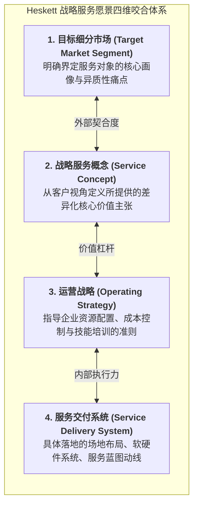

# Lec 3 服务愿景与核心服务特征（Service Vision and Characteristics）

## TL;DR

- 服务具有无形性（Intangibility）、不可分离性（Inseparability）、异质性（Heterogeneity）与易腐性（Perishability）四大根本属性。
- 战略服务愿景（Strategic Service Vision）构建了目标细分市场、服务概念、运营战略与交付系统的四维咬合框架。
- 服务不仅是无形劳动，而是通过结构化的“服务包”（Service Package）向顾客提供复合的情感价值与效用闭环。

## 一、服务与制造的本质区别：IHIP 四大根本属性

在长达一个世纪的工业管理发展中，管理理论主要围绕物理有形产品的制造装配（有形、可触摸、可离线生产检验）而构建。然而，在当今发达经济体中，服务业（金融、电信、医疗、咨询、软件与物流售后）占据了 GDP 的 70% 以上。

服务运筹学先驱将服务的物理与心理本质归纳为著名的 **IHIP 四大特征**：

1. **无形性（Intangibility）**：服务是行动、履约与体验，而非实物资产。顾客在购买前无法触摸或试戴，购买决策充满心理不确定性。服务企业必须通过“有形化展示（Tangibilizing the Service）”（如豪华整洁的营业厅、专业制服、清晰的合规资质挂牌）来传递可信度。
2. **生产与消费的同时不可分离性（Inseparability）**：在绝大多数服务场景中，服务的生产过程与客户的消费过程在时空上完全重叠。顾客不仅是接受者，更是深度参与生产的“副生产工人（Co-producer）”（例如看病时患者需详尽陈述病史、健身房训练需客户自身流汗）。
3. **异质性与波动性（Heterogeneity）**：服务高度依赖人与人之间的即时交互。即使是同一位客服员工，在上午精力充沛与下午疲劳状态下的服务水平存在天然变异，标准化控制难度极高。
4. **易腐性与不可存储性（Perishability）**：**服务无法被提前打包塞进仓库货架！**一架飞机起飞时空着的头等舱座位、一家酒店昨晚空着的客房、一家医院诊室昨天下午闲置的医生工时，在时间流逝的瞬间便彻底化为乌有，其潜在经济价值永久蒸发，残值绝对为零。

::: definition [服务包（Service Package）]
服务企业向客户交付的不是单一动作，而是一个复合的“服务包”，包含：
- **支持性设施（Supporting Facility）**：滑雪场索道、核磁共振设备大楼；
- **便利性商品（Facilitating Goods）**：航空公司机上餐食、租车公司的燃油；
- **显性服务（Explicit Services）**：手术成功、专车平稳送达目的地；
- **隐性心理服务（Implicit Services）**：五星级酒店门童的微笑关怀、顶级律所带来的心理安全感。
:::

## 二、赫斯克特战略服务愿景（Strategic Service Vision）

哈佛商学院詹姆斯·赫斯克特（James Heskett）提出了闻名遐迩的“战略服务愿景”四维集成模型。该模型确立了服务企业通向卓越的系统化指引：

### 四大维度的内部与外部咬合
- **外部契合（External Alignment）**：服务概念必须精准刺中目标市场的核心诉求。例如西南航空（Southwest Airlines）瞄准对价格极度敏感、追求极速通勤的中短途商务客与家庭，其服务概念就是“便宜如长途大巴，快速如直达航班”；
- **内部契合（Internal Alignment）**：运营战略与物理交付系统必须毫无保留地贯彻这一概念。为了达成超低票价与极高准点率，西南航空全部采用单一波音 737 机型（压低航材与培训成本）、取消机上对号入座（用免选座机制激励乘客快速登机）、消灭机上正餐托运，最终实现了全球传奇的 **10 分钟快速过站转场（10-Minute Turnaround）**！

## 三、服务分类矩阵与前后台解耦原则

蔡斯（Richard Chase）依据“客户与服务系统的接触程度（Extent of Customer Contact）”，将服务划分为三种截然不同的运营范式：

1. **纯粹服务（Pure Service / 高度接触）**：客户全程沉浸在服务现场（如心理咨询、私人定制沙龙）。该系统必须追求极高的前台情商、心理共情与柔性，几乎无法实现流水线式的工业化控制；
2. **混合服务（Mixed Service / 中度接触）**：客户仅在特定节点接入（如银行网点柜台、汽车 4S 店交车）；
3. **准制造服务（Quasi-Manufacturing / 低度接触）**：客户完全处于后台物理隔离状态（如信用卡清算中心、支票影像录入中心、自动化快递分拣中心）。

::: definition [前后台解耦原则（Front-Office / Back-Office Decoupling）]
卓越服务设计的核心，在于**坚决将高接触的前台与低接触的后台在物理上、组织上与流程上彻底剥离**！
- 前台专精于客户界面关怀、体验唤醒与定制化沟通；
- 后台把所有无须客户在场的单据审批、数据录入、信用核验打包收拢，全盘采用现代制造业的精益看板与高吞吐自动化流水线进行处理，释放巨大的规模经济。
:::

## 我的理解

服务愿景理论为我们理解现代体验经济提供了极其透彻的解构框架。

1. **易腐性倒逼收益管理的诞生**：正是因为服务具备“昨晚空置的房间今天无法补卖”的残酷易腐性，才催生了运筹学中最灿烂的明珠——收益管理与动态定价。在时间流逝的每一秒钟，用算法寻找边际收益与客座率的最佳平衡，是对易腐资产最大的敬畏。
2. **客户是未受训的兼职员工**：在现代自助服务（如自动售货机、手机 App 银行、自助值机行李托运）中，企业实际上成功地将原本由带薪员工承担的数据录入工时，平滑转嫁给了客户自身。设计出傻瓜级、零学习门槛的极简 UI 动线，让客户在愉悦的自主掌控感中完成自助服务，是现代服务系统降本增效的终极杀招。
3. **服务失误是不可避免的系统常态**：由于服务异质性的人性存在，任何声称“0% 服务失误”的系统都是虚伪的。卓越的服务企业绝不在于从不犯错，而在于设计出具备极强弹性、能够瞬间抚平客户情绪的“服务补救（Service Recovery）”机制。一次完美的补救，往往能将一位愤怒的投诉者转化为比以往更加忠诚的终身铁粉。
