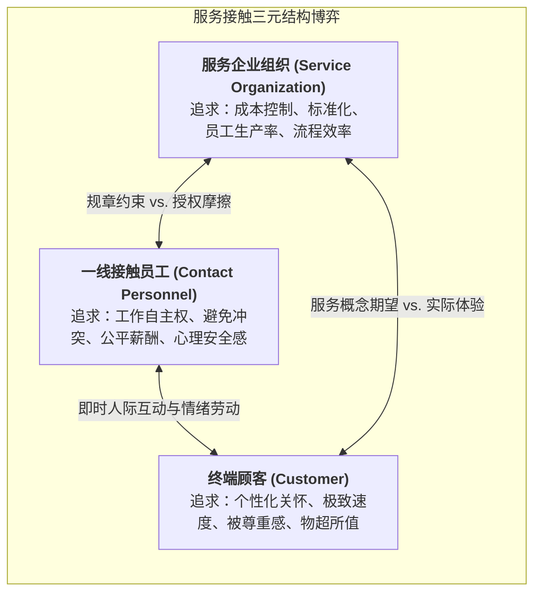
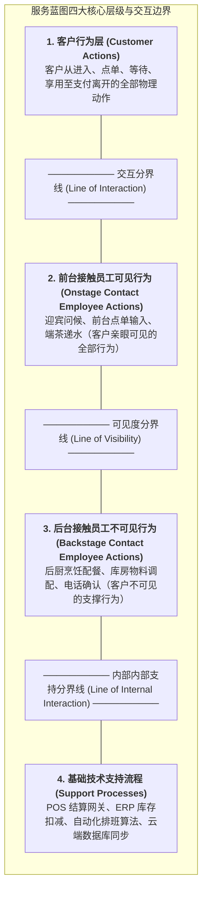

# Lec 4 服务接触界面与服务承诺保障（Service Encounter and Guarantees）

## TL;DR

- 服务接触（Service Encounter）构成了客户评估企业价值的“真实瞬间”（Moments of Truth）。
- 服务蓝图（Service Blueprinting）通过可见度分界线（Line of Visibility），精确映射前台互动与后台支撑的协同动线。
- 无条件服务承诺（Unconditional Service Guarantees）不仅是营销公关名片，更是反向倒逼内部运营系统防错（Poka-Yoke）的强效制度杀手锏。

## 一、真实瞬间（Moments of Truth）与服务接触三元博弈

北欧航空公司（SAS）前总裁扬·卡尔松（Jan Carlzon）在其里程碑著作中提出了著名的**真实瞬间（Moments of Truth）**概念：在服务企业中，客户对整家公司的全部品牌信任与价值认知，往往并不取决于总部大楼有多宏伟，而是取决于那成千上万个微小的瞬态接触——办理登机牌时地勤人员的一个微笑、机舱内一杯温热的咖啡、以及行李传送带上准时出现的箱包。每一次平均仅有 15 秒的服务接触，都是客户决定对企业忠诚还是离去的生死判决。

在任何服务接触界面中，恒久存在着三种力量的动态张力：

传统的官僚型企业往往由组织规章牢牢压制一线员工，导致员工在面对遇到特殊困难的客户时，只能像机器人一样冷冰冰地回复“对不起，公司规定不行”；而卓越的服务企业推行**一线深度授权（Empowerment）**（如丽思卡尔顿酒店允许任意基层员工无需审批即可支配高达 2000 美元的额度为客户解决突发问题），彻底激活服务界面的敏捷温度。

## 二、服务蓝图（Service Blueprinting）工程绘制全景

服务设计中最核心的工程工具是**服务蓝图（Service Blueprinting）**。服务蓝图最早由美国运筹学者林恩·肖斯塔克（G. Lynn Shostack）提出，其核心价值在于打破传统组织架构图按部门割裂的烟囱视角，将错综复杂的跨部门协同，严格按照**客户时间线视角的体验动线**进行全息透视与结构化展开。

一张制造级的标准服务蓝图，不仅能够直观呈现客户在每一个环节与企业的触点，更清晰勾勒出后台庞大技术支持系统与前台服务人员的交互拓扑。它将原本看不见摸不着的无形服务，转化为工程师可以精准量化度量、排查单点故障（SPOF）与持续优化的可视化结构图：

### 服务蓝图的三大核心工程控制点
在绘制完成基础四层结构之后，运营架构师必须运用工业工程与系统可靠性理论，在蓝图的关键动线上标定三大核心控制要素：
- **关键失效点标记（Fail Points, 标记为 $F$）**：在整条端到端动线上精确识别出哪些节点最容易发生信息丢失、员工遗漏、软件超时或客户误解（例如点错菜单规格、行李条码错挂、支付网关掉单）。对每一个失效点，必须制定明确的兜底恢复预案（Fallback Plan）；
- **排队等待瓶颈标记（Bottlenecks / Wait Points, 标记为 $W$）**：识别出哪些工序由于物理加工速率有限必然导致客户滞留排队（例如安检通道、高峰期结账台）。在此类节点，运营团队必须前置设计舒适的等候设施、娱乐视觉大屏或提供即时排队进度通知，以平抑等待焦虑；
- **服务防错设计（Poka-Yoke）**：设计物理限位或软件逻辑防呆机制（如飞机卫生间必须把门反锁上内部照明灯才会亮起，强制防止乘客因疏忽走光；银行 ATM 机必须先退回银行卡，蜂鸣提示音响过 3 声后才吐出现钞）。通过防错设计，确保即使在员工疲劳或客户分心时，系统依然能够以 100% 的准确率稳态运行。

## 三、无条件服务承诺保障（Service Guarantees）的制度威力

哈佛商学院克里斯托弗·哈特（Christopher Hart）在《无条件服务保证的威力》中指出，许多企业推行的“服务承诺”充满了密密麻麻的小字免责条款（如“在不可抗力、系统故障、节假日除外……”），这种虚伪的承诺只会招致客户的嘲笑。

一个具备真正杀伤力与运营价值的**无条件服务承诺（Unconditional Service Guarantee）**必须具备五大硬性特质：
1. **无条件（Unconditional）**：没有任何借口和小字免责说明，只要客户不满意即刻生效；
2. **易于理解与沟通（Easy to Understand & Communicate）**：一句话说清楚（如“达美乐披萨：30 分钟未送达，本单免费享用”）；
3. **有意义且具备实质价值（Meaningful）**：赔偿金额必须让客户感到受尊重，让企业感到肉疼；
4. **易于索赔兑现（Easy to Invoke）**：客户无需填写冗长申诉表格或出示复杂公证，一键秒退；
5. **极速兑付（Credible）**：现场当面现金赔付或系统秒级原路退款。

::: insight [服务承诺的终极价值：不是营销噱头，而是运营纠偏的听诊器]
许多平庸管理者不敢推出无条件承诺，害怕“被羊毛党薅羊毛破产”。真正的系统大师深刻懂得：**服务承诺的本质是一面无情照出内部运营缺陷的镜子**。当每一次服务失败都必须由财务部真金白银掏出现金赔付时，管理层就会像被踩了尾巴一样，以最高优先级扑向车间现场，彻查那道出问题的工序，迫使全员质量管理（TQM）在阵痛中彻底落地！
:::

## 我的理解

服务接触界面与服务承诺，是运营工程学与行为心理学交汇的最美前线。

1. **服务蓝图是跨越软硬件的统一设计语言**：无论你是开一家实体餐厅，还是开发一款复杂的跨平台软件 App，服务蓝图都能发挥降维梳理的作用。用户在手机屏幕上的每一次点击是“客户行为”，客户端渲染是“前台交互”，微服务 API 网关是“可见度边界”，底层分布式数据库事务是“支持流程”。用服务蓝图理清端到端调用链路，是消灭架构死角的最强蓝图。
2. **防呆设计（Poka-Yoke）的温柔哲学**：在服务系统中，客户经常会犯错（如忘记拔走 ATM 银行卡、在表单中输错电话格式）。平庸的系统会在弹窗中冷冰冰地报错责怪用户；优秀的设计则是在物理结构上让错误不可能发生（如 ATM 机必须先退卡、机器发出蜂鸣警告后才吐出现钞）。用系统的确定性去宽容人性的粗心，是最高阶的工程教养。
3. **敢于承诺体现最高级的系统自信**：如果一个技术团队不敢对自己的系统给出具有实质赔付罚则的 SLA 承诺（如 99.99% 可用性），就说明团队内心深处对自己的底层高可用架构充满心虚。设立严苛的公开服务承诺，是将组织推向卓越的最快强心剂。
