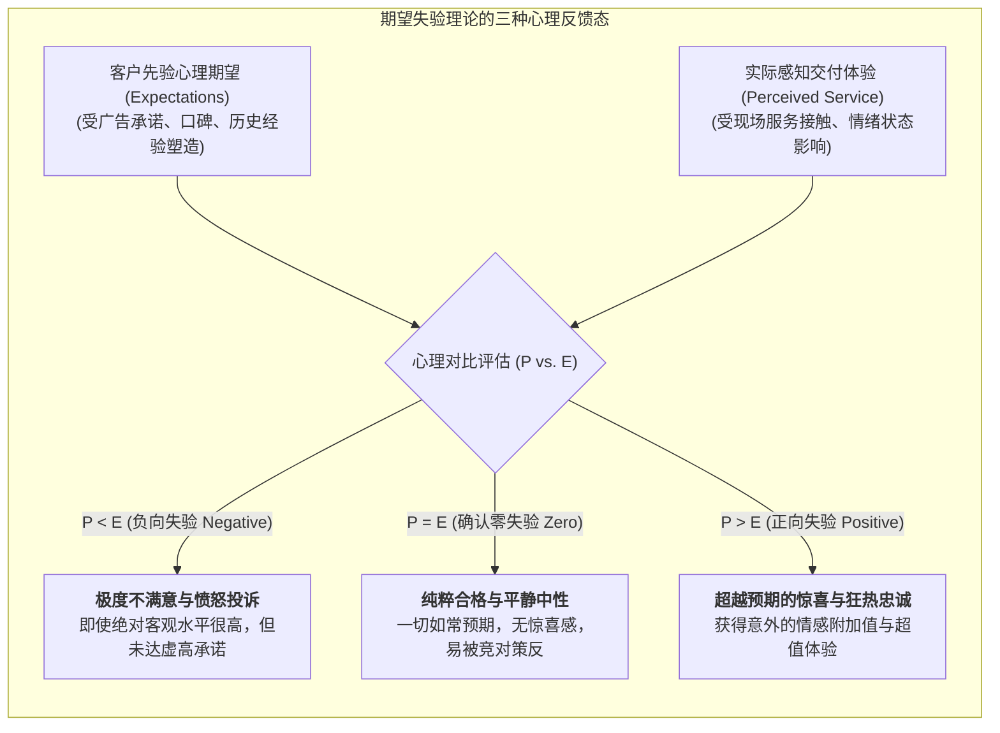
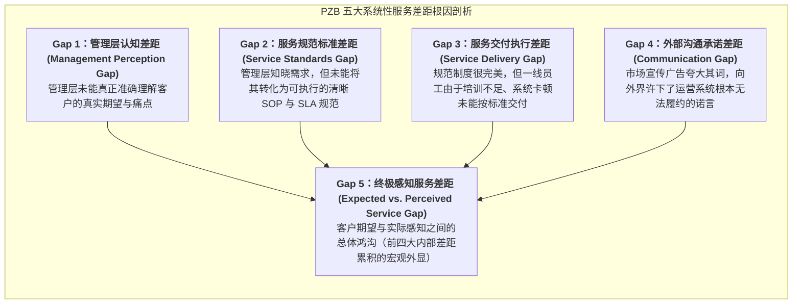

# Lec 5 客户满意度测度与期望差距模型（Customer Satisfaction & Expectation Gap Model）

## TL;DR

- 客户满意度在心理学上严格遵循期望失验模型（Expectation-Disconfirmation Model）：满意度等于感知感知体验减去先验期望。
- 帕拉苏拉曼与蔡特汉姆（PZB）经典 SERVQUAL 差距模型将服务质量裂解为有形性、可靠性、响应性、保证性与移情性五大维度。
- 五大结构性差距（Gap 1 至 Gap 5）深刻揭示了管理认知、质量规范、服务交付与外部营销承诺失调的系统性根源。

## 一、客户满意度的微观心理学：期望失验理论

在服务运营的评估度量中，许多管理者常常陷入“绝对客观绩效”的思维盲区，误以为只要将技术指标提升，客户就必然满意。例如某宽带运营商将网络修复工时从 48 小时压缩至 24 小时，客户投诉反而变多了。

现代服务管理确立了核心的认知心理学公理——**期望失验模型（Expectation-Disconfirmation Model）**：

$$\text{客户满意度 (Customer Satisfaction)} = \text{感知服务绩效 (Perceived Performance)} - \text{先验心理期望 (Prior Expectations)}$$

这一理论给运营战略带来了一记当头棒喝：**如果市场营销部在前端广告中吹嘘得天花乱坠、将客户的先验期望拉升至外太空，那么无论后方运营系统多么优秀，最终交付给客户的都只能是一场必然的“负向失验”悲剧！**

## 二、经典的 PZB SERVQUAL 五大质量维度体系

得克萨斯农工大学著名的研究团队帕拉苏拉曼（A. Parasuraman）、蔡特汉姆（Valarie Zeithaml）与贝里（Leonard Berry）（合称 PZB）在经典研究中，将抽象的“服务质量”提炼为全球通用的 **SERVQUAL 评估量表**，包含五大普适核心维度（简称 RATER 模型）：

1. **可靠性（Reliability）**：准确、可靠地履行所承诺服务的能力（五大维度中权重最高，属于最基础的一票否决底线，如账单准确无误、约定时间内准时到场）；
2. **响应性（Responsiveness）**：随时愿意为顾客提供迅速高效服务的敏捷度（如客服电话秒级接听、系统故障快速响应）；
3. **保证性（Assurance）**：员工的专业知识、礼节素养以及所展现出的让客户产生信任感与安全感的能力；
4. **移情性（Empathy）**：设身处地为顾客着想、提供充满人情味的个性化关怀与定制方案的能力；
5. **有形性（Tangibles）**：物理设施、办公环境、仪器设备、员工仪表与宣传物料的整洁美观程度。

::: definition [SERVQUAL 综合得分测算模型]
对于每一个具体服务项目，分别向客户调查其对该项指标的“期望分数 $E_i$”与“实际体验分数 $P_i$”（采用 1-7 分李克特量表）。单项服务质量缺口为 $Q_i = P_i - E_i$。加权综合服务质量指数为：
$$\text{SQI} = \sum_{i=1}^{22} w_i (P_i - E_i)$$
若 $\text{SQI} < 0$，系统处于服务质量赤字状态，必须启动根因溯源。
:::

## 三、PZB 五大服务质量差距模型（The Gap Model）

SERVQUAL 模型最伟大的学术成就，在于构建了诊断服务系统内部断层的**五大差距模型（Gap Model of Service Quality）**：

### 弥合内部差距的运营工程抓手
- **弥合 Gap 1**：破除大企业病，强制高管每年深入一线接听 100 通真实客户投诉电话，建立全网社交媒体负面情绪实时捕捉管道；
- **弥合 Gap 2**：推行端到端量化 SLA 制定，将模糊的“热情周到”转化为“振铃 3 声内接听、故障 15 分钟内启动响应”的硬性工程参数；
- **弥合 Gap 3**：优化员工排班、推行自动化辅助工具（如智能知识库与防错脚本），消除一线员工的疲劳失误；
- **弥合 Gap 4**：建立营销与运营的联席会审机制，严禁营销部门在未经运营架构师签名确认前对外发布任何不可兑现的功能期票。

::: example [世界级高端私人银行服务质量差距审计实战]
某欧洲私人银行近年来高净值客户流失率上升。管理层起初误以为是投资收益率不高，斥巨资升级量化交易系统。
随后引入 PZB 差距审计发现：问题根本不在投资收益，而在 **Gap 2 与 Gap 3**——高净值客户最在意的不是收益多高，而是“隐私极度安全与半夜遭遇跨境风控锁卡时能否 5 分钟内人工解锁”。银行原先的流程由于夜间只留外包客服，客户往往被锁卡数小时无法消费。银行迅速修正了夜间 VIP 响应机制，针对高端客户设立 24 小时全时直通专线，次年客户综合满意度跃升至 **96%**。
:::

## 我的理解

期望差距模型是每一个从事体验管理与产品运营人员的清醒剂。

1. **克制宣传是维护满意度的最高智慧**：乔布斯发布初代 iPhone 时，对电池续航的宣传极其克制（宣称待机几天、轻度使用）。当用户实际拿到手机发现电量甚至比宣称的还抗造时，正向失验催生了狂热的口碑。反观某些造车新势力，动辄宣称“全场景 100% 自动驾驶”，一旦用户在暴雨天遭遇接管失败，愤怒的被欺骗感瞬间吞噬所有前期公关成果。
2. **消灭 Gap 4 需要坚固的组织防火墙**：在许多互联网公司，业务增长部门（Growth Hacker）的考核完全取决于新用户注册量，因此他们有极强的话语冲动去虚假宣传；而烂摊子最终全留给客服与工程团队去背锅。战略高管必须把客户留存率（Retention）与退订率作为营销部门的核心负向对冲考核，从制度上切断虚假宣传的利益链条。
3. **把差距模型作为故障复盘的根本量尺**：当线上发生严重服务事故或大客户索赔时，团队复盘切忌停留在“员工态度不认真”这种毫无意义的道德批判上。必须严格对照 Gap 1 到 Gap 4 逐级盘查：是我们的需求理解错了？还是内部监控规则没写清？还是系统报警工具失效？亦或是对客户承诺的 SLA 本身就超越了当前算力的物理极限？唯有深挖系统性差距，组织才能真正从失败中实现肌肉进化。
