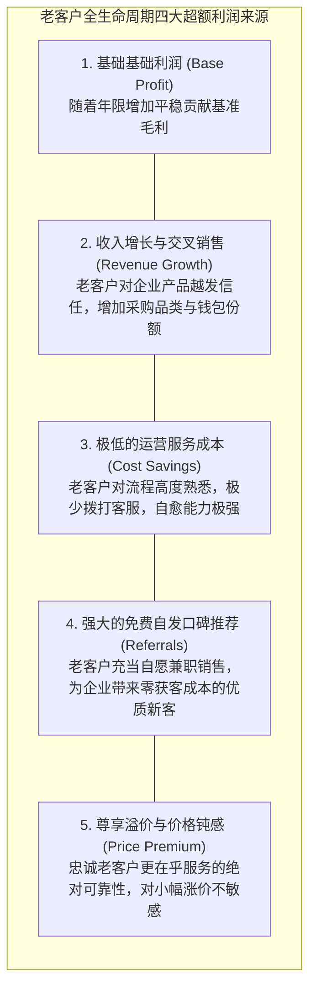
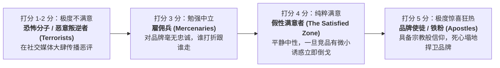

# Lec 6 客户维系、忠诚度与终身价值（Customer Retention, Loyalty & Lifetime Value）

## TL;DR

- 赖希赫尔德（Fred Reichheld）奠定了客户终身价值理论：客户留存率提升 5%，企业终身利润将飞跃 25% 至 95%。
- 客户满意并不等于忠诚；唯有跨越“纯粹满意”进入“狂热正向失验”的死忠群体，才能真正释放口碑裂变与钱包份额溢价。
- 服务利润链（Service-Profit Chain）揭示了内部员工满意度向外部客户价值、客户忠诚度乃至财务高额回报的逐级因果传导。

## 一、客户留存率（Retention Rate）的非线性利润魔力

在过去的商业狂热中，许多企业高管将全副精力倾注在“疯狂投放广告获取新客（Customer Acquisition）”上。然而，贝恩咨询公司（Bain & Company）著名合伙人弗雷德·赖希赫尔德（Fred Reichheld）在哈佛商学院发表的经典论文《零背叛：忠诚度的惊人力量》，彻底揭示了商业世界最核心的财富秘密：**新客获取只是表面数字繁华，而老客的长期留存（Retention）才是企业产生真实自由现金流的根本源泉**。

赖希赫尔德经过数十年的跨行业大数据实证研究，提出了震惊华尔街的经典实证结论：
**在信用卡、工业分销、软件订阅与汽车保险行业，企业只需将客户流失率降低 5%（即客户留存率提升 5 个百分点），企业的全生命周期净利润现值将戏剧性地提升 25% 至 95%！**

## 二、满意度与忠诚度的非线性断层：叛逆者 vs. 使徒

施乐公司（Xerox）在其经典客户调查中曾发现一个令高管百思不得其解的现象：在针对离职客户的问卷中，有超过 80% 的流失客户在过去一年的满意度打分中选择了“满意（Satisfied，4 分）”。

哈佛商学院托马斯·琼斯（Thomas Jones）与厄尔·萨瑟（W. Earl Sasser Jr.）在经典论文《为什么满意的客户依然会背叛》中，打破了“满意度等于忠诚度”的传统幻想。他们将客户分为截然不同的群体：

### 满意度到忠诚度的陡峭非线性拐点
实证数据表明，在完全竞争的开放市场中：
- 客户从打 1 分（极度不满意）提升到打 4 分（满意），其留存重购概率仅有极其微弱的提升（依然处于被竞品随时挖走的危险区）；
- **唯有当客户从打 4 分（满意）跨越进入打 5 分（极度惊喜）时，客户的重购概率才会发生垂直拔葱般的惊人暴增**！
- 那些将目标设定为“让所有客户纯粹满意（打 4 分即可）”的企业，实际上依然是在将自己的命运暴露在随时被竞争对手用价格战收割的悬崖边缘。

## 三、赫斯克特服务利润链（The Service-Profit Chain）

哈佛商学院詹姆斯·赫斯克特、赖希赫尔德与萨瑟在 1994 年共同奠定了现代组织管理学最重要的理论丰碑——**服务利润链（Service-Profit Chain）**。它用严格的因果链条，打通了从员工心智到股东回报的价值循环：

$$\begin{aligned}
\text{内部服务质量} &\longrightarrow \text{员工满意度} \longrightarrow \text{员工忠诚度与生产率} \\
&\longrightarrow \text{卓越外部服务价值} \longrightarrow \text{客户终身满意度} \\
&\longrightarrow \text{客户忠诚与口碑} \longrightarrow \text{企业营收高增长与超额利润！}
\end{aligned}$$

::: definition [净推荐值（Net Promoter Score, NPS）]
赖希赫尔德发明的商业量化度量指标。仅询问客户一个极简问题：“在 0 至 10 分的刻度上，您有多大意愿向朋友或同事推荐我们？”
- **推荐者（Promoters，9-10 分）**：忠诚狂热铁粉；
- **被动者（Passives，7-8 分）**：满意但易受诱惑；
- **贬损者（Detractors，0-6 分）**：心怀不满的潜在破坏者。
$$\text{NPS} = \% \text{推荐者} - \% \text{贬损者}$$
在欧美资本市场中，企业 NPS 得分的增长率与企业未来三年市值的超额复合增长率呈严格的正相关关系。
:::

::: example [西南航空践行服务利润链的全球神话]
西南航空创始人赫伯·凯莱赫（Herb Kelleher）公开宣布公司最核心的经营哲学：“员工第一，客户第二，股东第三。”如果管理层关爱员工、为地勤和空乘创造充满欢笑与安全感的组织氛围，员工就会发自内心地在机舱里为乘客唱歌、用极速的动作协助清理客舱。乘客感受到无与伦比的快乐与高准点率，从而死心塌地只坐西南航空，最终为股东创造了美国航空史上唯一连续 40 年盈利的无敌神话。
:::

## 我的理解

客户维系与终身价值理论，是击碎一切商业虚荣指标的终极照妖镜。

1. **漏斗底部的裂缝会吸干所有营销预算**：如果一个产品的客户流失率高达每月 10%，就意味着一年内全量老用户几乎要彻底洗牌一遍。此时你花几亿美金去铺地铁广告、买信息流流量，本质上就像在往一个底部千疮百孔的破水桶里疯狂倒水。把资源优先投入到修补水桶底部的裂缝（提升服务质量、挽留老客），是唯一的理性解。
2. **警惕“伪忠诚”的欺骗性**：有些客户看起来留存率很高，仅仅是因为企业设立了极其恶心、极其复杂的退订违约金门槛（锁定陷阱 Lock-in）。这种被强行绑架的客户在内心深处是彻头彻尾的“恐怖分子”，一旦未来政策松绑（如携号转网），他们会以最快的速度叛逃并到处控诉你的品牌。真正的忠诚必须建立在“来去完全自由，但我发自内心选择留下”的自愿基础之上。
3. **一线员工的情绪是无法伪装的**：如果企业对一线客服推行严苛的扣罚制度、每天逼迫员工高强度加班且毫无心理辅导，员工即使在电话里被强迫说出“祝您生活愉快”，客户在听筒另一端感受到的也只有冰冷的怨气与死寂。善待一线运营人员，是所有卓越服务体验的终极策源地。
