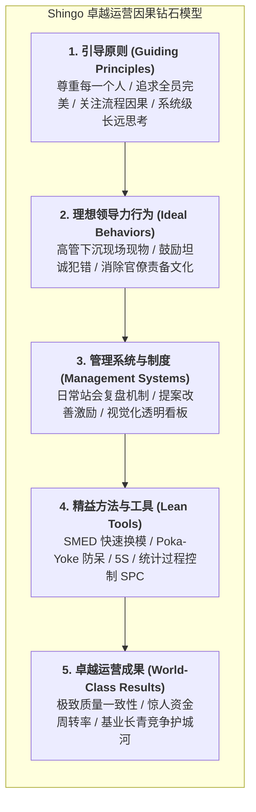

# Lec 7 卓越运营体系的创建与基业长青（Creating and Sustaining Operational Excellence）

## TL;DR

- 卓越运营（Operational Excellence）绝非一朝一夕的工具导入，而是一套深植于组织行为原则的持续改善生态系统。
- 新乡重夫奖（Shingo Model）确立了原则驱动行为、行为塑造文化、文化最终结出卓越运营成果的因果层级。
- 基业长青的运营系统必须打破“项目制运动式改良”的假象，将丰田现场现物（Gemba）与全员自主防错内生化为组织本能。

## 一、卓越运营的定义与误区：工具陷阱 vs. 原则系统

在过去的三十年中，全球成千上万家企业掀起了轰轰烈烈的“学精益”、“推六西格玛”、“搞敏捷转型”的浪潮。许多企业聘请了顶级管理咨询顾问，在车间贴满了 5S 标语、设立了看板、给工程师颁发了绿带与黑带证书。然而，令人遗憾的统计事实是：**超过 80% 的精益转型项目在咨询顾问离开后的 2-3 年内，以系统悄然回潮、重新陷入低效混乱宣告失败**。

犹他州立大学新乡重夫卓越运营研究院（Shingo Institute）深入剖析了这一普遍溃败的根源——**工具陷阱（The Tool Trap）**：
- 平庸的企业把精益工具（看板、安灯、价值流图、鱼骨图）当成了成品的万灵药，误以为只要依样画葫芦引入工具，就能复制丰田的辉煌；
- 然而，工具只是漂浮在水面上的冰山一角。决定工具能否发挥效能的，是深埋在水面之下的**领导力行为、员工底层信念与组织原则文化**。

## 二、新乡重夫模型（The Shingo Model）的三大核心原则群

日本工业工程大师、丰田生产方式的核心缔造者之一新乡重夫（Shigeo Shingo）指出，卓越运营系统建立在三大不随时代变迁的永恒原则群之上：

### 1. 文化推动力原则（Cultural Enablers）
- **尊重每一个员工（Respect Every Individual）**：不仅是道德号召，更是运营理性。一线操作工人是距离工艺公差最近的人，只有充分赋权、倾听一线的声音，系统的微小隐患才能被第一时间扑灭；
- **谦卑的领导力（Lead with Humility）**：高管必须承认自己脱离车间一线后对实际摩擦的无知，走到现场俯身向工人请教，创造让员工勇于暴露问题的心理安全感。

### 2. 持续改善原则（Continuous Improvement）
- **追求完美（Seek Perfection）**：永远不向任何一个次品妥协，推行严苛的“根因追溯五问法（5 Whys）”；
- **从源头拥抱质量（Embrace Scientific Thinking & Quality at Source）**：宁可停机停线，也坚决不把瑕疵件流向下一道工序；
- **关注流程而非单纯责备人（Focus on Process）**：当错误发生时，理性的假设永远是“我们的流程设计存在漏洞让员工犯了错”，而不是“这个员工态度不端正”。

### 3. 企业协同对齐原则（Enterprise Alignment）
- **保持使命目的的坚定一致性（Constancy of Purpose）**：绝不为了迎合季度的华尔街财报预期，随意推翻已经坚守五年的制造工艺标准；
- **系统级端到端思考（Think Systemically）**：坚决铲除部门利益孤岛，任何改善必须以全系统的吞吐量提升为评判标准。

## 三、从运动式改良走向组织本能：日常精益管理系统（DMS）

基业长青的卓越运营企业，依靠一套高度自律的**日常管理系统（Daily Management System, DMS）**将改善内化为组织的血液循环：

1. **三级分层站会机制（Tiered Daily Stand-ups）**：
   - **Tier 1（上午 08:00，班组级，10 分钟）**：班组长带领工人在车间可视化看板前快速核对昨天的良率、安全事件与今日交付节拍；
   - **Tier 2（上午 08:30，车间部门级，15 分钟）**：车间主任协调跨班组维保与工艺支援，将班组无法解决的跨界卡点上升；
   - **Tier 3（上午 09:00，全厂厂长级，20 分钟）**：厂长与各职能总监快速复盘关键异常，调度全厂工程与采购资源实施闭环攻坚。
2. **走动式管理（Gemba Walk）**：厂长与高管每天固定抽出 1 小时深入车间现场，用眼睛看、用手去摸真实的工装夹具，当场解决一线工人的流程堵点。
3. **全员改善提案制度（Kaizen Suggestions）**：每位员工每月平均提交 2-3 个微小改进提案（如自制一个小挂钩减少 2 步走动），哪怕只节约 5 秒钟工时也给予即时肯定与物质奖励，彻底激活全体员工的主人翁意识。

::: example [丹纳赫公司（Danaher）DBS 体系的商业奇迹]
全球工业与医疗仪器投资巨头丹纳赫（Danaher），其最为核心的商业武器就是名震全球的“丹纳赫商业系统（Danaher Business System, DBS）”。无论丹纳赫收购哪一家老旧传统企业，高管入驻后第一件事不是裁员，而是全面推行 DBS 卓越运营体系，从 5S、现场目视化到日常站会全盘导入。
数十年来，被收购企业在被注入 DBS 基因后，营业利润率平均提升 500 至 1000 个基点。丹纳赫过去三十年的复合股东回报率不仅超越了标普 500 指数数倍，更击败了巴菲特的伯克希尔哈撒韦，成为卓越运营创造复利价值的全球第一神话。
:::

## 我的理解

卓越运营的构建是对人性惰性与熵增定律的永恒抗争。

1. **卓越是一种日常习惯，而非一次性运动**：许多企业习惯于搞轰轰烈烈的“百日质量誓师大会”，誓师时群情激昂，三个月后风头一过一切复原。真正的卓越没有那些聚光灯下的虚荣，它只存在于每天清晨准时召开的那场 10 分钟站会里，存在于工位上永远摆放整齐的那把扳手里。把微小的好习惯坚持十年，就是不可逾越的护城河。
2. **制度要保护说真话的吹哨人**：如果你的企业文化中，发现问题的人会被批评为“给部门抹黑”，那么下一次你得知系统缺陷的时候，往往就是客户起诉退货、甚至产品在现场起火爆炸的新闻头条。把每一次缺陷暴露视为组织修复基因的宝贵免疫反应，给予吹哨人极高的精神荣耀，是卓越系统维持自愈能力的唯一法门。
3. **代码世界同样需要 Gemba 精神**：在软件工程中，许多首席架构师整天沉浸在高大上的架构蓝图白板上，从来不看底层代码提交（Git PR），不知道真实用户的崩溃堆栈日志到底长什么样。脱离了代码行与数据库监控的架构设计，本质上就是制造车间里的官僚主义。亲自深入代码仓库，读一读那些充满异味的坏味道函数，就是软件工程师最纯正的“走入现场（Gemba Walk）”。
