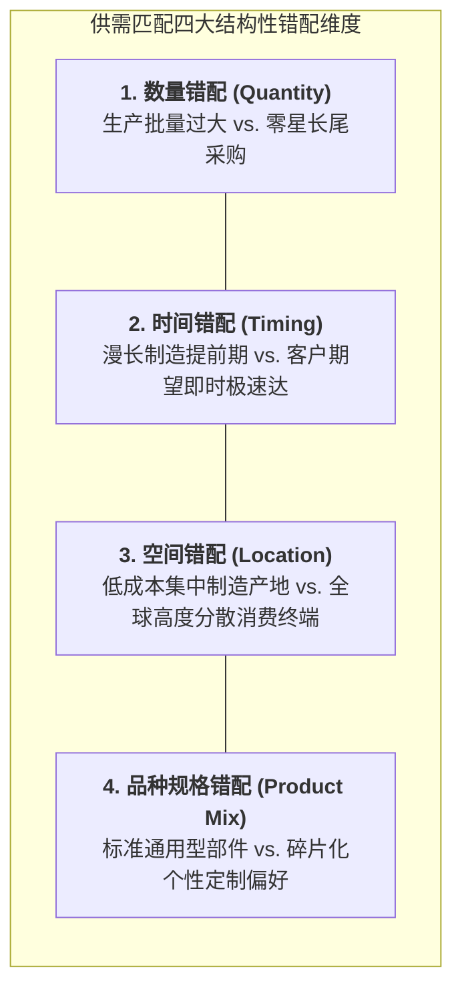

# Lec 8 供需匹配与拔河博弈：需求不确定性应对（Matching Supply and Demand: The Tug of War）

## TL;DR

- 供给与需求在时间、空间、数量与品种上的结构性错配，是引发全球商业系统波动的根本物理张力（拔河博弈）。
- 供需匹配存在调节供给（追逐策略、柔性工时、外包代工）与重塑需求（峰谷动态定价、交期承诺、替代引导）两大经典武器库。
- 柔性矩阵理论证明：通过设计微小的网络交叉柔性（Flexible Chaining），系统能以极低成本获得全柔性网络的惊人抗波动韧性。

## 一、供需匹配的永恒拔河博弈（The Tug of War）

在企业日常运营的微观现实中，供给端（Supply）与需求端（Demand）永远像处于一场力量不对称的拔河博弈之中：
- **供给端具有强烈的刚性物理惯性（Rigidity）**：重资产工厂需要提前数年建设、机床换模需要固定工时、工人轮班受劳动法规严格约束、原材料需要跨洋船运。供给端天然追求平稳、匀速、批量的确定性节拍；
- **需求端充满了不可预测的瞬时布朗运动（Volatility）**：消费者的偏好受季节、天气、社交媒体流行趋势、宏观经济信贷与竞品降价的影响，展现出剧烈的非平稳脉冲与峰谷交替。

当供给与需求这两股巨浪在现实时间轴上猛烈碰撞时，任何错配都将化为惨烈的财务损失：
- **供给高于需求（Supply > Demand）**：工厂产能闲置折旧、工人窝工放假、仓库库存积压爆仓、商品面临沉重的利息侵蚀与季末打折报废（Overage Loss）；
- **需求高于供给（Demand > Supply）**：货架空空如也、客户排起长龙、订单违约面临巨额罚金，不耐烦的客户永久倒流给竞争对手（Underage Loss）。

## 二、调节供给（Managing Supply）的经典运营策略库

当企业面临不可控的需求波动时，最直观的路径是通过调整自身的供给交付系统来迎合需求：

1. **追逐策略（Chase Strategy）**：让生产速率与瞬时需求波动完全实时对齐。
   - **实施手段**：旺季疯狂安排三班倒加班、大规模招募临时派遣工；淡季果断关闭产线放假、裁撤劳务工；
   - **代价**：员工归属感极差、频繁招募培训新手导致次品率飙升、员工士气低落。
2. **平滑平稳策略（Level Strategy）**：无论外部市场风吹雨打，工厂全年 365 天保持恒定不变的匀速排产节拍。
   - **实施手段**：在淡季将多余的产量全额存入仓库作为蓄水池；在旺季利用淡季囤积的库存满足超额爆发；
   - **代价**：全网常年沉淀极其庞大的库存持有与仓储租赁资金成本。
3. **产能与劳动力柔性调度（Workforce Flexibility）**：
   - 推行全员综合工时制与年化弹性工时银行（Annualized Hours）；
   - 投资快速换模技术（SMED），将原本需要 4 小时的机床停机换模压缩至 10 分钟以内，实现混流生产。
4. **外部弹性转包（Subcontracting & Peak Outsourcing）**：
   - 内部自建工厂仅承接稳定的基准底座负荷；面对季节性峰值需求，全额转包给外部代工厂协同吸收。

## 三、重塑需求（Managing Demand）与链状柔性网络理论（Chaining Theory）

除了被动改造供给端，现代运营战略的更高境界在于主动出击——**通过管理与重塑需求端，将不可预测的野蛮波动驯服为温和的平原流**：

- **峰谷差异化动态定价（Peak/Off-Peak Pricing）**：利用价格杠杆转移时间拥堵（如电网的峰谷电价、Uber 浪涌叫车加价、主题乐园工作日特价门票）；
- **主动引导替代与品类推荐**：在缺货时利用算法为客户动态推荐高利润现货替代品；
- **预售与交期管理（Pre-orders & Due-date Quoting）**：利用定金预售机制提前摸清需求底牌，根据工厂实时产能负荷动态拉长交期承诺。

### 乔丹-格雷夫斯链状柔性定理（Jordan & Graves Chaining Theory, 1995）
在设计跨工厂、跨产线的柔性配置时，管理层常常面临预算瓶颈：让每一家工厂都能生产全谱系产品（全柔性 Full Flexibility）需要投入天文数字的模具与设备成本。

麻省理工学院斯隆管理学院教授史蒂芬·格雷夫斯（Stephen Graves）与威廉·乔丹（William Jordan）在经典论文中证明了震撼学界的**链状网络定理（Chaining Principle）**：

::: theorem [Jordan-Graves 链状闭环柔性定理 (1995)]
考虑由 $N$ 座工厂与 $N$ 类产品构成的供需匹配系统。
企业完全不需要为所有工厂配置全柔性！只要在工厂与产品之间构建一条**简单的封闭环状配置链（Closed Chain: Plant 1 生产 Product 1&2, Plant 2 生产 Product 2&3, ..., Plant N 生产 Product N&1）**。
则该系统在仅仅增加极小局部柔性投入的前提下，所获得的系统抗波动韧性与整体期望吞吐量，**在数学上几乎 100% 等同于极其昂贵的全连接全柔性网络**！
:::

::: example [日产汽车与本田全球工厂柔性链状布局实践]
日产汽车在布局北美与亚洲制造基地时，严格践行了 Jordan-Graves 链状原则：每一家核心整车厂均被配置为具备生产“一款走量轿车 + 一款高底盘 SUV”的双重柔性能力，并将不同工厂的共线车型两两交织咬合。当北美遭遇油价暴涨导致大排量 SUV 销量暴跌而小型轿车需求暴增时，日产通过在链条上顺时针微调各工厂的混流比例，在零新厂房投资的前提下化解了全网产能危机。
:::

## 我的理解

供需匹配的拔河博弈揭示了企业运营架构设计中最深刻的对冲智慧。

1. **不要试图用单一武器打赢整场战争**：平庸的企业往往走极端——要么纯靠硬扛库存（Level），要么纯靠折腾员工加班（Chase）。优秀的架构师构建的是一个多维立体的对冲工具箱：用基准平滑排产守住 70% 的低成本底座，用弹性小时工化解 15% 的季节波动，用外部代工吸收最后 15% 的极端脉冲，同时配合前端动态定价主动削峰填谷。
2. **链状柔性（Chaining）是四两拨千斤的系统杠杆**：许多管理者误以为提高组织柔性就是要把所有人变成无所不能的全能战士。Graves 的链状定理优雅地证明：只要系统内部存在一条闭合的环形互助链条，局部孤岛上的富余产能就可以像多米诺骨牌一样顺次传导支援远方缺货的节点。以最小的局部连接激活全局网络流动性，是现代工程架构的终极美学。
3. **供需匹配的终极形态是按需定制**：随着 3D 打印、软件定义制造与柔性装配的普及，我们正在逼近供需匹配的终极圣杯——消除时间与空间上的所有物理错配。产品在客户下单的瞬间由离客户最近的智能节点就地生成，彻底终结百年来折磨人类商业文明的库存与折价噩梦。
