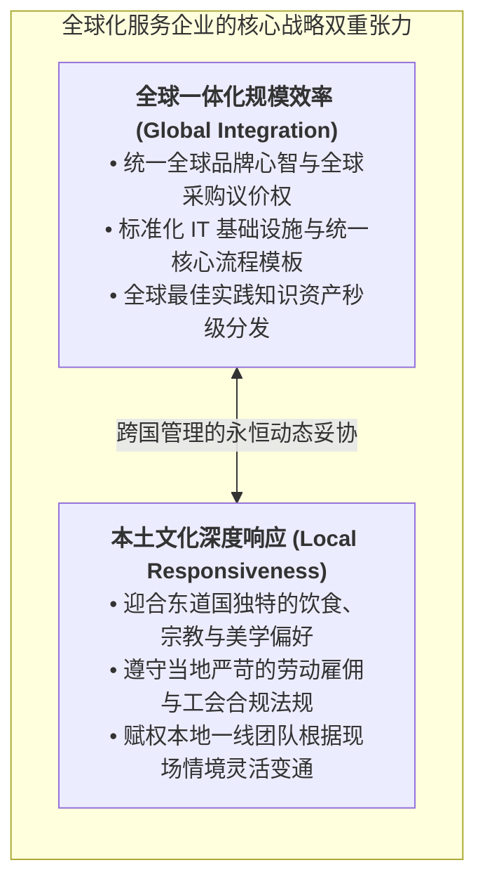

# Lec 9 全球化服务企业的运营管控（Managing a Global Service Company）

## TL;DR

- 全球化服务企业面临全球标准化规模效应（Global Efficiency）与本地文化深度适应（Local Responsiveness）的跨国张力。
- 巴特利特与戈沙尔（Bartlett & Ghoshal）跨国管理矩阵明确了全球型、多国本土型、国际型与跨国型四大组织范式。
- 卓越跨国服务巨头依托前后台解耦，将后台数字处理流程全球集中化，同时赋予前台接触界面极高的本地文化自治权。

## 一、服务出海的独特挑战：无形体验的跨文化碰撞

当一家物理制造业企业（如苹果、丰田）走向全球化时，其交付的核心资产是有形实物（iPhone、汽车）。只要实物产品本身的性能、质量与设计卓越，即使跨越不同的语言与国界，物理硬件依然能够保持极高的标准化普适性。

然而，当一家纯粹的**服务企业（Service Company）**（如麦当劳、万豪酒店、埃森哲咨询、迪士尼乐园、花旗银行）向全球进行跨国扩张时，其所面临的系统阻力与文化摩擦呈现出几何级放大：
- **服务高度依赖即时人际交互与语言沟通**：不同国家的客户对“什么是礼貌、什么是尊重、什么是合理的个人边界”具有截然相反的文化定义（例如在北欧，过于热情频繁的问候会被视为冒犯和打扰；而在拉美，缺乏身体接触与寒暄会被视为冷酷无情）；
- **不可存储性阻碍跨境集中出口**：你无法在纽约烘焙一个热腾腾的巨无霸汉堡，通过跨洋货轮运给东京的顾客当午餐。**服务必须在消费发生的当地现场即时被生产出来**！这意味着跨国服务企业必须在世界每一个角落，一次又一次地从零克隆其复杂的“人-流程-文化”交付系统；
- **监管与专业资质的极端地方化割裂**：金融牌照、医疗执业资格、劳动法工会协议与数据主权隐私法规（如欧盟 GDPR），在各个主权国家构筑起一道道深厚的行政壁垒。

## 二、巴特利特与戈沙尔（Bartlett & Ghoshal）跨国组织范式矩阵

哈佛商学院克里斯托弗·巴特利特（Christopher Bartlett）与伦敦商学院苏曼特拉·戈沙尔（Sumantra Ghoshal）提出了著名的跨国企业组织演进矩阵。服务企业在全球化扩张中必须明确自身的战略定位：

### 1. 多国本土型范式（Multidomestic / 麦当劳早期特许经营）
- **特征**：在每个国家设立高度独立的自治子公司。子公司完全由本地团队管理，自主决定服务菜单、定价与营销策略。
- **优势**：本地适应性极高，能够最大化融入当地社区；
- **代价**：总部对海外分支缺乏有效掌控，无法发挥全球规模经济，各分支重复发明轮子。

### 2. 全球型范式（Global / 新加坡航空、联邦快递）
- **特征**：将全球视为单一统一市场。核心战略、服务标准与品牌形象由总部高度集权掌控，海外网点仅扮演机械执行标准的销售与作业终端。
- **优势**：全球品牌一致性极高，运营效率极致放大；
- **代价**：对地方文化突变极度迟钝，容易在特定细分市场遭遇水土不服。

### 3. 跨国型综合网络范式（Transnational / 现代埃森哲、万豪集团）
- **特征**：当代卓越服务巨头的理想状态。打破纯粹集权或纯粹放权的二元对立，构建“分布式全球集成网络”：
  - 将各个国家的海外分支视为战略创新策源地；
  - 某个海外分支在本地孵化出的优秀服务创新（如麦当劳在法国发明的特级咖啡 McCafé），被总部迅速提炼为标准化模块，反向分发推广给全球其他所有国家网络！

## 三、全球服务管控的工程落地：前台微调与后台集中分工

跨国服务巨头破解“标准化与本土化矛盾”的终极工程杀手锏，依然依赖于**前后台的解耦与重组**：

1. **后台流程（Back-Office）全球共享服务中心（Shared Services Center, SSC）**：
   - 将全集团所有分支的财务核算、发票校验、IT 运维服务台、法律合规审核、薪酬社保核算，全盘集中至全球少数 2-3 个低成本、高教育水平的区域中心（如印度班加罗尔、菲律宾马尼拉、波兰克拉科夫、中国大连）；
   - 后台推行严苛的六西格玛流水线标准化控制，释放数十亿美元的集中处理规模经济。
2. **前台接触（Front-Office）的本地文化微创新**：
   - 保持核心服务蓝图（排队动线、清洁卫生标准、礼貌服务准则）全球 100% 统一；
   - 允许本地管理团队在“产品配方与场景细节”上推行 20% 的本土化微调。

::: example [麦当劳与迪士尼乐园在全球化本土化融合中的经典战役]
- **麦当劳的“全球标准 + 本地口味”**：麦当劳在全球推行严苛一致的炸薯条油温时长控制与餐厅卫生清洁 SOP。然而在印度，麦当劳果断剔除全部牛肉制品，推出纯素香辣土豆堡（McAloo Tikki）；在日本推出照烧猪肉堡；在法国引入法式长棍面包。这种克制的本土化创新使其在全球攻城略地。
- **巴黎迪士尼乐园的早期惨败与浴火重生**：迪士尼在法国开园初期，傲慢地照搬美国加州的纯正美式规则（园区内绝对禁售红酒、要求法国员工展现夸张的美式露齿大笑），激起法国知识界与当地游客的强烈抵制，陷入严重亏损。随后迪士尼深刻反思，在园区餐厅提供高品质法国红酒与法式奶酪，将员工微笑调整为更符合欧洲优雅审美的沉稳礼貌，乐园最终扭亏为盈。
:::

## 我的理解

全球化服务企业的运营管控，是对组织跨文化包容力与系统保真度的终极考验。

1. **不要把你的文化偏见当成普世真理**：许多在本土市场大获成功的企业管理者，出海时往往带着一种盲目的傲慢，误以为“我这套服务流程在母国被奉为神话，外国人就理所当然该跪着接受”。跨国出海的第一法则，是彻底放下傲慢，深入东道国街头的市井小巷，搞清楚当地普通老百姓在文化基因深处到底敬畏什么、反感什么。
2. **把品牌内核标准化，把呈现外壳本地化**：出海切忌走入两个极端：要么傲慢地全盘照搬导致水土不服而亡，要么无底线地全盘本土化导致失去自身品牌的独特辨识度。你的核心服务哲学与底层品质底线（如安全、诚实、极致整洁）必须像钢铁一样不可动摇；而你的语言风格、菜单风味、界面色彩必须像水一样自如适应当地容器。
3. **全球知识网络的双向反哺**：平庸的跨国公司把海外分支当成被动的提款机与吸血管；伟大的跨国公司把全球每一个分支当成创新的分布式传感器。允许前线团队在边界内自由实验，并建立通畅的知识中台把边缘创新的火花迅速放大为全集团的新增长引擎，才是跨国型企业基业长青的无敌飞轮。
