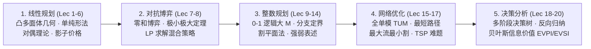

# 15.053 商业分析中的优化方法 (Optimization Methods)

> MIT Course 15 · Operations Research/Statistics · 运筹与统计 · 课号 15.053 · 主讲 Prof. James Orlin

## TL;DR

- 运筹学与管理科学的旗舰入门课：系统覆盖线性规划、整数规划、网络流优化与决策分析。
- 单纯形算法、对偶理论与影子价格量化了资源约束变化对总体经济收益的边际影响。
- 分支定界与割平面法为离散变量组合优化提供了通用精确求解框架。
- 网络流模型揭示全单模整数奇迹，序贯决策树与贝叶斯信息价值评估消除商业不确定性。

## 课程简介 / Description

本课程由麻省理工斯隆管理学院（MIT Sloan）运筹学杰出教授 James Orlin 主讲，是 MIT 面向高年级本科生与研究生开设的优化方法经典课程。

课程系统讲授运筹学（Operations Research）的理论体系、核心算法及其在商业分析与管理科学中的前沿实践。从物流供应链的车辆调度、航空公司机组排班，到金融投资组合配置、电信网络路由以及医疗放射治疗剂量规划，课程不仅强调数学建模的严密性，更注重培养学生利用算法洞察复杂系统瓶颈、提供科学决策支撑的能力。

## 管理科学运筹优化五大核心支柱

课程内容循序渐进，由五大有机咬合的运筹学理论与应用板块构成：

现代运筹优化方法构筑了数字经济时代工业软件与智能决策的核心底层代码。从确定性的连续空间资源调配，到充满对抗博弈的纳什均衡；从组合爆炸的离散逻辑选择，到物理拓扑网络的高效流动，模型为管理者提供了从定性经验直觉向定量科学计算跃迁的坚固桥梁。

这五大板块相互贯通，共同展现了运筹学作为“优化艺术”的完整生命周期。在第一板块建立的线性规划对偶性，成为理解博弈论与网络流的数学基石；而第三板块攻克的离散整数规划技术，则直接赋能了网络旅行商与工业选址等重大工程难题的工业级精确求解。

## 讲义与专题索引

本课程完整覆盖 MIT OCW 开放的全部 20 讲核心讲义与案例研讨专题：

| 讲次 | 标题 | 核心议题与优化工具 | 讲义状态 |
| :--- | :--- | :--- | :--- |
| [第 1 讲](./lec1.md) | 管理科学中的优化方法导论与数字划分 (Introduction to Optimization & Number Partition) | 运筹优化是管理科学的核心引擎，将有限资源分配与决策目标转化为严密的数学极值问题。 | [完整笔记](./lec1.md) |
| [第 2 讲](./lec2.md) | 线性与非线性规划建模实务 (Formulations of Linear and Non-linear Programs) | 线性规划（LP）严格要求目标函数与所有约束条件必须满足比例性（Proportionality）与可加性（Additivity）。 | [完整笔记](./lec2.md) |
| [第 3 讲](./lec3.md) | 线性规划的几何理论与可视化表达 (Geometry and Visualizations of Linear Programs) | 线性规划的每一个线性不等式约束在几何上定义了一个半空间（Half-space）。 | [完整笔记](./lec3.md) |
| [第 4 讲](./lec4.md) | 单纯形算法 I：代数基础、标准型与转轴操作 (The Simplex Method I: Standard Form & Pivoting) | 单纯形算法（Simplex Method）是 20 世纪对人类计算与管理影响最深远的十大算法之一。 | [完整笔记](./lec4.md) |
| [第 5 讲](./lec5.md) | 单纯形算法 II：单纯形表与退化循环治理 (The Simplex Method II: Tableaus & Degeneracy) | 单纯形表（Simplex Tableau）是手动与教学演算单纯形算法的高度紧凑表格矩阵工具。 | [完整笔记](./lec5.md) |
| [第 6 讲](./lec6.md) | 对偶理论、影子价格与灵敏度分析 (Sensitivity Analysis, Shadow Prices & Duality) | 对偶理论（Duality Theory）是线性规划最深刻的数学与经济学支柱，每个原问题均天然伴生一个对偶问题。 | [完整笔记](./lec6.md) |
| [第 7 讲](./lec7.md) | 博弈论 I：二人零和博弈与鞍点 (Game Theory I: 2-Person Zero-Sum Games) | 引入对抗性决策环境：博弈论研究多个自利决策主体在策略互动下的理性均衡。；二人零和博弈（2-Person Zero-Sum Games）中，一方之... | [完整笔记](./lec7.md) |
| [第 8 讲](./lec8.md) | 博弈论 II：极小极大定理与线性规划求解 (Game Theory II: Minimax Theorem & LP Formulations) | 当二人零和博弈缺乏纯策略鞍点时，博弈者必须采用**混合策略（Mixed Strategies）**通过概率随机化化解被动。 | [完整笔记](./lec8.md) |
| [第 9 讲](./lec9.md) | 实用线性规划实务：人工变量、大 M 法与两阶段单纯形 (Practical LP: Big-M & Two-Phase Simplex) | 当约束条件包含“$\ge$”或“$=$”时，$x=0$ 不再是可行解，单纯形算法面临无法启动初始基可行解的困境。 | [完整笔记](./lec9.md) |
| [第 10 讲](./lec10.md) | 整数规划导论与离散选择建模 (Introduction to Integer Programming: Discrete Choice & Modeling) | 现实世界的管理决策往往是非黑即白的离散抉择：建厂与否、投资与否、航班指派与否。；**0-1 二进制变量（Binary Variables）**赋... | [完整笔记](./lec10.md) |
| [第 11 讲](./lec11.md) | 经典整数规划模型：背包、集合覆盖、打包与划分 (IP Formulations: Knapsack, Set Covering & Packing) | 0-1 背包问题（Knapsack Problem）是运筹学与计算机算法史上最经典的有界容量价值最大化模型。 | [完整笔记](./lec11.md) |
| [第 12 讲](./lec12.md) | 整数规划算法 I：分支定界法 (Integer Programming Techniques I: Branch and Bound) | 分支定界法（Branch and Bound, B&B）是现代所有商业离散优化求解器（Gurobi, CPLEX）的绝对通用核心引擎。 | [完整笔记](./lec12.md) |
| [第 13 讲](./lec13.md) | 整数规划算法 II：割平面法与有效不等式 (Integer Programming Techniques II: Cutting Planes) | 割平面法（Cutting Plane Method）不将空间切分为两半，而是通过向多面体切入新的超平面剥离非整数解。 | [完整笔记](./lec13.md) |
| [第 14 讲](./lec14.md) | 高级整数规划建模技巧与逻辑约束 (Advanced IP Formulations & Logical Constraints) | 掌握将复杂非线性条件命题转化为严密线性 0-1 混合整数规划（MILP）的高阶战法。 | [完整笔记](./lec14.md) |
| [第 15 讲](./lec15.md) | 网络优化 I：最短路径问题与动态规划 (Network Optimization I: Shortest Path Problem) | 网络优化模型（Network Flow Models）将物理与逻辑流转抽象为节点（Nodes）与有向弧（Arcs）系统。 | [完整笔记](./lec15.md) |
| [第 16 讲](./lec16.md) | 网络优化 II：最大流、最小割与最小费用流 (Network Optimization II: Max-Flow, Min-Cut & Min-Cost Flow) | 最大流问题（Maximum Flow Problem）探究网络在有界管道容量下从源点到汇点的极限吞吐能力。 | [完整笔记](./lec16.md) |
| [第 17 讲](./lec17.md) | 网络优化 III：旅行商问题与组合搜索 (Network Optimization III: Traveling Salesman Problem) | 旅行商问题（TSP）是计算机科学与运筹学最著名的 NP-难组合优化难题。；深刻理解子回路（Subtour）陷阱：为什么仅凭简单的出入度等于 1 ... | [完整笔记](./lec17.md) |
| [第 18 讲](./lec18.md) | 决策分析与决策树 I：序贯决策与反向归纳 (Decision Trees I: Sequential Decisions & Rollback) | 现实世界的战略抉择往往包含长周期、多阶段的**序贯决策（Sequential Decisions）**与不确定性博弈。 | [完整笔记](./lec18.md) |
| [第 19 讲](./lec19.md) | 决策分析与决策树 II：信息价值与贝叶斯更新 (Decision Trees II: Value of Information & Bayes) | 商业调研、地质钻探与市场测试的核心价值，在于消除不确定性、提升决策质量。；**完全信息期望价值（EVPI）**为完美预测情报树立了数学上的最高理... | [完整笔记](./lec19.md) |
| [第 20 讲](./lec20.md) | 行为决策分析、启发式偏差与课程总结 (Behavioral Decision Making & Course Wrap-up) | 经典运筹学假设决策者是绝对理性的“经济人”，但真实人类决策普遍遭受认知启发式与系统性偏差的扭曲。 | [完整笔记](./lec20.md) |

---

本资料整理自 [MIT OpenCourseWare 15.053](https://ocw.mit.edu/courses/15-053-optimization-methods-in-management-science-spring-2013/)，遵循 Creative Commons BY-NC-SA 4.0 许可协议，仅供个人学习使用。
