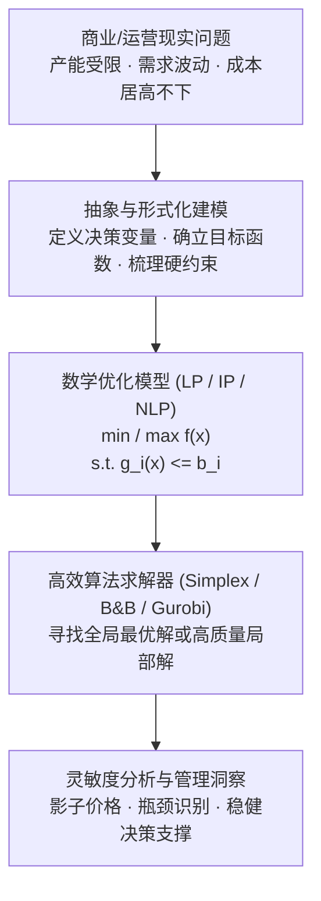
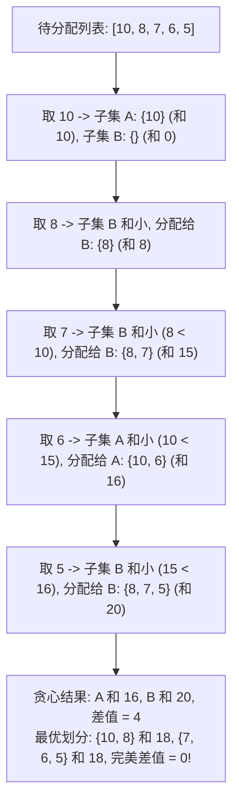
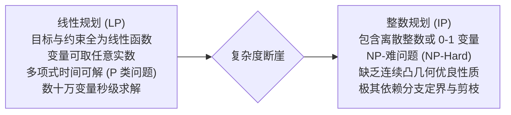

# Lec 1 管理科学中的优化方法导论与数字划分 (Introduction to Optimization & Number Partition)

> MIT Sloan 15.053 · Optimization Methods in Management Science · 主讲 Prof. James Orlin

## TL;DR

- 运筹优化是管理科学的核心引擎，将有限资源分配与决策目标转化为严密的数学极值问题。
- 优化模型三要素：决策变量（Decision Variables）、目标函数（Objective Function）与约束条件（Constraints）。
- 通过经典数字划分问题（Number Partition Problem）揭示组合爆炸与启发式搜索（Heuristics）的本质。
- 确立线性规划（LP）与非线性规划（NLP）、离散优化（IP）在计算复杂度上的分水岭。

## 运筹优化的范式：从经验直觉到数学规划

在现代商业与工程世界中，管理者每天都要面临无数资源分配与调度抉择：航空公司如何在成千上万个航班中分配机组人员？炼油厂如何将不同品质的原油调配成符合标准的成品油？物流巨头如何在庞大的全国仓网中寻找最低成本的配送路径？

若仅凭管理者的直觉经验与试错法，面对变量成千上万的复杂系统，人类大脑往往会陷入组合爆炸的死胡同。**运筹学（Operations Research, OR）与管理科学（Management Science）**的核心使命，就是将商业与工程现实抽象为严密的数学优化模型，利用高效算法在天文数字般的可能性中寻找最优解。

从知识工程的角度审视，优化模型的构建过程本身就是一次对业务机理的深度解剖。模型不仅能给出“应该怎么做”的决策建议，更通过影子价格与对偶变量揭示出每一项资源瓶颈的边际经济价值。

## 优化模型的三大标准要素

无论优化问题的背景是金融投资组合、医疗放射剂量规划还是制造车间排产，所有数学优化模型均统一构建在三大标准积木之上：

| 建模要素 | 形式化数学符号 | 核心管理内涵 | 典型商业实例 |
| :--- | :--- | :--- | :--- |
| **决策变量 (Decision Variables)** | $x_1, x_2, \dots, x_n \in \mathbb{R}^n$ (或 $\mathbb{Z}^n, \{0,1\}^n$) | 决策者**拥有完全自主控制权**的核心行动杠杆 | 下季度各类产品的计划生产量；每条航线的航班班次；投资组合中各项资产的配置权重 |
| **目标函数 (Objective Function)** | $\max z = f(x)$ 或 $\min z = f(x)$ | 衡量决策方案优劣的**唯一定量化价值标尺** | 最大化企业息税前营业利润；最小化总物流与仓储成本；最小化化疗对正常组织的射线照射损伤 |
| **约束条件 (Constraints)** | $g_i(x) \le b_i, \quad i = 1, \dots, m$ | 现实世界对决策方案施加的**物理、经济与法律硬边界** | 原材料库存上限；机床工时容量限制；客户订单最低交付需求；各变量非负条件 $x \ge 0$ |

::: definition 可行解、可行域与最优解
- **可行解（Feasible Solution）**：满足模型中所有约束条件的决策变量向量 $x$；
- **可行域（Feasible Region, $\mathcal{F}$）**：所有可行解构成的几何点集；若 $\mathcal{F} = \emptyset$，则称模型**不可行（Infeasible）**；
- **最优解（Optimal Solution, $x^*$）**：使得目标函数达到最大值（或最小值）的可行解，即对任意 $x \in \mathcal{F}$ 均有 $f(x^*) \ge f(x)$（极大化问题）。
:::

## 经典试金石：数字划分问题（Number Partition Problem）

为了让学生直观体会组合优化与连续优化的根本差异，课程在第一讲引入了著名的**数字划分问题（Number Partition Problem）**：

::: example 数字划分问题场景
给定一个包含 $n$ 个正整数的集合 $S = \{s_1, s_2, \dots, s_n\}$，要求将该集合精确划分为两个不相交的子集 $S_1$ 与 $S_2$（满足 $S_1 \cup S_2 = S$ 且 $S_1 \cap S_2 = \emptyset$），使得两个子集内部元素之和的绝对差值最小：
$$\min \left| \sum_{i \in S_1} s_i - \sum_{j \in S_2} s_j 
ight|$$
:::

### 1. 暴力穷举法与组合爆炸（Combinatorial Explosion）
对于包含 $n$ 个元素的集合，每个元素只有“归属 $S_1$”或“归属 $S_2$”两种选择。因此，总共存在 $2^{n-1}$ 种本质不同的划分方式：
- 当 $n = 10$ 时，搜索空间仅为 $2^9 = 512$ 种，计算机可在微秒内穷举完成；
- 当 $n = 50$ 时，搜索空间暴增至 $2^{49} pprox 5.6 	imes 10^{14}$ 种，单台超级计算机穷举需耗费数月；
- 当 $n = 100$ 时，$2^{99}$ 已经远远超越了已知宇宙中的基本粒子总数，任何超级计算机穷举法在物理层面上自始破产！

数字划分问题在计算复杂性理论中属于著名的 **NP-完全问题（NP-Complete）**。

### 2. 启发式贪心算法（Greedy Heuristic）
在商业实战中，面对 NP-难问题，管理者往往退而求其次采用**启发式算法（Heuristics）**寻求快速近似解：
1. 将集合 $S$ 中的所有数字按从大到小严格降序排列；
2. 依次取出当前最大的数字，将其分配给当前总和较小的那个子集；
3. 重复直至所有数字分配完毕。

从计算复杂性理论的宏观视角审视这一鲜明对比，我们会发现计算机科学与运筹学最深刻的本质规律。贪心算法的核心哲学在于“局部短视”——在做当前决策时，只关注能够立即最小化当前不平衡度的数字分配，而对后续更小数字的深层排列组合缺乏全局视野。在简单问题中，这种直觉尚可应付；但当面对高度敏感的离散组合优化时，一次局部的微小贪心便会酿成全局的无法挽回的偏差。

正因如此，真正的运筹学方法从来不寄希望于简单的直觉尝试。为了在多项式时间内逼近甚至精确定位全局最优解，现代运筹算法开发了包括分支定界树（Branch and Bound）、动态规划记忆化状态转移、以及基于凸包松弛的割平面法。这些算法之所以能够在数亿级庞大状态空间中免于迷航，正是因为它们在底层建立了坚固的数学理论剪枝准则。

如上图所示，贪心启发式算法虽然能在 $O(n \log n)$ 的极短时间内给出一个可行方案，但其致命缺陷在于其“目光短浅”，容易陷入局部陷阱，无法保证全局最优性。这正是深入学习严谨数学规划理论（如整数规划分支定界、割平面）的核心动力。

## 连续线性规划与离散整数规划的分水岭

在运筹学的大家族中，不同优化模型的求解难度存在天壤之别：

线性规划之所以能够在多项式时间内高效求解，是因为其可行域具有极其优良的**凸多面体（Convex Polyhedron）**几何结构，最优解必然存在于多面体的极点（顶点）之上；而一旦引入整数离散限制，原本连续平滑的可行域被破碎为互不相连的离散孤岛点集，传统的导数与单纯形转轴法瞬间失效。

::: pitfall 误以为“先求 LP 松弛解、再简单四舍五入就能得到最优整数解”
许多工程人员常犯的初级错误是：先忽略变量的整数限制，当作普通线性规划求解，得到 $x_1 = 4.7, x_2 = 3.2$，然后直接四舍五入为 $x_1 = 5, x_2 = 3$。这种做法具有极高风险：(1) **四舍五入后的解往往直接破坏约束条件，变成不可行解！** (2) 即使侥幸可行，其目标函数值也可能距离真正的最优整数解相差十万八千里。
:::

::: insight 优化的最高境界，是对问题数学结构的深刻敬畏
在初学者眼中，管理科学似乎只是将数字输入 Excel 求解器（Solver）点击运行。但顶级运筹学家与商业架构师深知：垃圾进，垃圾出（Garbage in, Garbage out）。一个卓越模型的威力，不在于代码的繁琐，而在于能否精准洞察业务底层的数学凸性与组合结构。将混乱复杂的商业现实抽象为优雅坚固的数学方程，是人类理性在商业世界中绽放的最极致之美。
:::
