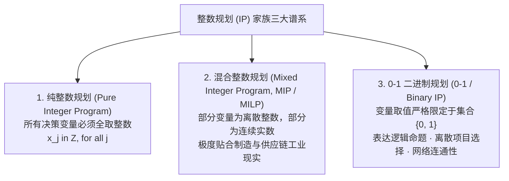
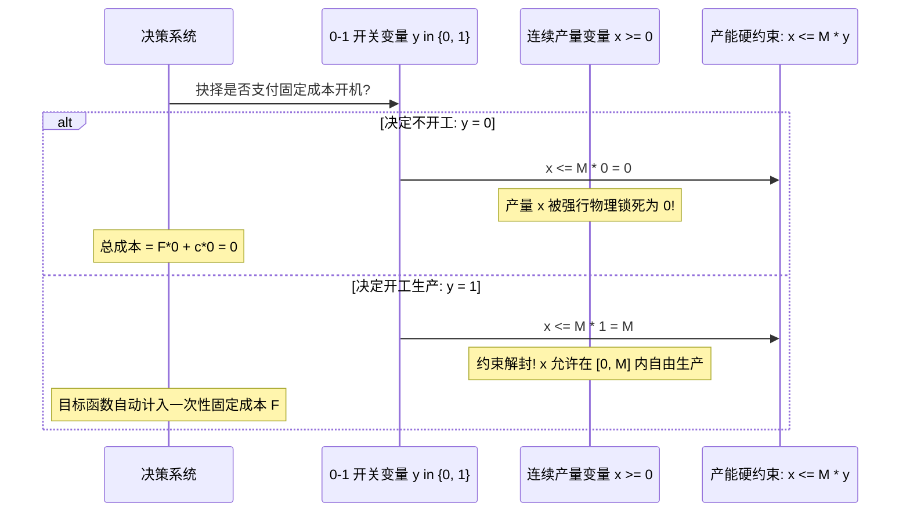
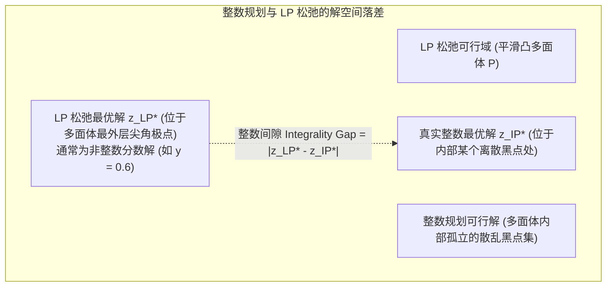

# Lec 10 整数规划导论与离散选择建模 (Introduction to Integer Programming: Discrete Choice & Modeling)

> MIT Sloan 15.053 · Optimization Methods in Management Science · 主讲 Prof. James Orlin

## TL;DR

- 现实世界的管理决策往往是非黑即白的离散抉择：建厂与否、投资与否、航班指派与否。
- **0-1 二进制变量（Binary Variables）**赋予了数学模型表达逻辑判断与开关控制的惊人表达力。
- 深入拆解固定成本问题（Fixed Charge Problem）与大 M 关联约束（Big-M Capacity Constraints）。
- **线性规划松弛（LP Relaxation）**与整数间隙（Integrality Gap）：揭示离散优化求解难度的本质指标。

## 离散的世界：为什么连续变量不再足够？

在线性规划中，我们假定所有的决策变量都是平滑连续的：生产 3.75 吨化肥、调配 12.8 加仑涂料在工业上完全合情合理。然而，当我们步入更高维度的战略与运营决策时，连续假设瞬间碎裂：
- 你不能在波士顿建造 0.6 个云计算数据中心，要么建（1），要么不建（0）；
- 跨国并购中，你不能雇佣 2.3 位项目合伙人；
- 机器生产若开机运转，必须先支付一笔 5,000 美元的冷启动固定调试费，哪怕只生产 1 个零件！

这种包含不可分割实体或逻辑命题的优化问题，统称为**整数规划（Integer Programming, IP）**。

## 0-1 变量的表达力：把逻辑语言翻译为代数矩阵

在 0-1 规划中，我们用变量 $y \in \{0, 1\}$ 表达一个逻辑命题的真伪：$y = 1$ 表示“采纳该决策/执行该项目”，$y = 0$ 表示“拒绝该决策”。借助简单的线性不等式，0-1 变量能够精妙表达几乎所有人类商业逻辑：

| 商业逻辑规则 | 逻辑命题描述 | 0-1 线性代数等价约束方程 |
| :--- | :--- | :--- |
| **互斥选择 (Mutually Exclusive)** | 在项目 A 和项目 B 中，**最多只能选择其中一个**投产 | $y_A + y_B \le 1$ |
| **严格单选 (Exactly One)** | 在三种备选建厂地址中，**必须且只能选定一个** | $y_1 + y_2 + y_3 = 1$ |
| **条件前置 (Contingency / Prerequisite)** | **只有在投资了项目 A 的前提下**，才被允许投资项目 B | $y_B \le y_A \iff y_B - y_A \le 0$ （若 $y_A=0$ 则 $y_B$ 必为 0） |
| **同生共死 (Co-requisite)** | 项目 A 与项目 B 要么**同时上马**，要么**同时放弃** | $y_A = y_B \iff y_A - y_B = 0$ |
| **配额阈值 (Threshold Limit)** | 在 5 个备选技术研发路径中，**至少要立项 3 个** | $\sum_{i=1}^5 y_i \ge 3$ |

这些看似质朴的不等式，构成了将企业管理层长篇累牍的战略规划方案自动化编译为求解器代码的底层汇编指令。

## 经典实战：固定成本问题（The Fixed Charge Problem）

在供应链管理中，生产成本往往包含两部分：(1) 一旦开工就必须支付的固定设备折旧费与模具安装费（Setup Cost, $F$）；(2) 随产量增加而线性上升的边际变动成本（Marginal Cost, $c$）。

$$C(x) = egin{cases} 0, & 	ext{若 } x = 0 \ F + c x, & 	ext{若 } x > 0 \end{cases}$$

这是一个典型的带有跳跃不连续点的非线性函数。我们如何用线性的混合整数规划（MILP）完美将其驯化？

### 关联约束与大 M 的数学推导
我们引入一个 0-1 二进制变量 $y \in \{0, 1\}$ 表示开工状态：
- 目标函数计入固定成本：$\min \quad \dots + F \cdot y + c \cdot x$
- 设立核心关联约束（Linking Constraint）：
  $$x \le M \cdot y \quad (	ext{其中 } M 	ext{ 为该生产线的最大物理产能上限})$$

当 $y = 0$ 时，约束变为 $x \le 0$，强制使得产量只能为 0；当 $y = 1$ 时，约束变为 $x \le M$，产量可以在合理产能区间内任意取值，同时目标函数自动触发了 $F 	imes 1 = F$ 的固定成本扣除！

## 线性规划松弛（LP Relaxation）与整数间隙

要评估一个整数规划问题的求解难度，首要动作是观察其**线性规划松弛（LP Relaxation）**：

::: definition LP 松弛（LP Relaxation）
对于一个整数规划问题，直接**剥离并忽略所有的“必须取整数”的约束**，允许原本离散的变量在连续实数区间 $[0, 1]$ 或 $[0, +\infty)$ 内任意取值所构成的常规线性规划，称为原问题的 LP 松弛。
:::

### 整数间隙（Integrality Gap）的管理隐喻
对于极大化问题，由于 LP 松弛的可行域远远大于原整数规划的可行域，其最优目标值必然满足：
$$z_{	ext{IP}}^* \le z_{	ext{LP}}^*$$
两者之间的代数差值（或相对比例）：
$$	ext{Gap} = rac{|z_{	ext{LP}}^* - z_{	ext{IP}}^*|}{|z_{	ext{IP}}^*|}$$
被称为**整数间隙（Integrality Gap）**。
- 如果 Gap 非常微小（例如 $< 1\%$），说明 LP 松弛与真实整数凸包极其贴合，分支定界算法通常在数步内即可极速收敛；
- 如果 Gap 极其巨大（例如 $> 50\%$），说明 LP 松弛给出的界限极度松散虚弱，算法将被迫在庞大的搜索树中苦苦遍历数百万个节点。

::: pitfall 大 M 设定过于松散引发的求解器瘫痪
在关联约束 $x \le M y$ 中，很多建模者图省事，随手写一个天文数字 $M = 1,000,000,000$（而实际最大产能其实只有 500）。这种极其懒惰的做法会导致灾难性的后果：**LP 松弛在求解时，只需令 $y = 0.0005$，就能让 $x$ 达到 500！**这使得松弛模型在极小化成本时以几乎为零的微小代价绕过固定成本 $F$，直接导致 LP 松弛给出的下界极其脆弱，分支定界树呈指数级膨胀爆炸，让数千万元采购的高性能求解器陷入假死。**必须尽可能将 $M$ 收紧到其真实物理上限！**
:::

::: insight 离散优化的魅力，在于给连续的自然法则注入人类意志的开关
连续数学描述的是星球运转、流体渗透等不受意志支配的物理客观世界；而整数规划描述的，则是充满人类理性权衡与制度规则的文明世界。一个 0-1 变量，就是人类在商业荒野上插下的一柄道岔——向左还是向右，生存还是毁灭。掌握了离散选择的建模艺术，我们才真正拥有了用冰冷的数学语言为复杂的商业社会构筑规则秩序的画笔。
:::
