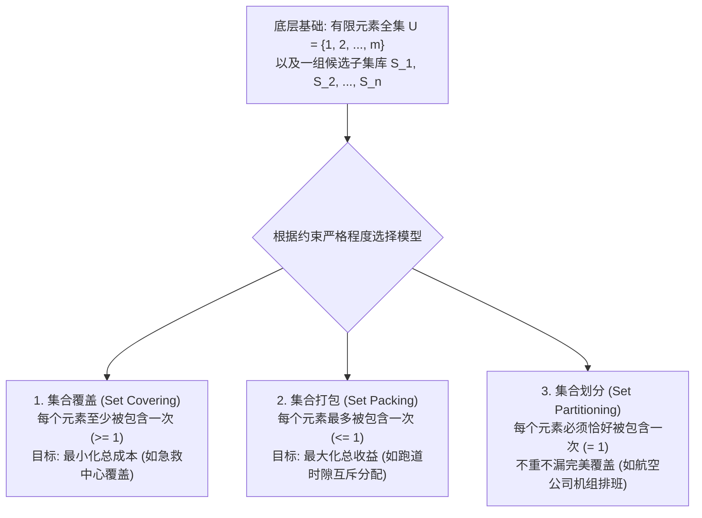
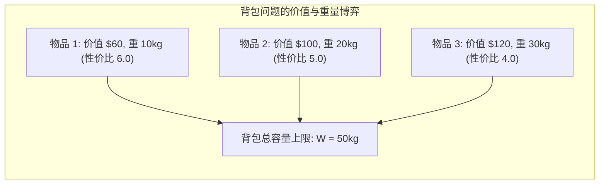
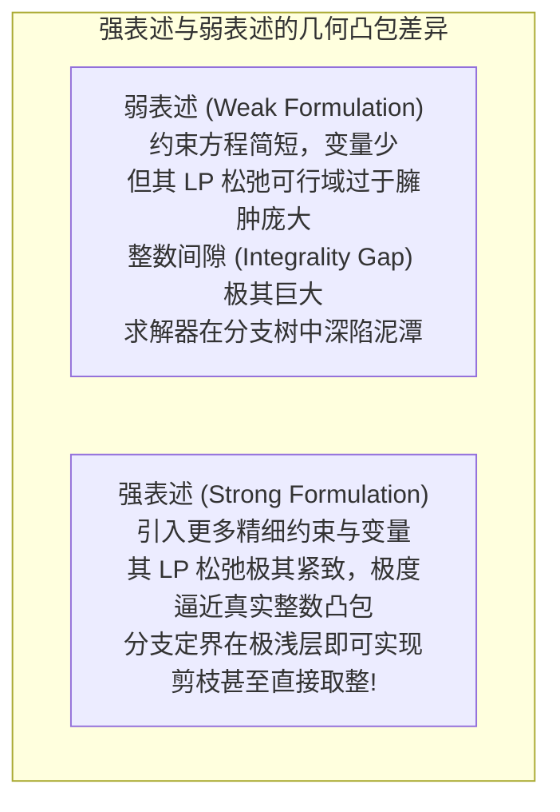

# Lec 11 经典整数规划模型：背包、集合覆盖、打包与划分 (IP Formulations: Knapsack, Set Covering & Packing)

> MIT Sloan 15.053 · Optimization Methods in Management Science · 主讲 Prof. James Orlin

## TL;DR

- 0-1 背包问题（Knapsack Problem）是运筹学与计算机算法史上最经典的有界容量价值最大化模型。
- **集合覆盖（Set Covering）**、**集合打包（Set Packing）**与**集合划分（Set Partitioning）**构成组合优化的四大神兽。
- 广泛应用于航空公司全网航班机组排班、城市应急消防站选址与无线电通信频段分配。
- 揭示强表述（Strong Formulations）对削减分支定界搜索空间所起到的决定性作用。

## 组合优化的世界观：子集选择与资源互斥

在离散运筹学中，绝大多数看似风马牛不相及的复杂现实问题，剥离掉行业特定的外衣后，底层往往都可以精确归约为四个具有极其优美对称性的经典原型问题：**背包问题、集合覆盖、集合打包与集合划分**。

掌握了这四大经典模型的数学骨架，就如同掌握了组合优化的通用基因图谱。

从计算理论与离散数学的宏观视角审视这一分类体系，我们会发现这四大模型构成了现代算法复杂性研究的奠基石。每一个模型都代表了一种特定类型的逻辑约束强度：集合覆盖允许重叠，追求底线保障；集合打包杜绝冲突，追求资源利用率最大化；而集合划分则以最严苛的不重不漏等式，锁定了工业调度系统的精密运转。

在过去的半个世纪中，从早期的理论图论探索，到现代云计算集群的任务调度、超大规模集成电路（VLSI）的芯片布线，这四大模型反复以不同的业务外衣登场。深刻理解它们之间的细微差异与转化技巧，是运筹学者在面对千奇百怪的工业需求时，能够迅速拨开迷雾、完成标准化数学建模的看家本领。

## 0-1 背包问题（The 0-1 Knapsack Problem）

想象一名登山探险家面对 $n$ 件有价值的物资，他的背包最大承重能力仅为 $W$：
- 每件物品 $j$ 拥有独立的经济价值 $c_j$ 与物理重量 $w_j$；
- 物品不可分割，要么完整装入背包（$x_j = 1$），要么彻底放弃（$x_j = 0$）。

代数形式化模型呈现为极其精简的一行约束：
$$\max \quad \sum_{j=1}^{n} c_j x_j$$
$$	ext{subject to} \quad \sum_{j=1}^{n} w_j x_j \le W$$
$$x_j \in \{0, 1\}, \quad orall j = 1, \dots, n$$

### 贪心算法在背包问题中的惨败
在连续线性规划中，我们只需计算“单位重量价值（性价比 $c_j / w_j$）”，按性价比从高到低装入即可获得最优解。然而在 0-1 离散背包中，纯粹的性价比贪心策略经常遭遇惨败：
- 贪心法可能装入了一件高性价比但体积尴尬的物品，导致背包留下无法利用的死角，反而错失了装入两件综合总价值更高的中等物品的机会。
- 0-1 背包问题属于弱 NP-难问题，可通过动态规划（DP）在伪多项式时间 $O(nW)$ 内精确求解。

## 集合三剑客：覆盖、打包与划分的代数矩阵

设全集由 $m$ 个需求要素构成（$i = 1, \dots, m$），我们拥有 $n$ 个可选服务方案（$j = 1, \dots, n$）。
定义 0-1 关联矩阵 $A \in \{0, 1\}^{m 	imes n}$：
$$a_{ij} = egin{cases} 1, & 	ext{若方案 } j 	ext{ 能够覆盖/包含要素 } i \ 0, & 	ext{反之} \end{cases}$$
决策变量：$x_j \in \{0, 1\}$ 表示是否选中方案 $j$。

| 经典模型 | 形式化代数方程 | 现实商业管理隐喻 | 典型工业级应用场景 |
| :--- | :--- | :--- | :--- |
| **集合覆盖 (Set Covering)** | $\min \sum c_j x_j$ s.t. $\mathbf{A x \ge 1}, \quad x \in \{0,1\}^n$ | 允许重叠与冗余，但全网**每个客户至少必须有 1 支队伍提供兜底服务** | 城市消防局与救护车站址规划；移动通信 5G 信号塔全域覆盖 |
| **集合打包 (Set Packing)** | $\max \sum c_j x_j$ s.t. $\mathbf{A x \le 1}, \quad x \in \{0,1\}^n$ | 资源具有绝对排他性，**每个资源最多只能分配给 1 个用户**，绝不允许多重冲突 | 机场起降跑道时隙拍卖；无线电频谱竞标；互斥投资项目组合 |
| **集合划分 (Set Partitioning)** | $\min \sum c_j x_j$ s.t. $\mathbf{A x = 1}, \quad x \in \{0,1\}^n$ | 完美不重不漏：**每个任务必须且只能由 1 个责任人执行**，既不缺位也不浪费 | **航空公司全网机组轮值排班 (Crew Scheduling)**；公交车辆线路循环图 |

### 航空公司机组排班（Crew Scheduling）的百亿级应用
在达美航空或美联航的运营中，全网每天有数千个航班航段（Flight Legs）。如果一名飞行员执行了航班 101，随后必须经过法定休息时间才能执飞航班 204。
- 运筹团队首先通过组合生成器，生成数百万条符合 FAA 严苛飞行疲劳安全法规的合法“连续轮值配对链（Pairings）”；
- 随后构建一个巨大的**集合划分模型（Set Partitioning）**：矩阵的每一行代表一个航班航段，每一列代表一条备选飞行员轮值链；
- 约束方程 $A x = \mathbf{1}$ 强制要求：**每一个航班的驾驶舱里，必须且只能分配一组机组人员，绝不允许出现航班无人执飞、也绝不允许两组飞行员重复登上同一架飞机！**
该模型每年为全球航空业节省数以十亿美元计的昂贵机组闲置与滞留成本。

## 建模的高阶艺术：强表述（Strong） vs 弱表述（Weak）

同一个实际问题，在数学上往往存在多种完全等价的代数表述方式。但在整数规划求解中，不同表述的求解性能可能相差数十万倍：

### 经典案例：固定设施选址与客户分配
设要在 $m$ 个备选地点建立仓库（$y_i \in \{0, 1\}$），并向 $n$ 个客户供应产品（$x_{ij} \in [0, 1]$ 表示客户 $j$ 由仓库 $i$ 供应）：
- **弱表述（聚合约束）**：
  $$\sum_{j=1}^n x_{ij} \le n \cdot y_i, \quad orall i = 1, \dots, m$$
  在 LP 松弛下，只要仓库 $i$ 供应了一个客户，$y_i$ 只需取微小的分数值 $rac{1}{n}$（例如 $0.05$）即可满足约束，给出的下界极度松散！
- **强表述（解聚约束）**：
  $$x_{ij} \le y_i, \quad orall i = 1, \dots, m, \quad orall j = 1, \dots, n$$
  约束条数虽然从 $m$ 条膨胀到了 $m 	imes n$ 条，但迫使 $y_i$ 在松弛解中必须紧紧跟随最大的 $x_{ij}$，直接将松弛解的下界拉高数倍，使求解耗时从数小时断崖式暴跌至数秒！

::: pitfall 盲目追求“变量数最少”的幼稚直觉
许多软件工程师在初写优化模型时，总是千方百计试图削减约束和变量的数量，误以为“变量越少计算越快”。在整数规划中，这种直觉往往是灾难性的反直觉！**包含更多约束的“强表述”，通过在空间中织就更密集的刀网，大幅削平了非整数的无用尖角，反而能以成百上千倍的速度完成分支定界收敛！**
:::

::: insight 组合优化的本质，是在离散的离心力与逻辑的向心力之间寻找共振
背包、覆盖、打包与划分，如同四部变奏曲，用极其简洁的代数符号诠释着资源互斥与目标达成的平衡艺术。现实商业世界中的资源永远是有限的，但欲望永远是无限的。学会用精妙的强表述为商业逻辑构筑坚不可摧的凸包骨架，是运筹学家将混乱无序的离散世界驯服为高效运转机器的无上荣耀。
:::
