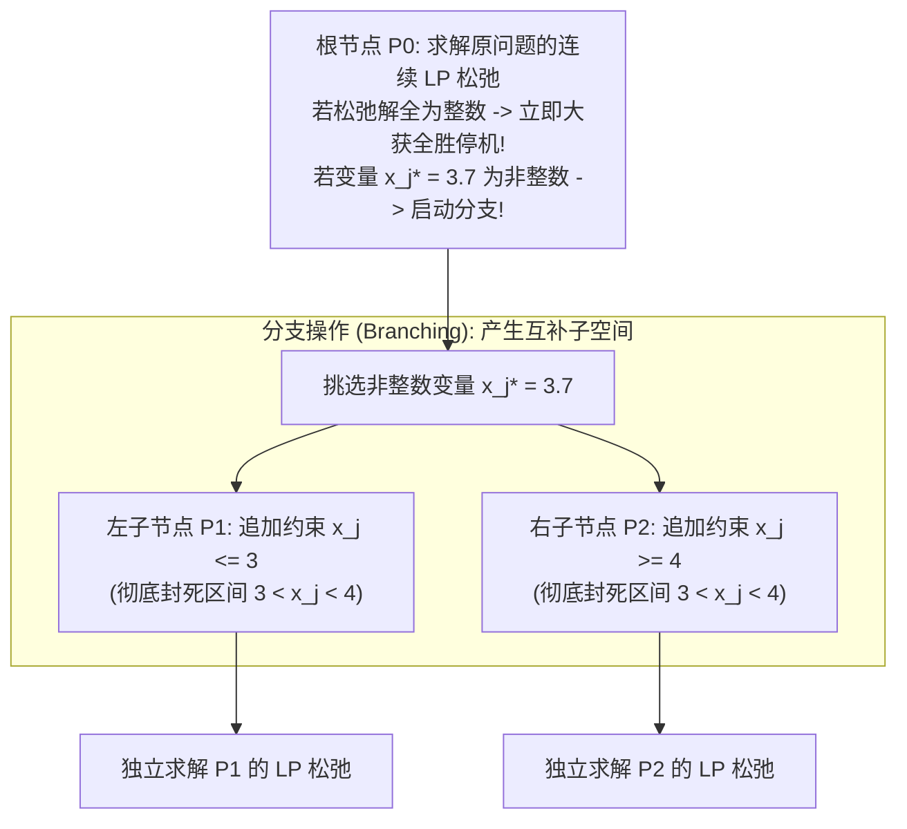
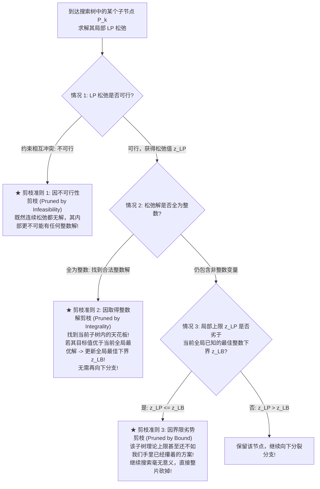

# Lec 12 整数规划算法 I：分支定界法 (Integer Programming Techniques I: Branch and Bound)

> MIT Sloan 15.053 · Optimization Methods in Management Science · 主讲 Prof. James Orlin

## TL;DR

- 分支定界法（Branch and Bound, B&B）是现代所有商业离散优化求解器（Gurobi, CPLEX）的绝对通用核心引擎。
- 核心哲学：分而治之（Divide and Conquer），通过递归将庞大的可行域切割为互不相交的子空间树。
- 依靠 LP 松弛提供严密的目标值**上界（Bound）**，依靠已知整数可行解提供**全局下界（Incumbent）**。
- 深度拆解三大剪枝（Pruning / Fathoming）法则，让求解器免于穷举数十亿无用分支。

## 分而治之的威力：为什么暴力穷举必死无疑？

在第十讲中我们已经看到，对于一个包含 100 个 0-1 二进制变量的整数规划问题，搜索空间包含 $2^{100} pprox 1.26 	imes 10^{30}$ 种可能的离散解。哪怕一台每秒能够检验 10 亿个解的超级计算机，也需要花费上千亿年才能穷举完成。

面对看似不可逾越的组合爆炸深渊，1960 年艾莉西亚·兰德（Ailsa Land）与艾莉森·多伊格（Alison Doig）提出了运筹学史上最伟大的算法构想之一——**分支定界法（Branch and Bound, B&B）**。它的精髓在于：**绝不愚蠢地逐个遍历解，而是通过严密的数学界限，在搜索树的极高位置，以一刀切的方式直接成批斩断数以万亿计根本不可能包含更优解的无用分支！**

如上图所示，由于任何合法的整数解必然满足 $x_j \le 3$ 或者 $x_j \ge 4$，开区间 $(3, 4)$ 之间绝不可能存在任何整数！因此，将可行域切分为左、右两个子空间，不仅没有遗漏任何一个合法的整数解，而且成功抹杀了当前破坏整数性的非整数解。

## 分支定界的三大核心构件：分支、定界与剪枝

在整棵搜索树的递归展开中，算法严格依赖三大基石协同运转（以极大化问题 $\max z$ 为例）：

| 核心构件 | 数学执行机制 | 核心管理与算法功能 |
| :--- | :--- | :--- |
| **1. 分支 (Branching)** | 挑选当前松弛解中取值最尴尬的分数变量 $x_k^* = \lfloor x_k^* 
floor + f$ ($f > 0$)，分立两个子问题： 左支追加 $x_k \le \lfloor x_k^* 
floor$；右支追加 $x_k \ge \lceil x_k^* 
ceil$ | 将原多面体沿超平面一刀切为两半，强行驱逐非整数解 |
| **2. 定界 (Bounding)** | 在每个子节点处，求解该节点追加约束后的连续 LP 松弛，获得松弛最优值 $z_{	ext{LP}}$ | **提供本子树绝对不可逾越的目标值上限（Upper Bound）**：该子树内部的任何整数解目标值绝不可能超越 $z_{	ext{LP}}$！ |
| **3. 剪枝 (Pruning / Fathoming)** | 判定该节点是否已经失去继续向下分支的价值；若触发剪枝条件，**立即将该节点冻结，绝不再向下分裂任何子节点！** | **算法提速的核心发动机**：一刀斩断整条庞大的子树分支 |

## 算法灵魂：三大剪枝准则（Pruning Criteria）

正是依靠严密的剪枝逻辑，B&B 才能在浩瀚的组合宇宙中实现指数级压缩。任何一个子节点一旦触发以下三大准则之一，立即被**宣判剪枝（Pruned / Fathomed）**：

从信息论与搜索树剪枝的深层逻辑审视这三大准则，分支定界法的本质是在“乐观界限”与“现实成就”之间构筑起一道高压电网。每一个通过连续松弛求解出来的目标上限，都是大自然根据物理多面体给出的最慷慨承诺；而每一次取得合法整数解，则是人类在离散荒野中真正攥在手里的真金白银。

这两条不断逼近的界限，构成了现代运筹算法的夹逼定理。不可行剪枝帮助算法迅速识别逻辑冲突的死胡同；整数解剪枝为全系统的搜索高度持续抬升基准面；而界限劣势剪枝，则以摧枯拉朽的确定性直接宣判了成千上万个潜在方向的死刑。正是这种在数学上无可辩驳的排除法，赋予了分支定界法穿越万亿级组合迷宫的无穷力量。

### 剪枝准则 3 的巨大威力：界限剪枝（Pruned by Bound）
假设我们在搜索树的某一深层节点侥幸发现了一个合法的整数解，其利润为 **100 万元**。此时，我们将全局已知的最优整数底线锁定为 $z_{	ext{LB}} = 100$ 万元。
随后，算法回溯到另一条未探索的支路根部，求解其 LP 松弛得到最优值为 **92 万元**。
**此时根本无需关心这个 92 万元的解有多么复杂，算法立即可以直接将该分支彻底永久注销！**因为该分支在最理想的连续松弛状态下最多只能取得 92 万，其内部的真实整数解绝不可能超越 92 万，更不可能战胜我们手中已经拥有的 100 万方案！这一刀下去，往往直接抹杀了数十亿个无用叶子节点。

## 搜索遍历策略：深度优先 vs 最佳界限优先

当树中存在多个待探索的未决节点时，求解器应该优先访问哪一个？两大主流策略各有千秋：

| 搜索策略 | 策略执行机制 | 核心优势 | 潜在缺陷 |
| :--- | :--- | :--- | :--- |
| **深度优先搜索 (DFS / Diving)** | 始终沿着刚分裂出来的子节点一路猛扎到底，直至撞墙被剪枝，再逐步回溯 | **极快找到第一个整数可行解**，从而迅速建立非平凡的全局下界 $z_{	ext{LB}}$ 启动剪枝；内存占用极小 | 容易在局部劣质死角深潜太久，缺乏全局宏观视野 |
| **最佳界限优先 (Best-Bound First)** | 扫描全树中所有待决节点，**优先探索当前松弛目标上限最高的那个节点** | 全局收敛速度在理论上证明是最快的，被探索的节点总数最少 | 需要在内存中维护庞大的未结节点池，易造成内存溢出；初期可能久久找不到整数可行解 |

现代商业求解器普遍采用混合交替策略：**初期采用 DFS 深度探索快速抓取几个可行解锁定底线，随后无缝切换为最佳界限优先全速收敛！**

::: pitfall 误以为“B&B 找到了最优整数解后就能立即停机”
很多初学者在演算 B&B 时，一旦在某个叶子节点发现了令人满意的整数解，便兴奋地宣布算法结束。这是严重的逻辑硬伤！**找到整数解仅仅意味着更新了全局下界（Incumbent），只要树中还有其他未决节点的局部松弛上限高于该值，你就必须继续搜索！唯有当全树所有开放节点的松弛上限全都不优于当前最优整数解时，算法方能正式宣布取得全局最优解！**
:::

::: insight 分支定界是人类在无限迷宫中留下的最优雅理性的路标
面对天文数字般的组合可能性，人类往往容易陷入两种极端：要么盲目冲动地在黑暗中乱撞，要么在浩瀚的可能界面前绝望放弃。分支定界法展现了理性思维的高阶之美——它承认单次计算能力的局限，但通过建立不可逾越的数学边界，以分而治之的从容，将混沌的迷宫层层剥离。每一个被剪掉的分支，都是人类智慧用数学逻辑向不确定性所宣告的绝对胜利。
:::
