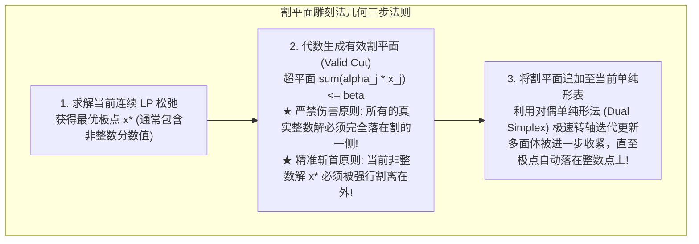
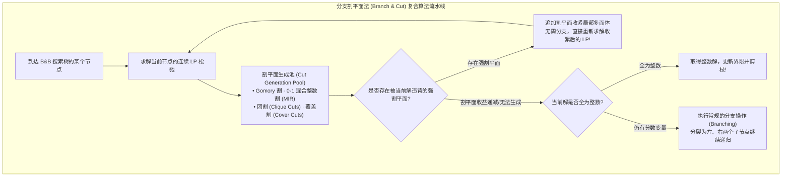

# Lec 13 整数规划算法 II：割平面法与有效不等式 (Integer Programming Techniques II: Cutting Planes)

> MIT Sloan 15.053 · Optimization Methods in Management Science · 主讲 Prof. James Orlin

## TL;DR

- 割平面法（Cutting Plane Method）不将空间切分为两半，而是通过向多面体切入新的超平面剥离非整数解。
- 割平面的黄金准则：**严禁切掉任何一个合法的整数可行解，同时必须切掉当前的非整数松弛解**。
- 拉尔夫·戈莫里（Ralph Gomory）1958 年发明的戈莫里分数割，彻底奠定了割平面的系统化代数生成法。
- 现代工业求解器的王牌杀手锏：**分支割平面法（Branch and Cut, B&C）**如何将 B&B 与割平面融为一体。

## 割平面的几何直觉：削去松弛多面体的虚幻尖角

在第十二讲中，我们学习了分支定界法（B&B）——它通过“分而治之”将可行域在几何上切成互不相交的两个子空间。

然而，20 世纪 50 年代末，数学家拉尔夫·戈莫里（Ralph Gomory）提出了另一种截然不同、更加精巧的几何思考：**既然原问题的整数解全部深锁在松弛凸多面体的内部，而当前松弛解之所以是非整数，是因为松弛多面体在最外层的极点处延伸出了过多的‘虚幻尖角’，那我们为什么不能像雕刻家削木头一样，一刀削掉这个包含非整数解的尖角呢？**

这种向模型中源源不断追加有效约束的方法，被称为**割平面法（Cutting Plane Method）**。

## 戈莫里分数割（Gomory Fractional Cuts）的精密代数推导

戈莫里最伟大的贡献，在于证明了**割平面完全不需要凭借几何猜测，而是可以直接从单纯形法的最终最优表中自然推导出来！**

### 优雅的代数推导过程
设当前连续 LP 松弛已经达到最优，在最终单纯形表中，某一行基变量 $x_i$ 的方程形式为：
$$x_i + \sum_{j \in N} ar{a}_{ij} x_j = ar{b}_i$$
假设常数项 $ar{b}_i$ 为非整数（例如 $ar{b}_i = 4.7$）。
我们将所有实数系数拆解为其**整数部分 $\lfloor \cdot 
floor$ 与小数分数部分 $f \in [0, 1)$ 之和**：
- $ar{a}_{ij} = \lfloor ar{a}_{ij} 
floor + f_{ij}, \quad 0 \le f_{ij} < 1$
- $ar{b}_i = \lfloor ar{b}_i 
floor + f_i, \quad 0 < f_i < 1$

将原方程重写：
$$x_i + \sum_{j \in N} \left( \lfloor ar{a}_{ij} 
floor + f_{ij} 
ight) x_j = \lfloor ar{b}_i 
floor + f_i$$
移项整理，将整数部分归于左侧，小数部分归于右侧：
$$x_i + \sum_{j \in N} \lfloor ar{a}_{ij} 
floor x_j - \lfloor ar{b}_i 
floor = f_i - \sum_{j \in N} f_{ij} x_j$$

::: theorem 戈莫里割的判定不等式
现在，我们审视任何一个合法的**整数解**：
1. 观察等式左边：由于 $x_i$ 与 $x_j$ 都是整数，且 $\lfloor \cdot 
floor$ 全为整数，因此**等式左边在任何合法整数解下必然是一个纯整数！**
2. 观察等式右边：由于 $f_i < 1$ 且所有 $f_{ij} \ge 0, x_j \ge 0$，因此等式右边必然**严格小于 1**（即 $f_i - \sum f_{ij} x_j \le f_i < 1$）；
3. **关键飞跃**：一个小于 1 的整数，其最大取值最多只能是多少？**只能小于或等于 0！**
:::

于是，我们立即推导出了载入史册的**戈莫里分数有效割（Gomory Cut）**：
$$f_i - \sum_{j \in N} f_{ij} x_j \le 0 \iff \sum_{j \in N} f_{ij} x_j \ge f_i$$

### 检验割平面的合法性
1. **绝不伤害无辜整数解**：上面的推导完全建立在“$x$ 是整数”的前提下，因此全天下所有合法的整数可行解无一例外都满足该不等式；
2. **精准消灭当前松弛解**：在当前的连续松弛最优解中，所有非基变量全为 0（即 $x_N = 0$）。将 $x_N = 0$ 代入不等式左边，得到 $0 \ge f_i$；但由于 $f_i > 0$，**该不等式发生严重违背（$0 \ge 0.7$ 不成立）！当前非整数解被瞬间割杀！**

## 单纯形转轴的无缝衔接：对偶单纯形法的妙用

当我们向原单纯形表中追加一条全新的割平面约束时：
$$-\sum_{j \in N} f_{ij} x_j + s_{	ext{cut}} = -f_i \quad (	ext{其中 } -f_i < 0)$$
此时，右端项为负数，但目标函数行（Row 0）的所有检验数依然满足最优性条件（全非正）！

无需从头重新计算整个线性规划，直接调用**对偶单纯形法（Dual Simplex Method）**，仅需极少的转轴步数，便可立即将新约束消化吸收，几何多面体随之完成一次精密切削。

## 现代求解器的核武器：分支割平面法（Branch and Cut, B&C）

在 20 世纪 70 年代，纯粹的割平面法曾因收敛极其缓慢、易引发严重的数值退化而一度被打入冷宫。然而，到了 90 年代，运筹学家完成了一项石破天惊的融合——**分支割平面法（Branch and Cut, B&C）**：

在分支割平面体系中：
- 算法不是机械地一味盲目分支，而是在每个节点处，先调用算法池生成数十条极具针对性的**结构割平面（如旅行商问题的子回路消除割、背包问题的覆盖割）**；
- 割平面在局部将松弛凸多面体收割得极其紧致，大幅削减整数间隙；
- 只有当割平面的边际收益衰减时，才平稳过渡到分支操作。

正是由于分支割平面技术的突破，现代商业求解器求解大规模混合整数规划（MIP）的速度，比三十年前暴增了**数千万倍**！

::: pitfall 盲目向模型中无节制堆砌上万条割平面
初学者常以为割平面越多越好。然而，每一条割平面都意味着向系数矩阵中增加了一行约束，会导致单纯形表的基矩阵急剧膨胀，单次转轴的耗时大幅拉长，且过度密集的切面极易诱发严重的病态矩阵条件数。**现代求解器包含精密的“割平面老化与清洗机制（Cut Ageing & Purging）”——一旦某条割平面在后续迭代中不再处于紧约束状态，求解器会果断将其从活跃内存中剔除！**
:::

::: insight 雕刻的艺术，在于每一刀都直击虚妄而完形真实
如果说分支定界法是用重锤将巨石砸为两半，那么割平面法则如同一柄精巧的手术刀，在多维几何体上游刃有余地切除冗余的虚幻。它向我们展示了纯粹代数推理在几何空间中所能达到的至高精度。将粗犷的分支与细腻的切削完美熔于一炉，正是人类在离散运筹计算史上铸就的最伟大的工程奇迹。
:::
