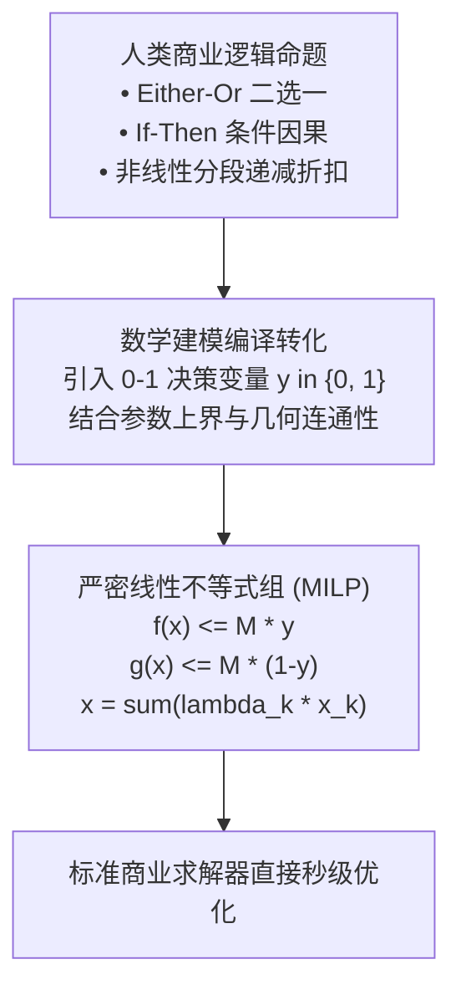
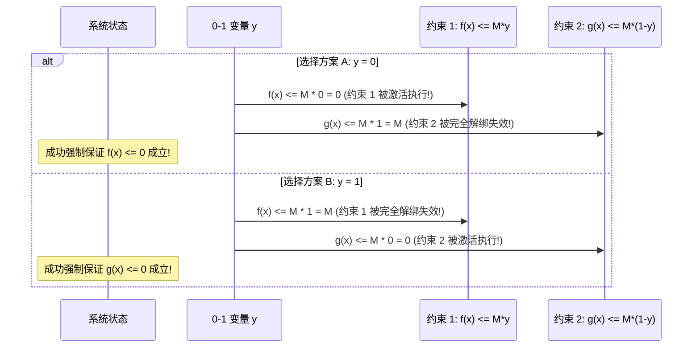

# Lec 14 高级整数规划建模技巧与逻辑约束 (Advanced IP Formulations & Logical Constraints)

> MIT Sloan 15.053 · Optimization Methods in Management Science · 主讲 Prof. James Orlin

## TL;DR

- 掌握将复杂非线性条件命题转化为严密线性 0-1 混合整数规划（MILP）的高阶战法。
- 深入拆解“二选一”约束（Either-Or）与条件蕴涵逻辑（If-Then）的大 M 标准代数套路。
- 掌握非凸分段线性成本函数（Piecewise Linear Functions）的建模精粹。
- 特殊有序集（SOS1 与 SOS2）如何赋能现代求解器绕过大 M 陷阱实现极速分支。

## 现实世界的复杂逻辑挑战

在初阶优化建模中，我们处理的约束大多是直截了当的“资源不得超标”或“需求必须满足”。但在复杂的企业战略、系统调度与智能电网博弈中，管理者往往面对的是充满条件分支的复杂逻辑语言：
- **互斥政策**：“供应商 A 的送货量必须在 1,000 到 2,000 吨之间，**或者**我们彻底不从供应商 A 采购任何货物（0 吨）”；
- **条件触发**：“**如果**我们在该省投资了物流集散基地，**那么**必须在该省同时配置至少两支专业冷链车队”；
- **非线性折扣**：“采购量在 0 到 100 吨单价为 50 元；100 到 500 吨超额部分享受 40 元批发价；超过 500 吨享受 30 元特价”。

很多程序员面对这些需求，第一反应是用代码写大量的 `if-else` 条件判断。然而，数学规划求解器（如 Gurobi）无法直接接受带有 `if-else` 的非连续分支代码，**所有逻辑必须被无缝翻译为一组具有绝对数学确定性的线性代数不等式！**

## 二选一约束（Either-Or Constraints）的大 M 标准化

设系统面临两大约束条件，现实要求**必须满足其中至少一个（可以都满足，但绝不能两个都违背）**：
$$f(x) \le 0 \quad 	ext{或者} \quad g(x) \le 0$$
直接联立求解要求两者同时成立，显然破坏了“二选一”的自由度。

### 大 M 标准转化模板
我们引入一个 0-1 二进制变量 $y \in \{0, 1\}$，以及一个充分大的常数 $M$：
$$f(x) \le M \cdot y$$
$$g(x) \le M \cdot (1 - y)$$

在深入推导具体的代数消元之前，我们必须建立对大 M 变量作为“逻辑离合器”的高维物理直觉。在传统的代数方程中，等式与不等式是死板僵硬的铁律，无论发生什么都必须严格满足。而大 M 技巧的精髓，就是通过与 0-1 二进制变量相乘，为人为设立的数学约束赋予了一个可被算法自由控制的“通断开关”。

当开关变量处于激活状态时，大 M 产生的巨大数值空间如同一片辽阔的缓冲带，将原本严苛的约束彻底淹没在无边际的裕量之中，使得该约束在几何上退化为根本无法触及的远天虚线；而当开关关闭时，缓冲带瞬间收缩归零，约束立刻还原为冷酷的硬性边界。正是这种通过代数放大与收缩实现的逻辑通断，才使得线性规划这一古老工具得以兼容现代计算机科学复杂的条件分支结构。

无论 $y$ 取 0 还是 1，必有一个约束右端项被压为 0（成为严格生效的硬约束），而另一个约束右端项被放大至 $+M$（只要 $M$ 足够大，该不等式在物理上被完全解封，形同虚设），从而完美实现了二选一逻辑的代数化！

## 条件蕴涵逻辑（If-Then）的代数重塑

商业决策中最具杀伤力的是因果条件命题：**“如果发生事件 A，则必须发生事件 B”**（$A \implies B$）。

设命题 A 对应线性不等式 $f(x) > 0$，命题 B 对应线性不等式 $g(x) \le 0$。根据形式数理逻辑的经典等价法则：
$$(A \implies B) \iff (
eg A \lor B) \iff (	ext{非 A 或者 B})$$
即：“要么命题 A 不发生（$f(x) \le 0$），**或者**命题 B 强制发生（$g(x) \le 0$）”。

命题瞬间被规约为了我们刚刚征服的“二选一”约束！
- 设 0-1 变量 $y_A = 1$ 表示命题 A 成立，$y_B = 1$ 表示命题 B 成立；
- 逻辑命题“若 $y_A = 1$ 则必须 $y_B = 1$”，直接等价于一句极其优雅简练的不等式：
  $$y_A \le y_B \iff y_A - y_B \le 0$$
- 若命题 A 成立（$y_A = 1$），则强制逼迫 $y_B$ 只能取 1；若命题 A 未发生（$y_A = 0$），则 $y_B$ 可以自由取 0 或 1，完全契合因果逻辑律！

## 非凸分段线性函数（Piecewise Linear Functions）的建模精粹

在电力系统阶梯电价、供应链批量折扣中，成本函数往往是一条由多条不同斜率的线段拼接而成的折线：

### 凸分段 vs 非凸分段的分水岭
- **凸分段函数（斜率单调递增，如边际成本递增）**：极其简单，甚至完全不需要引入任何整数变量！只需令 $C(x) \ge c_k x + d_k$，求解器在极小化目标下会自动贴合上包络线；
- **非凸分段函数（斜率单调递减，如规模经济折扣）**：直接求解将陷入死穴，必须借助 **SOS2 特殊有序集**进行严谨离散化。

### 凸组合网格建模法（$\lambda$-Formulation）
设转折点横坐标为 $a_0, a_1, \dots, a_k$，对应的函数值为 $f(a_0), f(a_1), \dots, f(a_k)$：
我们将任意变量 $x$ 及其函数值表达为相邻转折点的凸组合：
$$x = \sum_{i=0}^k \lambda_i a_i, \quad f(x) = \sum_{i=0}^k \lambda_i f(a_i)$$
$$\sum_{i=0}^k \lambda_i = 1, \quad \lambda_i \ge 0$$
**核心限制**：点 $x$ 只能落在某一条具体的线段内部！这意味着**在所有权重向量 $(\lambda_0, \dots, \lambda_k)$ 中，最多只能有两个 $\lambda_i$ 严格大于 0，且这两个大于 0 的 $\lambda$ 必须是相邻的（如 $\lambda_2$ 与 $\lambda_3$）！**

## 特殊有序集（SOS1 与 SOS2）与大 M 解耦

为了表达上述相邻限制，传统做法需要引入大量 0-1 二进制变量和复杂的大 M 约束，导致模型矩阵变得极其脆弱臃肿。现代顶级运筹求解器（如 Gurobi）在底层直接内置了**特殊有序集（Special Ordered Sets, SOS）**原语：

| 求解器原语 | 形式化定义与数学规则 | 典型商业赋能场景 | 相比传统大 M 建模的核心优势 |
| :--- | :--- | :--- | :--- |
| **SOS1 (Special Ordered Set of Type 1)** | 集合内的所有非负连续变量中，**最多只能有恰好一个变量取正值**（其他全为 0） | 互斥多选一投资；不同制造车间设备独占排他 | 无需引入任何辅助 0-1 变量和大 M；求解器直接在分支定界树内部实施高效二叉树剪枝 |
| **SOS2 (Special Ordered Set of Type 2)** | 集合内的所有非负连续变量中，**最多只能有两个变量取正值，且这两个变量必须在预定序列中物理相邻** | **任意复杂的非凸分段线性成本函数建模**；气体管网热力学非线性曲面拟合 | 彻底消除了大 M 引发的浮点精度丢失灾难；求解器转轴速度提升数十倍 |

::: pitfall 忽视大 M 选值对线性规划松弛界限的隐性摧毁
在起草“二选一”约束 $f(x) \le M y$ 时，某些建模人员随手设置 $M = 10^8$。在连续松弛状态下，求解器只需令 $y = 0.000001$，就能让约束右侧达到 100，从而以极其微不足道的分数代价欺骗系统。**最佳实践法则：对每一个具体的约束不等式，必须根据物理业务上下限单独量身计算其紧凑的最小合法上界 $M = \max \{ f(x) \}$，严禁通篇硬编码全局统一的大 M！**
:::

::: insight 严谨的代数抽象，赋予混乱的世界以秩序的骨架
人类语言充满歧义与上下文隐喻，而数学规划要求绝对的非黑即白。高级整数规划建模的至高境界，就是化身为一位精准的逻辑翻译官——将企业管理层充满博弈与权衡的复杂意图，用大 M 约束、SOS 集合与 0-1 变量，无损地翻译为冷酷的代数矩阵。每一个精心设计的逻辑约束，都是在用理性的尺度，为复杂的现代商业大厦浇筑最坚实的钢筋铁骨。
:::
