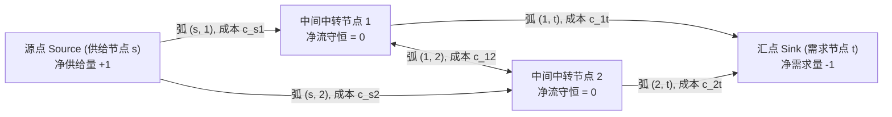
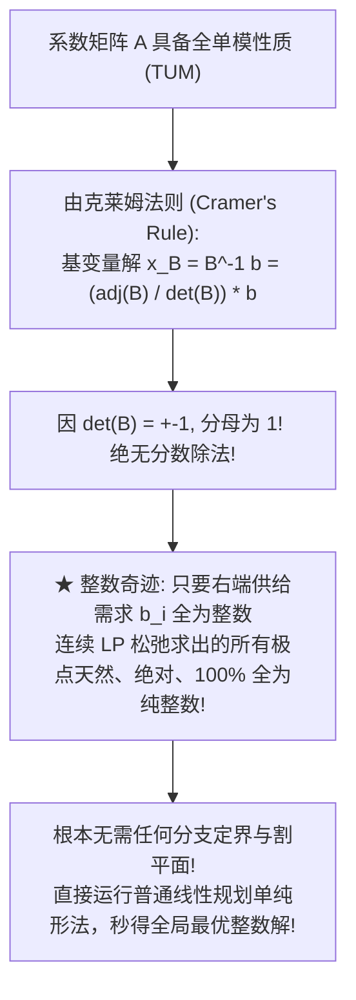
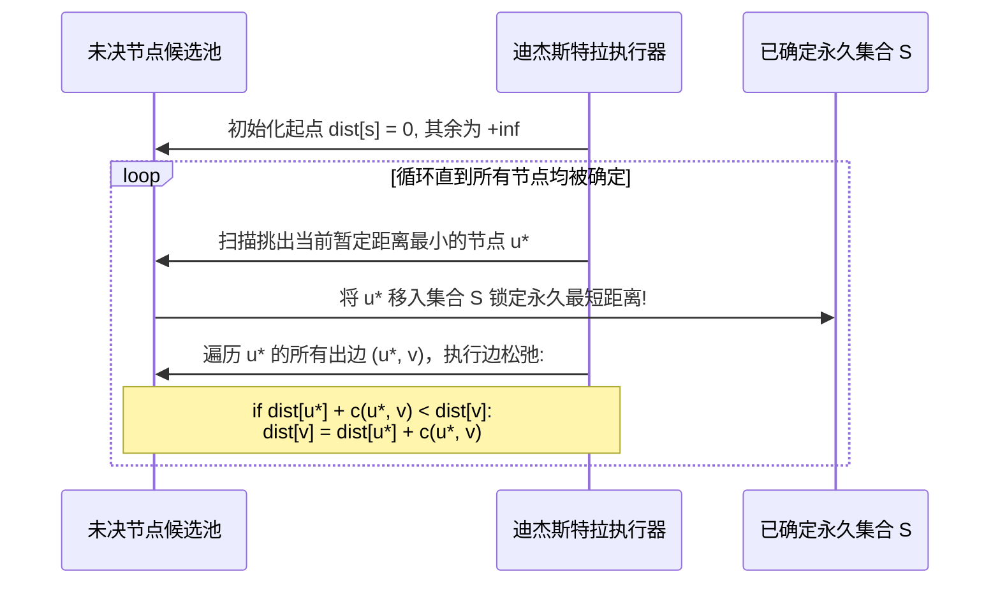
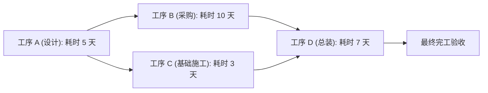

# Lec 15 网络优化 I：最短路径问题与动态规划 (Network Optimization I: Shortest Path Problem)

> MIT Sloan 15.053 · Optimization Methods in Management Science · 主讲 Prof. James Orlin

## TL;DR

- 网络优化模型（Network Flow Models）将物理与逻辑流转抽象为节点（Nodes）与有向弧（Arcs）系统。
- 节点物质流守恒定律：流入总量加上净供给量，严格恒等于流出总量加上净需求量。
- **全单模矩阵（Totally Unimodular Matrix, TUM）**奇迹：证明网络线性规划松弛解天然必然是纯整数解！
- 掌握迪杰斯特拉算法（Dijkstra）、贝尔曼-福特算法（Bellman-Ford）以及工程关键路径法（CPM）。

## 网络的语言：从多面体抽象到图论拓扑

在商业与工程实践中，数以亿计的优化问题天然具有“流（Flow）”的拓扑特征：物流包裹在全国分拨中心之间的转运、数据数据包在互联网路由器节点之间的穿梭、甚至跨国石油管网的原油输送。

当线性规划遇见图论（Graph Theory），原本抽象生硬的矩阵方程，瞬间转化为具有强烈直观几何连通感的**网络流模型（Network Flow Models）**。

从代数角度审视，网络图由两个核心集合定义：
- **节点集（Node Set, $V$）**：代表物理设施（工厂、城市、交叉路口、工程工序阶段）；
- **有向弧集（Arc Set, $E$）**：代表流通通道（公路、航线、光纤管道、工序前后承接关系）；每条弧 $(i, j) \in E$ 附带单位流通成本 $c_{ij}$ 与通过容量上限 $u_{ij}$。

## 网络流的通用代数大一统：节点净流守恒方程

所有纯网络流问题均统一受制于极其优美的**节点物质平衡方程（Flow Conservation Equations）**：

::: definition 节点流守恒定理
对于网络中的每一个节点 $i \in V$，定义其外生净供给/需求量为 $b_i$：
- 若 $b_i > 0$：节点 $i$ 为**供给源点（Supply Node）**；
- 若 $b_i < 0$：节点 $i$ 为**需求汇点（Demand Node）**；
- 若 $b_i = 0$：节点 $i$ 为**纯中转节点（Transshipment Node）**。
守恒方程形式化表达为：
$$\sum_{j: (i,j) \in E} x_{ij} - \sum_{k: (k,i) \in E} x_{ki} = b_i, \quad orall i \in V$$
即：**从节点 $i$ 流出的全部流量之和，减去流入节点 $i$ 的全部流量之和，严格等于节点自身的净外生供给量 $b_i$！**
:::

全网总流守恒的物理闭环前提是：全网总供给量必须精确等于全网总需求量（$\sum_{i \in V} b_i = 0$）。

## 运筹学的奇迹：全单模矩阵（Totally Unimodular Matrix, TUM）

在第十讲与第十二讲中，我们深知整数规划是极难求解的 NP-难问题。然而，当运筹学家审视纯网络流问题的约束系数矩阵 $A$ 时，发现了一个震撼整个数学界的惊人奇迹：

::: theorem 网络节点-弧关联矩阵的全单模性质（TUM Theorem）
网络流模型的约束矩阵 $A$ 具有如下极其特殊的拓扑结构：
1. 矩阵的每一列对应网络中的一条有向弧 $(i, j)$；
2. **每一列中有且仅有两个非零元素**：在起点 $i$ 行处为 **$+1$**，在终点 $j$ 行处为 **$-1$**！
3. 该矩阵在数学上是一个**全单模矩阵（Totally Unimodular Matrix, TUM）**——其任意阶子方阵的行列式只能等于 $0, +1$ 或 $-1$！
:::

这一定理使得规模达到数百万个节点的巨型网络调度问题，能够以不可思议的毫秒级速度被纯线性连续算法彻底秒杀。

## 最短路径问题（Shortest Path Problem）与经典算法

最短路径是网络优化中最核心的基础构建块：在赋权有向图中，寻找从起点 $s$ 到终点 $t$ 的总权值最小的路径。

| 算法名称 | 适用网络环境 | 时间复杂度 | 核心算法哲学与操作特征 |
| :--- | :--- | :--- | :--- |
| **迪杰斯特拉算法 (Dijkstra's Algorithm)** | **权值必须严格非负** ($c_{ij} \ge 0$) | $O(|V|^2)$ 或 $O(|E| + |V| \log |V|)$ (利用斐波那契堆) | **贪心策略（Greedy）**：将节点划分为“已确定最短距离集 $S$”与“未决集”；每次从未决集中挑选距离最近的节点永久标定，绝无回溯 |
| **贝尔曼-福特算法 (Bellman-Ford Algorithm)** | 允许存在**负权弧** ($c_{ij} < 0$) | $O(|V| \cdot |E|)$ | **动态规划松弛（Dynamic Programming）**：连续对全网所有边执行 $|V|-1$ 轮松弛操作；若第 $|V|$ 轮依然能松弛，则**成功检测出负权回路（Negative Cycle）** |
| **拓扑排序动规 (DAG Dynamic Programming)** | **有向无环图 (DAG)** (无任何回路) | $O(|V| + |E|)$ (线性极速!) | 先按拓扑次序线性排队，再单向按递推方程自底向上计算，广泛用于工程关键路径法 |

## 工程实战：关键路径法（Critical Path Method, CPM）

在大型研发项目、航天器制造与巨型土木工程中，成百上千个工序存在严格的前后承接依赖。工程管理者面临两大生死问题：(1) 整项工程最早在何时能全盘完工？(2) 哪些工序是绝对拖延不得的**“关键瓶颈（Critical Activities）”**？

运用 DAG 上的最长路径算法（将耗时取相反数转化为最短路径）：
- **最早开工时间（Early Start, ES）**：由前置任务的最早完工时间的最大值决定；
- **最晚开工时间（Late Start, LS）**：在不推迟全盘完工底线的前提下允许的最迟开工时点；
- **总时差（Total Float / Slack）**：$	ext{Slack} = 	ext{LS} - 	ext{ES}$；
- **关键路径（Critical Path）**：所有**总时差严格为 0** 的工序链条。关键路径上的任何一天懈怠，都会导致全工程最终交付期等额延误一天！

::: pitfall 盲目在包含负权边的网络中套用 Dijkstra 算法
Dijkstra 算法的贪心正确性完全建立在“非负权边”的假设之上——即一旦某个节点被标记为永久集合 $S$，后续绝不可能通过其他未决边绕回来让其距离变得更短。若网络中包含负权边（例如某条弧代表某种奖励现金流），Dijkstra 算法将彻底失效并输出严重错误的距离！此时**必须无条件调用 Bellman-Ford 算法！**
:::

::: insight 网络是多维世界对人类直觉最慈悲的馈赠
面对充斥着数万行矩阵的纯代数系统，人类大脑往往感到冰冷与疏离；但一旦将其还原为节点、管道与连线的网络拓扑，人类深层空间感知直觉便瞬间苏醒。全单模矩阵的整数奇迹，展现了自然界拓扑对称性与线性代数的完美共鸣。学会用网络的眼光审视系统，是运筹学者将错综复杂的社会经济联系化解为清澈明了流动图景的高阶本领。
:::
