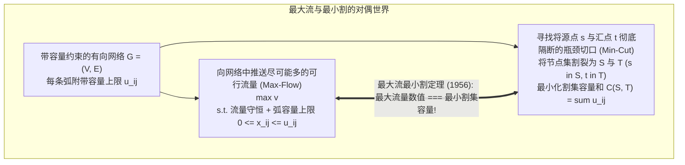
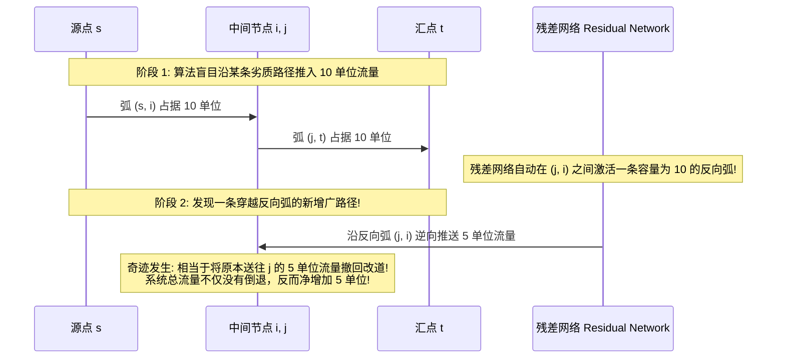
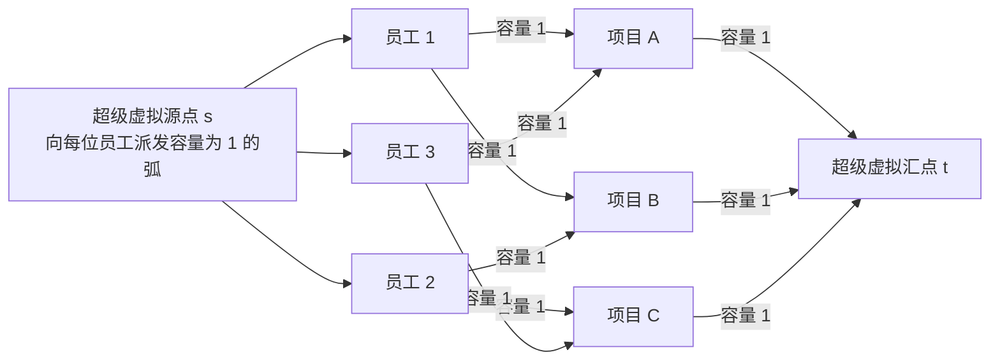

# Lec 16 网络优化 II：最大流、最小割与最小费用流 (Network Optimization II: Max-Flow, Min-Cut & Min-Cost Flow)

> MIT Sloan 15.053 · Optimization Methods in Management Science · 主讲 Prof. James Orlin

## TL;DR

- 最大流问题（Maximum Flow Problem）探究网络在有界管道容量下从源点到汇点的极限吞吐能力。
- **最大流最小割定理（Max-Flow Min-Cut Theorem, 1956）**确立了网络连通性与瓶颈容量的深层对偶性。
- 福特-富尔克森算法（Ford-Fulkerson）通过残差网络（Residual Network）与反向弧实现“试错撤销”。
- 二部图匹配与人员指派问题（Assignment Problem）作为最大流的经典工业映射。

## 极限吞吐量的探求：最大流问题

想象一个巨型跨国输油管网，各管道由于口径与泵站压力限制，拥有明确的通过容量上限 $u_{ij}$。炼油基地（源点 $s$）在单位时间内最多能向港口储油罐（汇点 $t$）输送多少桶原油？在遭遇自然灾害时，敌方至少需要切断哪些管道，才能彻底切断两座枢纽之间的供给网络？

这便是运筹学史上著名的**最大流问题（Maximum Flow Problem）**及其孪生对偶——**最小割问题（Minimum Cut Problem）**。

从现代网络架构与基础设施工程的角度审视这一数学模型，最大流问题实质上回答了任何分布式系统的核心承载极限。无论是城市给排水管网在暴雨倾盆时的排涝通量、大型数据中心之间骨干光纤的光信号交换速率，还是应急物流体系在战时向灾区运送救灾物资的极限车队规模，系统的总运力永远受到底层物理链路容量的刚性规训。

传统经验往往试图通过局部的“拓宽个别路段”来提升吞吐量，但这种局部修补在网络流理论面前往往收效甚微。如果新修的高速公路连接的依然是一个严重堵塞的收费站瓶颈，整个系统的实际通过流量将不会有哪怕一车一轴的提升。正因如此，最大流与最小割理论为系统架构师提供了一把能够精准穿透局部假象、直击全网最关键瓶颈的X光手术刀。

从系统瓶颈论的角度审视，最大流的本质是对系统极限造血潜能的压测，而最小割则是对系统最脆弱薄弱环节的精准定位。

## 算法引擎：残差网络与反向弧的“后悔药”机制

如何寻找最大流？1956 年莱斯特·福特（L.R. Ford）与德尔伯特·富尔克森（D.R. Fulkerson）提出了著名的**增广路径算法（Ford-Fulkerson Method）**。

算法最核心的天才发明，在于引入了**反向弧（Backward Arcs）构成的残差网络（Residual Network, $G_f$）**：

::: definition 残差网络与反向弧机制
对于网络中的任意一条原始弧 $(i, j)$，其实际输送流量为 $x_{ij}$，容量上限为 $u_{ij}$：
1. **正向前向弧（Forward Arc）**：剩余可用未饱和容量为 $u_{ij} - x_{ij}$，表示**允许进一步追加推送的新流量**；
2. **反向后向弧（Backward Arc）**：附带容量等于当前已送流量 $x_{ij}$，表示**允许将之前已经推送的流量“撤销/退回”（Cancel Flow）的额度！**
:::

反向弧的引入，赋予了算法极其惊人的“自适应后悔修正能力”。哪怕前期启发式搜索走错了弯路，后续迭代也能通过反向弧将错误流量优雅擦除重定向，直至残差网络中再也找不到任何一条从 $s$ 到 $t$ 的**增广路径（Augmenting Path）**！

## 宪章级定理：最大流最小割定理（Max-Flow Min-Cut Theorem）

当残差网络中无法再找到从源点通往汇点的增广路径时，算法停机。此时，数学上最震撼的对偶定理横空出世：

::: theorem 最大流最小割定理（Max-Flow Min-Cut Theorem, 1956）
对于任意单源单汇容量网络：
1. 从源点 $s$ 到汇点 $t$ 能够推送的**最大流数值，严格恒等于全网所有 $(s, t)$ 割集中的最小割容量（Minimum Cut Capacity）**：
   $$\max 	ext{Flow Value} = \min_{S, T} C(S, T)$$
2. 此时，残差网络中从源点 $s$ 能够连通到达的所有节点集合构成 $S^*$，其余节点构成 $T^*$；所有横跨从 $S^*$ 指向 $T^*$ 的原始弧，**其实际输送流量必然 100% 达到其物理容量上限（全满管），且从 $T^*$ 回流到 $S^*$ 的流量必然 100% 彻底为 0！**
:::

### 工业与国家安全的深刻隐喻
- **对于电信与电网运营商**：最小割精准锁定了全网最脆弱的物理管线集合。要想提升全网总运力，必须且只能向最小割集合中的线路投资扩容；对非最小割线路扩建哪怕一倍容量，全网总吞吐量依然纹丝不动！
- **对于军事与反恐防御**：最小割量化了以最小破坏代价彻底瘫痪敌方补给走廊的必经物理咽喉。

## 二部图匹配与人员指派问题（The Assignment Problem）

最大流模型不仅能算水和油，更能以极度精巧的方式解决人力资源中的**最佳人员-任务指派问题（Assignment Problem）**：

::: example 猎头公司顾问指派场景
有 $n$ 位金融分析师，需要指派到 $n$ 个不同的并购尽调项目中去。每位分析师只能执行 1 个项目，每个项目只能由 1 位分析师负责。分析师与项目之间存在技能资质兼容矩阵。
:::

### 网络流转化建模艺术
1. 设立超级虚拟源点 $s$ 和超级虚拟汇点 $t$；
2. 从 $s$ 向每一位员工引出一条有向弧，**容量上限严格设为 1**（保证每人最多承担 1 项任务）；
3. 若员工 $i$ 具备执行任务 $j$ 的技能，则在 $(i, j)$ 之间引出一条弧，**容量设为 1**；
4. 从每一个任务向汇点 $t$ 引出一条弧，**容量上限严格设为 1**（保证每项任务最多由 1 人承担）；
5. **结论**：直接在该网络上求解最大流！由于 TUM 全单模性质，求出的最大流必然全为 0 或 1。**若最大流数值等于 $n$，则该流量分布直接就是完美的一对一最佳指派方案！**

## 最小费用最大流（Minimum Cost Flow）：网络优化的集大成者

如果网络中的管道不仅有容量上限，每流动一加仑液体还要支付运输运费 $c_{ij}$。我们不仅要求把尽可能多的流量推过去，还要求总运费最低，这便升华为了**最小费用流问题（Minimum Cost Network Flow Problem, MCNFP）**。

$$\min \quad \sum_{(i,j) \in E} c_{ij} x_{ij}$$
$$	ext{subject to} \quad \sum_{j: (i,j) \in E} x_{ij} - \sum_{k: (k,i) \in E} x_{ki} = b_i, \quad orall i \in V$$
$$0 \le x_{ij} \le u_{ij}, \quad orall (i, j) \in E$$

MCNFP 是运筹学皇冠上的明珠：**最短路径问题、最大流问题、指派问题、运输问题（Transportation Problem），全部只是最小费用流在特定参数设定下的微小子集！**运用精密的网络单纯形算法（Network Simplex Algorithm），其求解速度比通用矩阵单纯形法快上百倍。

::: pitfall 忽视福特-富尔克森算法在无理数容量下的“无限不收敛”
在理论计算机科学中，若网络容量包含无理数，原始的 Ford-Fulkerson 算法如果糟糕地选择增广路径，**可能会经历无穷多步迭代而永远无法收敛，甚至收敛到一个完全错误的流量值！**为了彻底根除该漏洞，埃德蒙兹和卡普（Edmonds-Karp）改进了算法：**强制每次使用 BFS 广度优先搜索寻找边数最少的增广路径**，在数学上严格保证了算法在 $O(|V| \cdot |E|^2)$ 强多项式时间内收敛。
:::

::: insight 瓶颈的所在，正是系统灵魂的度量
最大流与最小割的交相辉映，是近代运筹学最优雅的哲学沉淀。一个系统的伟大，不取决于其顺境中看似辽阔的冗余管道，而取决于其面对极限冲击时最小割所展现的承载韧性。学会用最小割的锐利目光洞察企业的核心瓶颈，将有限的资本与精力精准浇灌在最脆弱的咽喉要道之上，是每一位卓越系统工程师与战略领袖的至高修养。
:::
