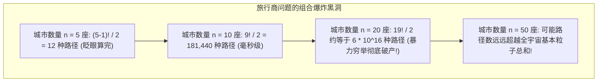
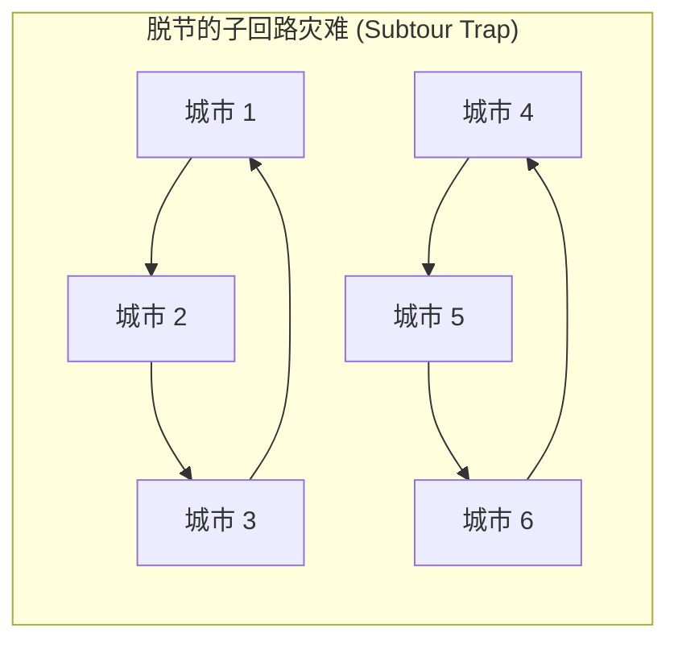
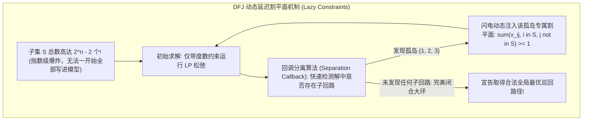
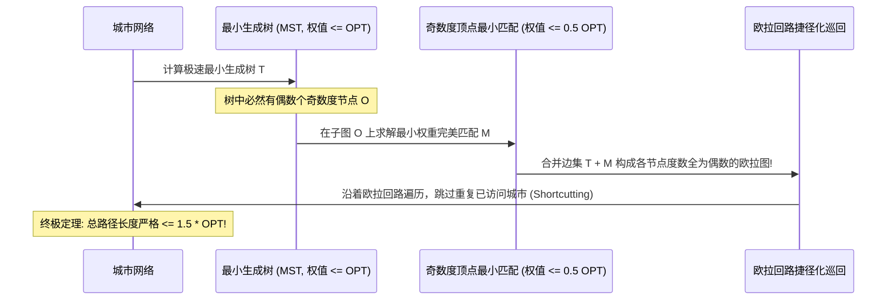

# Lec 17 网络优化 III：旅行商问题与组合搜索 (Network Optimization III: Traveling Salesman Problem)

> MIT Sloan 15.053 · Optimization Methods in Management Science · 主讲 Prof. James Orlin

## TL;DR

- 旅行商问题（TSP）是计算机科学与运筹学最著名的 NP-难组合优化难题。
- 深刻理解子回路（Subtour）陷阱：为什么仅凭简单的出入度等于 1 约束无法保证一条完整大回路。
- 掌握两大经典子回路消除表述：DFJ 指数级子集切割约束 vs MTZ 多项式级位序变量约束。
- 探索克里斯托菲德斯（Christofides）1.5 倍近似算法与现代物流车辆路径规划（VRP）。

## 运筹学的圣杯：旅行商问题（TSP）

想象一名销售代表必须拜访全美 $n$ 座城市：
- 他从母港城市出发，每座城市**必须且只能访问恰好一次**；
- 最终必须完好无损地**返回初始出发城市**；
- 任意两座城市 $i$ 与 $j$ 之间的交通旅行距离为 $c_{ij}$；
- **目标**：规划出一条闭合巡回路径（Hamiltonian Cycle），使得全行程的总旅行距离最短！

这就是名震天下的**旅行商问题（Traveling Salesman Problem, TSP）**。

从计算复杂性理论审视，TSP 是纯粹的强 NP-难问题。然而，正是为了征服 TSP，运筹学家先后催生出了分支定界、割平面法、拉格朗日松弛与局部禁忌搜索等半个世纪以来最优美的高阶算法。

## 致命的“子回路（Subtour）”陷阱

初学整数规划的工程师在对 TSP 进行建模时，往往会写出如下极度直觉的模型：
- 设 0-1 决策变量 $x_{ij} \in \{0, 1\}$ 表示是否直接从城市 $i$ 旅行至城市 $j$；
- **每个城市必须且只能离开一次**：$\sum_{j=1, j 
eq i}^n x_{ij} = 1, \quad orall i$；
- **每个城市必须且只能进入一次**：$\sum_{i=1, i 
eq j}^n x_{ij} = 1, \quad orall j$；
- 目标：$\min \sum_{i} \sum_{j} c_{ij} x_{ij}$。

这个模型表面上看完美无缺，但在求解器中运行后，得出的结果往往令人哭笑不得：

每个节点的入度和出度确实严格等于 1，但它根本没有形成一条横跨全美 6 座城市的完整大旅行环线，而是**破碎分裂成了两个各自闭环的小孤岛回路（Subtours）！**为了粉碎这些非法的局部小圈子，数学家展开了长达数十年的智慧攻坚。

## 两大传世子回路消除表述的巅峰对决

### 1. DFJ 子回路消除约束（Dantzig-Fulkerson-Johnson, 1954）
1954 年，丹齐格、富尔克森与约翰逊三位巨擘提出了运筹学史上最经典的割集消除约束：
对于城市全集 $V$ 的**任意一个真子集 $S \subset V$（满足 $2 \le |S| \le n-1$）**，回路中离开子集 $S$ 的边数必须至少为 1 条：
$$\sum_{i \in S} \sum_{j 
otin S} x_{ij} \ge 1, \quad orall S \subset V, \quad 2 \le |S| \le n-1$$

**优劣评价**：DFJ 表述在几何上具有极其强悍的凸包紧致度（强表述），配合现代求解器的**延迟约束注入（Lazy Constraints）**技术，成为目前求解大规模 TSP 商业实战的绝对统治级标杆！

### 2. MTZ 位序标记约束（Miller-Tucker-Zemlin, 1960）
1960 年，米勒、塔克与赞姆林提出了另一种极其优雅的多项式级连续位序标记法：
引入连续辅助变量 $u_i \in \mathbb{R}$，表示城市 $i$ 在整个漫长旅行路线中所处于的**先后访问次序号**（令出发城市 $u_1 = 1$）：
$$u_i - u_j + n \cdot x_{ij} \le n - 1, \quad orall i, j \ge 2, \quad i 
eq j$$
- **若 $x_{ij} = 0$**（未走边 $(i, j)$）：约束退化为 $u_i - u_j \le n - 1$，由于位序差值天然小于 $n$，约束自动失效；
- **若 $x_{ij} = 1$**（直接从 $i$ 走到 $j$）：约束瞬间收紧为 $u_j \ge u_i + 1$！**即后续城市的访问序号必须严格递增！**

由于一个孤立的小圈子必须不断循环递增，最终必然出现 $u_{	ext{start}} > u_{	ext{end}} > \dots > u_{	ext{start}}$ 的严格递增自相矛盾，从而在代数上彻底消灭了任何不经过起点 1 的小回路！MTZ 仅需增加 $O(n)$ 个变量和 $O(n^2)$ 条约束，是小规模快速建模的利器。

## 近似算法的巅峰：克里斯托菲德斯算法（Christofides）

对于拥有数十万个节点的巨型工业物流网络，即使最强求解器也无法在几分钟内完成精确求解。在满足三角不等式（$c_{ij} \le c_{ik} + c_{kj}$）的度量 TSP 中，运筹学家将目光投向了**具有严格理论保证的近似算法（Approximation Algorithms）**：

| 启发式算法 | 理论最坏情况近似比 (Approximation Ratio) | 核心算法设计逻辑 |
| :--- | :---: | :--- |
| **最近邻贪心法 (Nearest Neighbor)** | 无界 ($O(\log n)$)；最坏情况下误差可任意恶劣 | 每一步贪心寻找距离当前城市最近的未访问城市，在最后一步收尾时常被迫走一条天价长边 |
| **最小生成树倍增 (Double Tree Heuristic)** | **2.0 倍上界保证**；解的长度绝不超过最优解的 2 倍 | 构造全网最小生成树（MST），将每条边复制一份变为欧拉图，沿欧拉回路跳过重复节点遍历 |
| **克里斯托菲德斯算法 (Christofides Algorithm, 1976)** | **1.5 倍神圣上界保证**；四十年未被打破的世界纪录！ | 构造 MST，仅对度数为奇数的顶点集合寻找**最小权完美匹配（Minimum Weight Perfect Matching）**，熔铸为欧拉图并捷径化遍历 |

## 工业现实的升华：车辆路径规划（Vehicle Routing Problem, VRP）

在美团外卖配送、顺丰速运与沃尔玛干线运输中，经典的单人 TSP 进一步演进为了现代供应链的超级中枢——**多车辆路径规划（Vehicle Routing Problem, VRP）**：
- **容量限制 VRP (CVRP)**：每辆冷链货车或配送电瓶车拥有载重与容积上限；
- **带时间窗 VRP (VRPTW)**：每个生鲜超市或写字楼客户强制限定了送达时间窗口 $[e_i, l_i]$；
- **取送一体 VRP (VRPPD)**：车辆在沿途必须一边卸下干货、一边装载客户退货，必须严格维护车厢实时空间守恒。

::: pitfall 误以为“在欧几里得平面上最近邻贪心法表现良好”
许多工程师编写物流算法时习惯使用“最近邻点搜索”。在密集的蜂窝状城市路网中，最近邻法极易在前 90% 的行程中表现优良，但由于缺乏全局闭环统筹，最后剩下的 10% 孤立节点往往散落在地图的极端对角边缘，迫使货车在最后数阶段跨越整个城市来回折返空跑，最终总油耗远超科学规划！
:::

::: insight 简单的规则下，深藏着对复杂宇宙最深沉的挑战
旅行商问题的题目简洁到连小学生都能完全读懂，但半个世纪以来全人类最顶尖的数学家与图灵奖得主却为之倾注了一生的心血。它向我们昭示了算法世界最永恒的敬畏：形式的简约从来不代表内涵的单薄。在看似简单的点线徘徊之中，蕴藏着对称性破缺、图论组合与代数几何的无穷奥秘。征服 TSP 的每一步探索，都在拓展人类计算理性的终极边界。
:::
