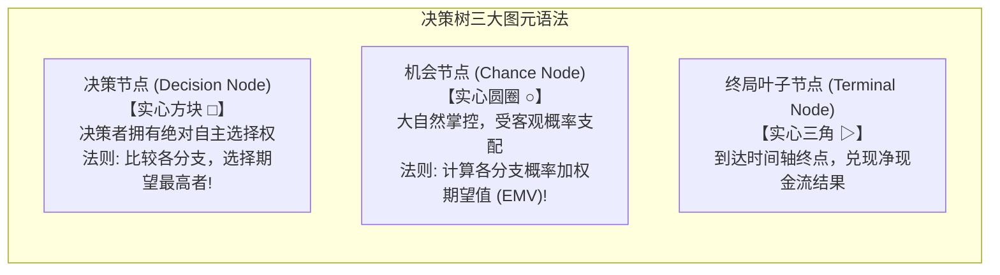
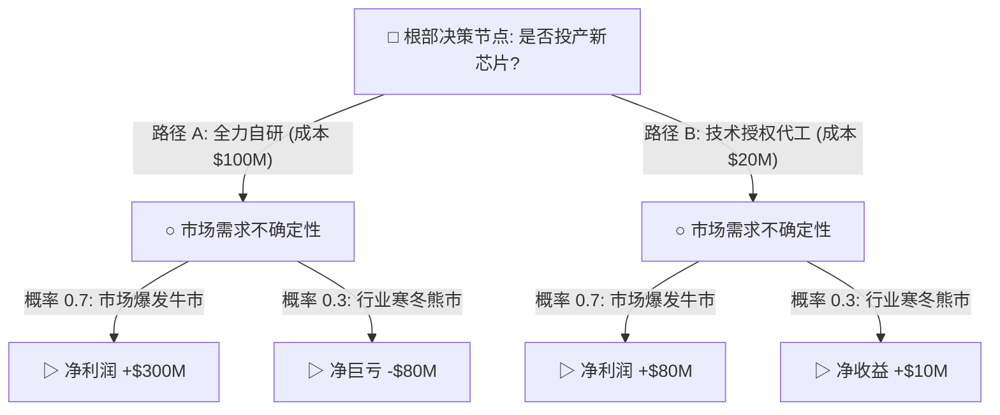
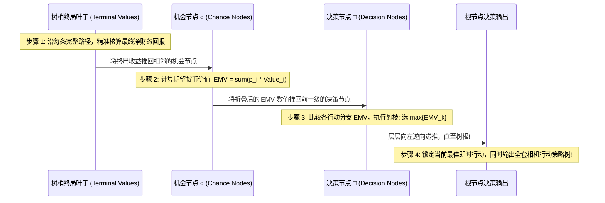
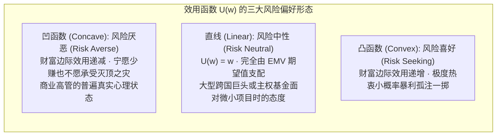

# Lec 18 决策分析与决策树 I：序贯决策与反向归纳 (Decision Trees I: Sequential Decisions & Rollback)

> MIT Sloan 15.053 · Optimization Methods in Management Science · 主讲 Prof. James Orlin

## TL;DR

- 现实世界的战略抉择往往包含长周期、多阶段的**序贯决策（Sequential Decisions）**与不确定性博弈。
- 决策树（Decision Trees）以严格的图论层级清晰隔离**决策节点（方块）**与**机会偶然节点（圆圈）**。
- **反向归纳折叠法（Rollback Method）**：从时间轴最末端的终局收益，由右至左逆向计算期望并折叠最优选择。
- 期望货币价值（EMV）准则与效用理论（Utility Theory）：科学权衡风险中性与风险厌恶者的决策断层。

## 面对未知的决策智慧：从静态到序贯

在前十七章中，我们探讨的线性规划与整数规划，本质上假定决策是在“单一时间断面”下完成的静态资源分配。然而，真实的商业竞争与战略转型，往往是一场跨越数年、充满不确定性扰动的**序贯博弈（Sequential Decision Process）**：
- 一家生物制药独角兽正在研发一款抗癌新药：当前是否投入 5,000 万美元启动 I 期临床？
- 如果 I 期成功（概率 60%），半年后是选择与跨国药企合作联合开发，还是自建生产线推进 II 期（耗资 2 亿）？
- 若 II 期遭遇严重副作用危机（概率 30%），是否追加预算挽救试验，还是壮士断腕彻底注销资产？

在这种“决策—不确定性展现—再决策—再展现”的交替演进中，决策者不能盲目走一步看一步。**决策树（Decision Tree）分析法**正是为了让管理者能够在今天的第一步，就能严谨推演未来所有可能分支的最佳应对战略。

## 决策树的标准构建与图纸语法

构建一份无懈可击的商业决策树，必须严格遵守严格的时间流向与逻辑排他性原则：

| 节点类型 | 几何图形表示 | 分支分支含义与数学要求 | 核心处理与折叠准则 |
| :--- | :---: | :--- | :--- |
| **决策节点 (Decision)** | **方形 $\square$** | 每一条引出的树枝代表一个**可选行动方案（Alternatives）**；各行动必须互斥且穷尽 | **求极大值（$\max$）**：比较各备选分支折算回来的价值，果断砍掉劣质分支，保留最优路径 |
| **机会偶然节点 (Chance)** | **圆形 $igcirc$** | 每一条引出的树枝代表大自然的一种**随机客观状态（State of Nature）**；各分支附带概率 $p_i$ | **求期望值（$\sum p_i V_i$）**：各概率必须严格满足 $p_i \ge 0$ 且 $\sum p_i = 1$（完全穷尽） |
| **终局结算点 (Terminal)** | **三角 $	riangle$** | 沿该完整路径从树根走到树梢所累积的**全部收入减去全部沉没成本的净财务现值（NPV）** | 直接读取静态现金流数字，充当逆向递归计算的初始边界条件 |

## 决策树的求解灵魂：反向归纳折叠法（Rollback Method）

决策树的阅读方向是从左向右（沿时间正向流动），但其**数学求解方向必须严格从右向左逆向折叠（Rollback Method）**！

### 实战数值演算（基于上图模型）
1. **折叠机会节点 C1（全力自研的期望收益）**：
   $$	ext{EMV}(C_1) = 0.7 	imes (\$300	ext{M}) + 0.3 	imes (-\$80	ext{M}) = \$210	ext{M} - \$24	ext{M} = \mathbf{+\$186	ext{M}}$$
2. **折叠机会节点 C2（技术授权的期望收益）**：
   $$	ext{EMV}(C_2) = 0.7 	imes (\$80	ext{M}) + 0.3 	imes (\$10	ext{M}) = \$56	ext{M} + \$3	ext{M} = \mathbf{+\$59	ext{M}}$$
3. **在根节点进行决策选择**：
   比较两分支：$\max \{ 	ext{自研: } \$186	ext{M}, \quad 	ext{授权: } \$59	ext{M} \} = \$186	ext{M}$。
   **决策裁定**：理性的决策者应当毫不犹豫地选择“全力自研”路径，并用双横线斩断“授权”分支！

## 决策准则的分歧：EMV 准则 vs 效用理论（Utility Theory）

在上述计算中，我们默认采用了**期望货币价值准则（Expected Monetary Value, EMV）**。EMV 假定决策者是**风险中性（Risk Neutral）**的——哪怕有 30% 的概率会净亏损 8,000 万美元，只要数学期望为正，就敢于豪赌。

然而，在现实商业世界中，如果一家市值仅有 1 亿美元的初创企业遭遇 8,000 万美元巨亏，公司将直接破产清算、创始人身败名裂！此时，真实的决策者往往呈现强烈的**风险厌恶（Risk Averse）**特征：

引入约翰·冯·诺伊曼与奥斯卡·摩根斯坦的**期望效用理论（Expected Utility Theory, VNM Utility）**：我们将每一个终局金额换算为其心理效用分值 $U(\$) \in [0, 1]$，在决策树中折叠计算**期望效用（Expected Utility）**。当考虑了破产风险的严重惩罚后，折叠计算的最优决策往往会从高风险的自研路径，逆转为稳妥保守的“技术授权”路径！

::: pitfall 忽视沉没成本（Sunk Cost）对决策树分支的污染
在多阶段决策树的后续节点中，很多高管经常犯下灾难性的“沉没成本谬误（Sunk Cost Fallacy）”：“我们在前一阶段已经砸进去了 1 亿美元且全部打水漂了，现在如果不继续追加 5,000 万，之前亏的 1 亿不就全浪费了吗？”**记住决策树的绝对铁律：前序阶段已经发生且不可收回的支出属于绝对沉没成本！在评估后续节点时，唯一决定命运的是未来增量现金流的期望现值！**切勿让沉没成本绑架理性未来。
:::

::: insight 远见不是预知未来，而是在分叉的树状世界中构筑从容
没有任何凡人能够准确预知命运骰子掷出的是哪一面。但决策树赋予了人类一种超越时空的理性定力：它迫使我们在风险真正爆发之前，就将所有可能的阴霾摊开在阳光下进行冷酷推演。一个优秀的战略家之所以在危机袭来时镇定自若，不是因为他运气超群，而是因为眼前发生的一切动荡，早已在他两年前画下的决策树分支中被精确预演并做好了应对方案。
:::
