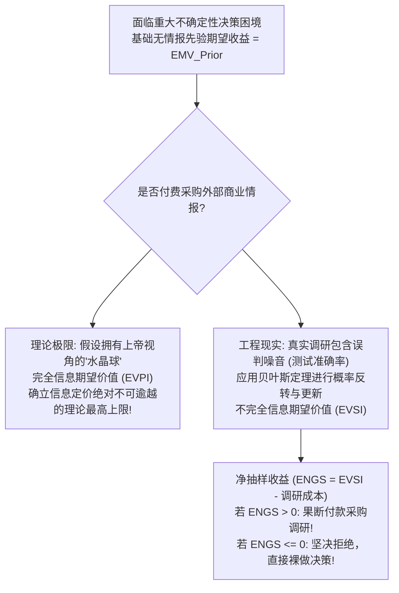
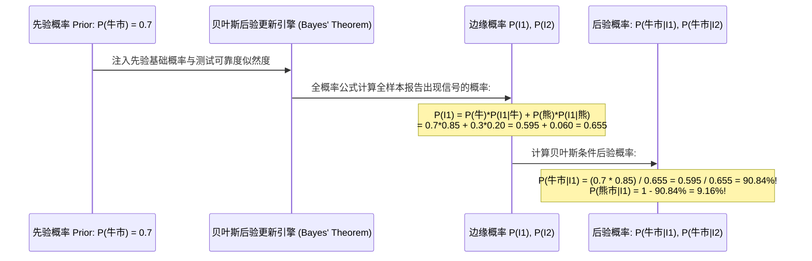
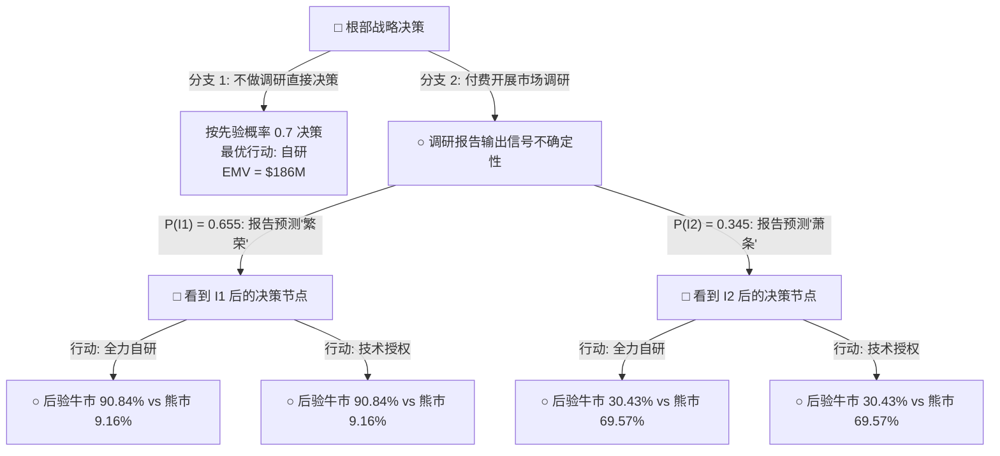

# Lec 19 决策分析与决策树 II：信息价值与贝叶斯更新 (Decision Trees II: Value of Information & Bayes)

> MIT Sloan 15.053 · Optimization Methods in Management Science · 主讲 Prof. James Orlin

## TL;DR

- 商业调研、地质钻探与市场测试的核心价值，在于消除不确定性、提升决策质量。
- **完全信息期望价值（EVPI）**为完美预测情报树立了数学上的最高理论对价天花板。
- **不完全信息期望价值（EVSI）**运用贝叶斯定理（Bayes' Rule）将先验概率严谨修正为后验概率。
- 净信息价值（ENGS）：严密量化“是否值得支付调研咨询费”的商业决策分水岭。

## 商业情报的定价难题：信息究竟价值几何？

在第十八讲的芯片投资决策中，管理层面临 70% 繁荣牛市与 30% 萧条熊市的不确定性困境。此时，一家顶尖的硅谷半导体战略咨询智库找上门来，声称他们拥有一套独特的产业监测大数据模型，能够在芯片量产之前向公司提供一份详尽的市场预测调研报告，但开价高达 **3,000 万美元咨询费**。

作为首席执行官或投资总监，你是否应该在合同上签字买下这份报告？
- 如果报告能 100% 精准预测未来，这份“未卜先知”的情报到底最高值多少钱？
- 如果该智库历史预测准确率并非 100%，而是存在 20% 的误判噪音，这份带有瑕疵的报告又值多少钱？

回答商业情报定价与尽职调查预算边界的核心理论，就是运筹学中的**信息价值理论（Value of Information Theory）**。

## 理论天花板：完全信息期望价值（EVPI）

我们首先假定存在一个神奇的“水晶球”——它能提前 100% 毫无差错地告诉我们未来的大自然状态究竟是繁荣还是萧条（完全信息 Perfect Information）。

::: definition 完全信息期望价值（EVPI, Expected Value of Perfect Information）
$$	ext{EVPI} = 	ext{EVwPI} - 	ext{EMV}_{	ext{Prior}}$$
其中：
- $	ext{EMV}_{	ext{Prior}}$：在没有任何额外情报时，直接依靠先验概率所能取得的最大期望货币价值；
- $	ext{EVwPI}$（Expected Value with Perfect Information）：**拥有完全信息时的期望价值**——即假设每次都能预先知晓结果，从而**每一次都必定选择针对该状态的最佳行动**，取加权平均值：
  $$	ext{EVwPI} = \sum_{j} P(s_j) \cdot \left[ \max_{i} 	ext{Payoff}(a_i, s_j) 
ight]$$
:::

### EVPI 数值演算实例
回到芯片投资案例：
1. **若事先确知是牛市（概率 0.7）**：最佳行动是自研，利润为 **+\$300M**；
2. **若事先确知是熊市（概率 0.3）**：最佳行动是授权代工，净收益为 **+\$10M**（此时绝不自研，避免 -\$80M 巨亏）；
3. **计算 EVwPI**：
   $$	ext{EVwPI} = 0.7 	imes (\$300	ext{M}) + 0.3 	imes (\$10	ext{M}) = \$210	ext{M} + \$3	ext{M} = \mathbf{\$213	ext{M}}$$
4. **计算 EVPI**：
   回顾第十八讲，无情报时的最佳期望 $	ext{EMV}_{	ext{Prior}} = \$186	ext{M}$（自研）。
   $$	ext{EVPI} = \$213	ext{M} - \$186	ext{M} = \mathbf{\$27	ext{M}}$$

**震撼的管理推论**：即使这家咨询公司的预测准确率达到了惊人的 100% 上帝神谕级别，这份情报对公司的绝对最大经济价值也就是 **2,700 万美元**！咨询公司开价 3,000 万美元纯属抢劫，管理层可以立即将其扫地出门！

## 现实世界的不完美情报：贝叶斯概率反转更新

现实中所有的尽调报告、医疗核酸筛查或石油勘探勘测，都存在一定的误诊与误判率。设调研报告的输出只有两种预测信号：
- 信号 $I_1$：报告预测市场将“繁荣”；
- 信号 $I_2$：报告预测市场将“萧条”。

咨询公司通常只能提供其历史测试的**条件概率（似然度 Likelihoods）**：
- $P(I_1 | 	ext{牛市}) = 0.85$（真实牛市时，预测准确率为 85%）；$P(I_2 | 	ext{牛市}) = 0.15$（漏报率 15%）；
- $P(I_2 | 	ext{熊市}) = 0.80$（真实熊市时，预测准确率为 80%）；$P(I_1 | 	ext{熊市}) = 0.20$（虚报率 20%）。

然而，决策者在拿到报告时，面临的是**逆向问题**：**“当且仅当我亲眼看到报告预测繁荣（$I_1$）时，未来市场真正成为牛市的后验概率（Posterior Probability）究竟是多少？”**

借助贝叶斯公式，我们将原本模糊的先验概率 70%，在获得利好报告信号的加持下，精准修正为了置信度高达 **90.84%** 的后验概率！

## 双层序贯决策树与不完全信息价值（EVSI）

我们将“先调研还是直接决策”绘制成一张宏伟的双层序贯决策树：

### EVSI 与 ENGS 的科学裁决
1. 沿双层决策树执行反向归纳折叠（Rollback），计算出**拥有该真实调研报告时的整体期望货币价值 $	ext{EVwSI}$**；
2. **不完全信息期望价值（Expected Value of Sample Information, EVSI）**：
   $$	ext{EVSI} = 	ext{EVwSI} - 	ext{EMV}_{	ext{Prior}}$$
   在数学上，必然有严格边界：$0 \le 	ext{EVSI} \le 	ext{EVPI}$；
3. **净抽样期望收益（Expected Net Gain of Sampling, ENGS）**：
   $$	ext{ENGS} = 	ext{EVSI} - 	ext{Cost of Information}$$
   - **若 $	ext{ENGS} > 0$**：调研带来的预期决策质量提升超越了其调研费用，**应当开展调研**；
   - **若 $	ext{ENGS} \le 0$**：调研完全不划算，**坚决拒绝调研，直接依照现有经验做出即时决策！**

::: pitfall “只有当信息能够改变你的既有行动时，信息才具有价值！”
这是决策分析学中含金量最高、最振聋发聩的黄金定律！如果无论咨询报告给出正面还是负面结论，管理层在事后都会坚定不移地选择“全力自研”（即报告根本无法动摇你的既定选择），那么**该份报告的实际经济价值在数学上精确等于 0 美元！**无数大企业每年花费数千万元采购各类形式主义的咨询报告，仅仅是为了给管理层早已内定的方案背书找借口，从运筹优化角度看纯属纯粹的股东财富净浪费。
:::

::: insight 认识你自己，并学会为确定性开出理性的价码
人类天生厌恶未知与模糊，这种对不确定性的恐惧常常诱使我们在恐慌中向兜售安全感的预言家中介支付过高的对价。信息价值理论如同一面冷静的照妖镜：它用冰冷的贝叶斯公式剥离了焦虑的迷雾，告诉每一位商业领袖——世界是不确定的，但消除不确定性是有明确价格上限的。在未知中保持数学的理性与克制，是在风浪翻涌的商海中掌舵远航的最高从容。
:::
