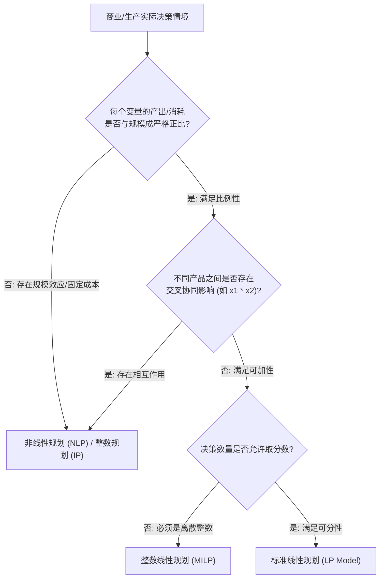
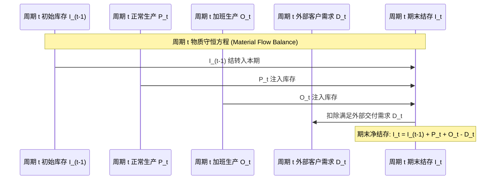

# Lec 2 线性与非线性规划建模实务 (Formulations of Linear and Non-linear Programs)

> MIT Sloan 15.053 · Optimization Methods in Management Science · 主讲 Prof. James Orlin

## TL;DR

- 线性规划（LP）严格要求目标函数与所有约束条件必须满足比例性（Proportionality）与可加性（Additivity）。
- 经典斯蒂格勒饮食问题（Stigler Diet Problem）奠定了现代配方优化与混合规划的范式。
- 深入拆解生产排产、投资配比与多时期库存平衡的代数建模模式。
- 非线性规划（NLP）的现实映射：规模报酬递减、二次投资组合方差与非线性生产函数。

## 线性规划的公理化假设：比例性与可加性

在着手编写代数模型之前，建模者必须首先检验实际问题是否满足**线性（Linearity）**的严格数学公理。在数学上，一个函数 $f(x_1, \dots, x_n)$ 是线性的，当且仅当其具备以下两大约束性特征：

::: theorem 线性规划的两大基本假定
1. **比例性假定（Proportionality Assumption）**：
   每一个变量对目标函数或约束条件的贡献，与该变量的取值成**严格的正比例关系**。不存在数量折扣、起步固定成本或规模报酬递增/递减；
2. **可加性假定（Additivity Assumption）**：
   所有变量对目标函数或约束条件的总贡献，等于**各个变量单独贡献的简单代数相加**。不存在变量之间的协同放大效应或相互抵消的交叉乘积项（如 $x_1 x_2$）。
:::

此外，模型还必须满足**可分性（Divisibility）**（变量允许取任意非整数分数值）与**确定性（Certainty）**（所有技术系数与参数完全确定已知）。任何对上述假定的违背，都将迫使模型跃迁至整数规划（IP）或非线性规划（NLP）的范畴。

## 历史里程碑：斯蒂格勒饮食问题（Stigler Diet Problem）

1945 年，诺贝尔经济学奖得主乔治·斯蒂格勒（George Stigler）提出了著名的“饮食问题”：如何在满足人体每日必需的各类营养元素（热量、蛋白质、维生素、铁等）摄入底线的前提下，使得购买食物的总支出最低？

当时单纯形算法尚未问世，斯蒂格勒凭借精巧的启发式试算与经济直觉，在 77 种备选食物中计算出年化最低伙食成本约为 39.93 美元。数年后，乔治·丹齐格（George Dantzig）运用刚刚发明的单纯形法在早期军用计算机上进行了重新演算，最终得出的全局最优解为 **39.67 美元**——斯蒂格勒当年的直觉猜测与数学最优解仅差微不足道的 26 美分！

### 饮食问题的通用代数建模范式
设系统中有 $n$ 种备选食物（下标 $j = 1, \dots, n$），以及 $m$ 种必需营养素（下标 $i = 1, \dots, m$）：
- **决策变量**：设 $x_j$ 为每日购买食物 $j$ 的单位数量（$x_j \ge 0$）；
- **参数矩阵**：
  - $c_j$：购买单位食物 $j$ 的市场零售单价；
  - $a_{ij}$：单位食物 $j$ 中所含有的营养素 $i$ 的有效成分含量；
  - $b_i$：人体每日维持健康所需的营养素 $i$ 的**法定最低推荐摄入量**。

数学模型形式化表达为经典的**标准覆盖型线性规划**：
$$\min z = \sum_{j=1}^{n} c_j x_j$$
$$	ext{subject to} \quad \sum_{j=1}^{n} a_{ij} x_j \ge b_i, \quad orall i = 1, \dots, m$$
$$x_j \ge 0, \quad orall j = 1, \dots, n$$

这一范式至今仍是全球饲料配方工业、炼油厂原油调配（Blending Problem）以及化工原料合成中最核心的工业模型。

## 生产计划与多时期动态库存平衡模型

在制造与供应链管理中，最经典的线性规划应用是跨越多个时间周期的**动态排产与库存平衡模型**：

### 多时期库存排产代数公式
设规划期包含 $T$ 个离散周期（$t = 1, \dots, T$）：
- **目标函数**：最小化全周期总成本（正常工时成本 + 加班成本 + 库存持有成本）：
  $$\min \sum_{t=1}^{T} \left( c_t P_t + c_t^{OT} O_t + h_t I_t 
ight)$$
- **物质守恒约束（Flow Balance）**：
  $$I_t = I_{t-1} + P_t + O_t - D_t, \quad orall t = 1, \dots, T$$
- **产能瓶颈约束**：
  $$P_t \le 	ext{Cap}_t^{	ext{Regular}}, \quad O_t \le 	ext{Cap}_t^{	ext{Overtime}}, \quad orall t = 1, \dots, T$$
- **非负与安全库存约束**：
  $$P_t, O_t \ge 0, \quad I_t \ge I_t^{	ext{Safety}}, \quad orall t = 1, \dots, T$$

通过物质守恒约束，线性规划将原本相互割裂的时间维度紧密缝合，算法能够自动在“本月提前加班生产支付库存持有费”与“下月临时高薪赶工”之间找到全周期综合成本最低的最优折中点。

## 非线性规划（NLP）的现实映射

现实商业世界中，许多经济关系天然呈现非线性特征：

| 非线性来源 | 经济学与商业成因 | 典型数学表达形式 | 典型应用领域 |
| :--- | :--- | :--- | :--- |
| **规模报酬递减 (Diminishing Returns)** | 边际产量递减法则；广告边际收益随投入增加而衰减 | $f(x) = lpha x^{eta} \quad (0 < eta < 1)$ 或 $\ln(1+x)$ | 市场营销广告预算跨渠道最优分配 |
| **投资组合风险测度 (Portfolio Variance)** | 资产收益率之间的协同协方差矩阵（Markowitz 模型） | $\min \sigma_p^2 = \sum_{i} \sum_{j} x_i x_j \sigma_{ij} = \mathbf{x}^T \mathbf{\Sigma} \mathbf{x}$ | 华尔街量化资产配置与风险对冲 |
| **拥堵与排队延迟 (Congestion Costs)** | 交通路网或通信信道随负荷接近极限而出现非线性延迟爆炸 | $t(x) = t_0 \left[ 1 + lpha \left(rac{x}{C}
ight)^{eta} 
ight]$ | 城市智能交通诱导与物流干线路由 |

::: pitfall 盲目将非凸非线性模型交给求解器
在线性规划中，任何局部最优解必然是全局最优解；但在**非凸非线性规划（Non-convex NLP）**中，目标函数曲面上充斥着成千上万个局部波谷与假死鞍点（Saddle Points）。商业求解器往往在接触到第一个局部洼地时便宣布收敛退出，导致决策者错失数十倍更优的真实全局最优解。除非能证明函数具备严格凸性（Convexity），否则切勿轻易依赖局部梯度下降算法。
:::

::: insight 建模是一门妥协的艺术，抓住第一阶主要矛盾
初涉运筹学的工程师往往有一种病态的执念，试图在模型中巨细靡遗地还原现实中的每一个微小非线性细节与随机扰动，结果导致模型规模膨胀成不可求解的计算怪兽。真正的运筹大师深刻懂得：所有的模型都是错的，但有些是有用的（All models are wrong, but some are useful）。在线性规划的简洁优雅与现实世界的复杂扭曲之间寻找最敏锐的切入点，是用数学驾驭商业决策的最高心法。
:::
