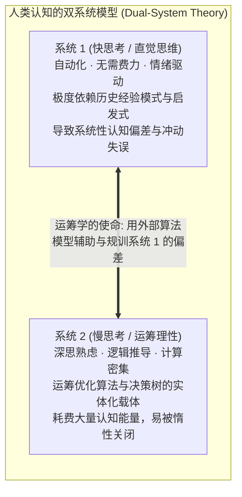
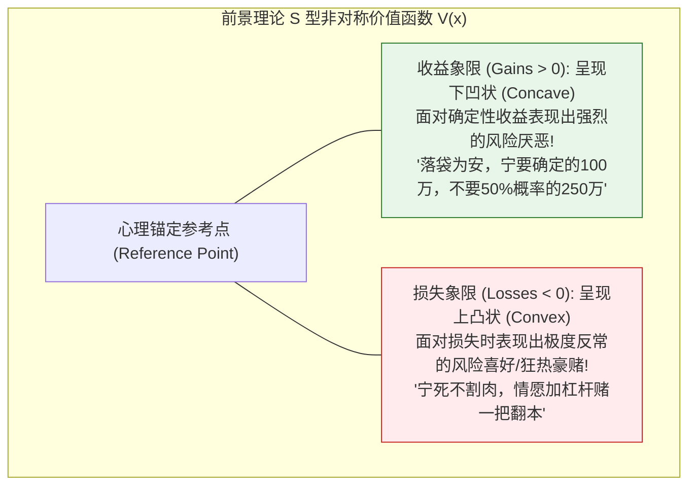
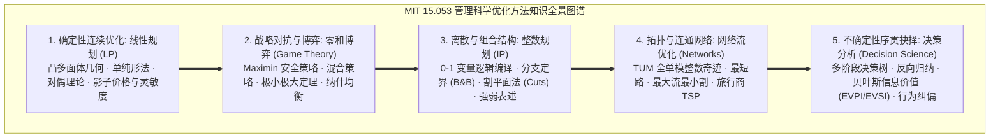

# Lec 20 行为决策分析、启发式偏差与课程总结 (Behavioral Decision Making & Course Wrap-up)

> MIT Sloan 15.053 · Optimization Methods in Management Science · 主讲 Prof. James Orlin

## TL;DR

- 经典运筹学假设决策者是绝对理性的“经济人”，但真实人类决策普遍遭受认知启发式与系统性偏差的扭曲。
- 丹尼尔·卡尼曼与阿莫斯·特沃斯基的**前景理论（Prospect Theory）**：损失厌恶（Loss Aversion）与 S 型价值函数。
- 深入拆解商业管理三大高频认知陷阱：锚定效应、可得性偏差与代表性启发式。
- 全课二十讲知识体系大圆满：从凸多面体、单纯形算法、整数规划分支割平面到网络流与序贯决策树。

## 理性的神话与现实的深渊：行为决策学的引入

在整门 15.053 课程的前十九章中，我们搭建起了一座令人叹为观止的理性数学大厦：我们假定目标函数明确无误、决策变量受严格的公理约束、概率分布完全客观、管理层无条件追求期望效用最大化。

然而，当运筹学者走出象牙塔、深入全球五百强企业的董事会时，往往遭遇沉重的现实困境：**一套耗时数月、在数学上证明具有绝对全局最优性的排产或投资方案，往往在提交给高管的第一天就被束之高阁！**

人类决策者从来不是冷酷的超级计算机。2002 年诺贝尔经济学奖得主丹尼尔·卡尼曼（Daniel Kahneman）与阿莫斯·特沃斯基（Amos Tversky）的划时代研究表明：**人类大脑在进化过程中形成的直觉启发式（Heuristics），在高度复杂的现代决策环境中，会产生顽固且系统性的认知偏差（Cognitive Biases）！**

## 前景理论（Prospect Theory）与 S 型价值函数

经典期望效用理论假定人们关注最终的“全盘总财富净值”；而卡尼曼和特沃斯基的前景理论颠覆性地指出：**人类大脑根本不关心绝对财富，而是极度敏感于相对于某一“心理参考点（Reference Point）”的得失相对变动！**

### 核心行为学定律：损失厌恶（Loss Aversion）
- 价值函数在损失区间的斜率，显著陡峭于在收益区间的斜率：
  $$	ext{Loss Aversion Ratio: } rac{|V(-x)|}{V(x)} pprox 2.0 \sim 2.5$$
- **直观隐喻**：丢失 100 美元所带来的生理与心理痛苦程度，需要捡到 **200 至 250 美元**的快乐才能勉强予以抹平！
- **管理启示**：这一非理性偏差深刻解释了为什么陷入困境的项目经理在面对亏损时，往往拒绝止损，反而越亏越赌，最终引发全公司的毁灭性爆雷。

## 商业管理者最常踩的三大认知启发式陷阱

| 认知偏差类别 | 心理学成因机制 | 典型商业决策灾难表现 | 运筹学解毒剂与纠偏工具 |
| :--- | :--- | :--- | :--- |
| **1. 锚定与调整偏差 (Anchoring & Adjustment)** | 大脑过度依赖最先接收到的初始参考数字（哪怕该数字完全荒谬），并在后续调整中严重不足 | 在并购估值谈判中，卖方随口抛出的天价虚高要价，成为买方后续压价谈判的潜意识锚点 | 严格构建基于 DCF 与线性规划的底层内在经济价值测算，彻底屏蔽外部噪音锚 |
| **2. 可得性启发式 (Availability Heuristic)** | 依据某类事件在大脑中被唤醒提取的容易程度与鲜活性，来草率评估其发生的客观概率 | 某家竞争对手近期因供应链断裂登上了财经头条，管理层便恐慌性地将该小概率事件的预算拔高十倍 | 拒绝情绪鲜活性，无条件依赖严谨的大样本历史统计频数与贝叶斯客观后验更新 |
| **3. 代表性启发式 (Representativeness)** | 依据样本与心理刻板印象的相似度做判断，盲目忽视基础概率（Base Rate Neglect） | 看到一位初创企业年轻创始人穿着套头衫、具有斯坦福背景，就盲目推定该项目能成长为下一个谷歌 | 强制要求在决策树机会节点中，先填写宏观先验基础概率，再运用似然比严谨修正 |

## 15.053 知识大厦的全景终极融会贯通

站在课程的终点极目远眺，麻省理工 15.053 为我们构筑的完整决策科学大厦，展现出浑然天成的和谐美感：

纵览这五大支柱所织就的学科宏图，我们能够清晰地触摸到运筹学在面对真实世界时所展现的深层逻辑闭环。线性规划以其凸多面体的完美几何性，奠定了连续资源最优配置的基石；博弈论引入了对抗性博弈者的心智模型，打破了单方静态决策的盲目幻想；整数规划利用严谨的 0-1 逻辑代数，攻克了离散选择与组合爆炸的深渊；网络优化发掘出拓扑结构中的全单模整数奇迹，实现了跨越物理与逻辑网络的超大规模极速调度；而决策分析则在时间的河流中，用反向归纳与贝叶斯信息更新，为人类在不确定性的迷雾中指明了前行的最佳航向。

这五大领域相辅相成，绝非孤立的数学技巧堆叠。在现代数字经济、全球供应链与复杂工程系统的最前沿，最卓越的运筹解决方案永远是这些工具的有机熔铸——用决策树推演战略阶段，用整数规划锁定核心厂址，用网络流优化实时配送，同时用博弈论防范竞品的反制反扑。唯有建立起这种融会贯通的系统工程视野，方能在瞬息万变的大时代中立于不败之地。

从工厂车间里的一颗螺丝钉排产，到跨国巨头的全球供应链拓扑；从两个人面对面博弈时的概率心智抗衡，到在充满迷雾的不确定性商业未来中给情报开出精准价码——**运筹学与管理科学绝非冰冷的象牙塔算术，它是人类在复杂的现代文明社会中，驯服不确定性、实现资源最佳配置的最强理性工具！**

## 结语：理性、优雅与对局限的谦卑

从 15.053 的殿堂启程，你们即将奔赴全球金融、科技独角兽、智能制造与公共政策的广阔战场。

在未来的决策征途上，愿你们时刻铭记：
- **永远追求最优，但敬畏模型的边界**；
- **懂得用线性的简洁驯服复杂的世界，但绝不忽视人类行为偏差的深层引力**；
- **最伟大的商业决策者，不仅精通算法的利刃，更拥有一颗在不确定性风暴中始终秉持理性、从容不迫的坚毅心灵！**

::: insight 理性与直觉的终极和解，是商业领袖一生的必修课
运筹学绝不是为了取代人类直觉，而是为了给容易被情绪与偏见蒙蔽的大脑装上一具冷静理性的外骨骼。模型算出的最优解是一个清晰的北极星参照物，它告诉我们在毫无私心杂念、数据完全客观时，理性的最高极限在何处。然而，最终扣动扳机下达决断的，依然是胸怀远见、敢于承担责任的人类领袖。将数学优化的刚性骨架，与洞察人性的温度深度融合，是管理科学赋予现代商业文明的最深沉智慧。
:::

---

> “所有的模型都是错的，但有些是有用的。”
> —— 乔治·博克斯（George E. P. Box）
