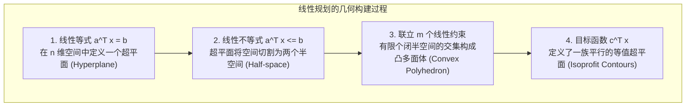
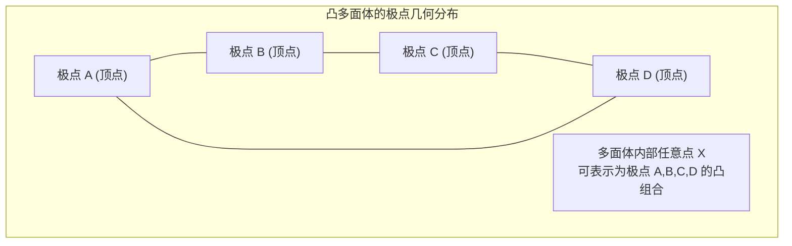
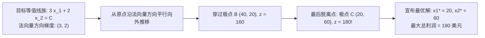

# Lec 3 线性规划的几何理论与可视化表达 (Geometry and Visualizations of Linear Programs)

> MIT Sloan 15.053 · Optimization Methods in Management Science · 主讲 Prof. James Orlin

## TL;DR

- 线性规划的每一个线性不等式约束在几何上定义了一个半空间（Half-space）。
- 线性规划的可行域是有限个闭半空间的交集，构成**凸多面体（Convex Polyhedron）**。
- 凸集基本定理：线性目标函数的全局最优解必然可以在可行域的某个**极点（Extreme Point / 顶点）**处取得。
- 深刻理解二维图解法：等值线法（Isoprofit Lines）与梯度投影方向。

## 几何视角：从代数方程到多维空间

线性规划之所以拥有其他复杂优化模型所无法比拟的高效求解算法，其根本秘密隐藏在其优美的几何构造之中。在代数上，我们面对的是一组联立的线性不等式组；但在几何学上，这组代数符号在多维欧几里得空间中雕刻出了一座边缘平直、棱角分明的晶体结构——**凸多面体（Convex Polyhedron）**。

理解线性规划的几何骨架，是将代数转轴计算升华为算法直觉的必由之路：

从几何上审视，求解线性规划的过程，就是沿着目标函数梯度的反方向（或正方向），在多维空间中平移等值超平面，直至该超平面即将彻底脱离凸多面体可行域的“最后接触点”。

## 凸集、极点与基本定理

在深入几何图解之前，必须确立三个核心数学定义：

::: definition 凸集（Convex Set）
集合 $\mathcal{S} \subseteq \mathbb{R}^n$ 被称为凸集，当且仅当对于集合中的任意两点 $x, y \in \mathcal{S}$，连接这两点的整个闭线段上的所有点均完全包含在 $\mathcal{S}$ 内部：
$$orall \lambda \in [0, 1], \quad \lambda x + (1 - \lambda) y \in \mathcal{S}$$
:::

::: definition 极点 / 顶点（Extreme Point / Vertex）
设 $\mathcal{S}$ 为凸集，点 $x \in \mathcal{S}$ 被称为 $\mathcal{S}$ 的极点，当且仅当**不存在**集合中的另外两个不同点 $y, z \in \mathcal{S}$ ($y 
eq z$) 以及标量 $\lambda \in (0, 1)$，使得 $x = \lambda y + (1 - \lambda) z$。也就是说，极点无法被表示为集合内其他任何两点的严格内凸组合，它位于几何体的最外层尖角处。
:::

### 线性规划基本定理（Fundamental Theorem of Linear Programming）
线性规划之所以能被快速求解，完全归功于以下宪章级定理：

::: theorem 线性规划基本定理
设线性规划问题 $\max \{ c^T x : x \in \mathcal{P} \}$ 的可行域 $\mathcal{P}$ 是一个非空有界凸多面体（Polytope）：
1. 目标函数 $z = c^T x$ 的**全局最优解必然存在**；
2. **至少存在一个极点（Extreme Point）是最优解**；
3. 如果存在多个最优解，则最优解的集合构成 $\mathcal{P}$ 的某个面（Face / 边），该面上的任意点（均为最优极点的凸组合）均能取得完全相同的最优目标函数值。
:::

这个定理引发了一场计算革命：尽管可行域内部包含无穷多个连续点，但寻找最优解的任务**瞬间被从无穷连续搜索，简化为在有限个离散极点之间的穷举与比较！**

## 二维图解法实战：等利润线法（Isoprofit Method）

为了让抽象的几何定理具象化，我们考察一个经典的二维生产制造案例：

::: example 二维玩具工坊生产规划
某工坊生产玩具士兵（$x_1$）与玩具火车（$x_2$）：
$$\max z = 3 x_1 + 2 x_2 \quad (	ext{总利润，美元})$$
约束条件：
1. 木工工时限制：$2 x_1 + x_2 \le 100$
2. 饰面工时限制：$x_1 + x_2 \le 80$
3. 木材原料限制：$x_1 \le 40$
4. 非负约束：$x_1 \ge 0, \quad x_2 \ge 0$
:::

### 可行域边界与极点定位
我们将不等式取等号，绘制各边界直线，它们围成一个凸五边形，五个极点坐标分别为：
- **极点 O**：$(0, 0)$，目标函数值 $z = 3(0) + 2(0) = 0$
- **极点 A**：$(40, 0)$，由 $x_1 = 40$ 与 $x_2 = 0$ 相交，$z = 3(40) + 2(0) = 120$
- **极点 B**：$(40, 20)$，由 $x_1 = 40$ 与 $2x_1 + x_2 = 100$ 相交，$z = 3(40) + 2(20) = 160$
- **极点 C**：$(20, 60)$，由 $2x_1 + x_2 = 100$ 与 $x_1 + x_2 = 80$ 相交，$z = 3(20) + 2(60) = \mathbf{180}$
- **极点 D**：$(0, 80)$，由 $x_1 + x_2 = 80$ 与 $x_1 = 0$ 相交，$z = 3(0) + 2(80) = 160$

如上流程所示，当等利润线 $3x_1 + 2x_2 = C$ 沿着梯度方向 $(3, 2)$ 不断向外平移时，它与凸多面体可行域相接触的**最后一个极限点正是极点 C**，其目标函数值达到最高峰 180 美元。

## 线性规划可能遭遇的四种几何命运

不仅是寻常的有界唯一最优解，几何视角还能完美解释线性规划在数学上可能遭遇的全部四种终极状态：

| 几何状态 | 几何特征描述 | 代数与求解器诊断结果 | 真实商业管理隐喻 |
| :--- | :--- | :--- | :--- |
| **1. 唯一最优解 (Unique Optimal)** | 等值超平面与可行域的交集恰好是一个孤立极点 | 求解器返回确定性最优基，所有非基变量检验数（Reduced Costs）严格非零 | 资源约束与市场需求高度锁定，存在清晰无歧义的最佳排产决策 |
| **2. 无穷多重最优解 (Alternative Optima)** | 等值超平面与可行域的一整条边（或高维面）重合平移脱离 | 求解器找到一个最优解，但存在非基变量检验数为 0，允许在不改变目标值下转轴 | 企业拥有战略缓冲空间；可在不牺牲最大利润前提下兼顾员工满意度或环保指标 |
| **3. 无界解 (Unbounded)** | 可行域向无穷远处延伸（包含一条射线），且目标函数沿该方向单调递增 | 目标函数最优值达到 $+\infty$；求解器报错 `Problem is Unbounded` | 建模严重失误！遗漏了关键的物理产能约束（如以为不消耗资金就能无限生产） |
| **4. 不可行 (Infeasible)** | 所有半空间的交集为空集 $\mathcal{P} = \emptyset$，不存在任何一个点能同时满足所有约束 | 求解器报错 `No Feasible Solution Found` | 冲突的商业目标！例如客户要求交付量远远超出了所有工厂最大设计产能总和 |

::: pitfall 忽视“退化极点（Degenerate Extreme Points）”的几何陷阱
在二维空间中，一个极点由恰好两条边界线相交确定；在高维 $n$ 维空间中，一个极点通常由恰好 $n$ 个超平面相交锁定。若在同一点处，有**超过 $n$ 个约束超平面同时穿过该点**，在几何上该点被称为“过度确定的退化极点”。退化在代数上直接引发单纯形法的基变量取值为 0，极易诱发致命的**循环（Cycling）**，导致求解算法在同一个几何顶点处无休止打转而无法收敛！
:::

::: insight 几何是照亮高维矩阵迷雾的火炬
当我们面对拥有十万个变量、五万条约束的工业巨型线性规划时，任何人都无法在大脑中脑补出十万维空间的真实模样。然而，数学家之所以敢于操刀如此宏大的运算，正是因为他们在内心深处坚信：无论维度攀升至多高，凸多面体的基本几何法则永远坚如磐石。从二维图纸上的一个小尖角，到高维空间中的复杂晶体，几何直觉是每一位运筹学家穿越矩阵迷雾最忠实的罗盘。
:::
